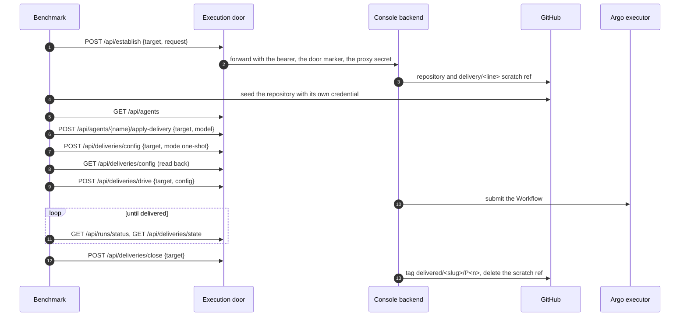

The benchmark opens a bench delivery from a task's ask with nobody in the loop. Every call goes to
the console's execution door with the benchmark's bearer token and, on a command, an operation id.
The flow ends with the line closed and its delivered tag in place, ready for grading.

## Sequence

## Steps

1. The benchmark establishes the line on a repository within its scope, sending the ask alone. The
   console creates the repository and registers the scratch ref; the benchmark then seeds the
   repository with its own repository credential.
2. It lists the console's install agents and applies one, with one of its models, to the line. The
   console seats that agent's own credential for the line, so the benchmark carries no model key. A
   team or personal agent is neither listed nor applied through the door.
3. It sets the line's mode to one-shot and reads the configuration back to confirm the agent, model
   and mode before it starts.
4. It drives the line with a repository target and write rights and no worker settings; a machine
   drive that names an endpoint, provider, model or credential is refused.
5. It follows the run by its handle and the line's state, reading each phase's gate as it is
   stamped.
6. When the line is delivered it closes it, which tags `delivered/<slug>/P<n>` and removes the
   scratch ref. Every command carries an `Idempotency-Key`, so a retried act never runs twice.

## Read next

- [The observation tick](../observation-tick/)
- [The admission module](../../modules/admission/)
- [Operate the execution door](../../operations/execution-door/)
