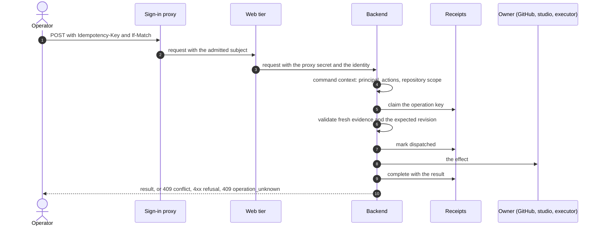

Every mutation the console performs follows one path, from the operator's press (or a machine
caller's request) to a durable receipt. The path ends in exactly one of four outcomes the cockpit
names: complete, conflict, refused, or unknown.

## Sequence

## Steps

1. The browser sends the command with an operation id (`Idempotency-Key`) and, where the command
   acts on a source revision, the revision it read (`If-Match`).
2. The sign-in proxy admits the operator; the web tier forwards the identity with the proxy secret.
   The backend builds the command context and checks the action and the repository against it.
3. The backend claims the operation's receipt atomically, under a key derived from the act's scope
   and its operation id. A key already completed returns its retained result; a key whose outcome
   is unknown answers unknown again and dispatches nothing.
4. It validates fresh evidence and the expected revision. A refusal here releases the claim: a
   moved revision answers 409 conflict, invalid evidence 422, a source that cannot be read 503. In
   each case nothing was done.
5. It records the dispatch, performs the effect, and completes the receipt with the result. From
   dispatch on, any failure answers 409 `operation_unknown` with the operation key, so the cockpit
   keeps the same operation id and offers to inspect the receipt before acting again.

## Read next

- [The admission module](../../modules/admission/)
- [API conventions](../../reference/api/)
- [Drive from the published console](../../operations/publish/)
