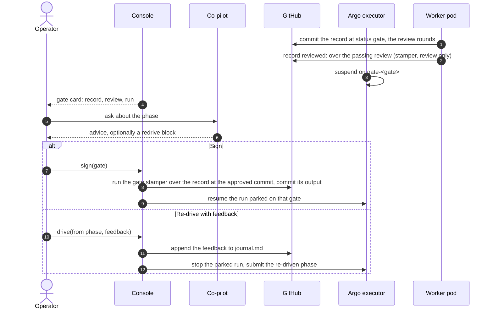

In interactive mode a phase's record reaches its gate, the worker records the phase's passing
fresh-eyes review, and the run suspends. The operator closes the review conversation in the
cockpit with one of two acts: Sign accepts, Re-drive with feedback revises.

## Sequence

## Steps

1. The worker commits the phase record at `status: gate`, runs the phase's fresh-eyes review and
   commits its rounds. Over a passing review it runs the gate stamper in review-only mode, which
   records `reviewed:` and leaves `signed: pending`.
2. The executor parks the run on the gate's suspend step. The cockpit shows the gate card with the
   record, its review and the run.
3. The operator reads the record and may ask the co-pilot, which answers from the record, the run's
   log tail and the derived state. A reply may carry a fenced `redrive` block that pre-fills the
   Re-drive composer.
4. **Sign:** the console runs the playbook's gate stamper over the record at the approved scratch
   commit and commits its output with that commit as parent; a concurrent head change rejects the
   write. It then resumes the run parked on the gate it signed, and stops a run parked on any other
   gate as superseded.
5. **Re-drive with feedback:** the console appends the feedback to `.delivery/journal.md` before
   submitting, then stops the parked run and launches the phase again with the feedback threaded
   into the worker's prompt as a revision clause.

## Read next

- [The gate mechanism](../../reference/gates/)
- [A maintenance ticket, resolve to merge](../maintenance-ticket/)
- [The co-pilot module](../../modules/copilot/)
