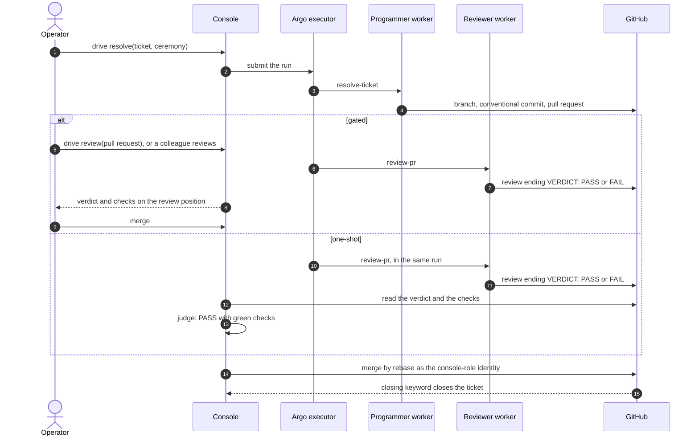

A maintenance act starts from an open issue on a maintained repository and ends with its pull
request merged, or parked for the operator with the reason. The verdict on the pull request is the
gate; the merge executes under the console-role git identity.

## Sequence

## Steps

1. The operator drives a resolve on a ticket, choosing the ceremony: gated (the default) or
   one-shot. The console submits a run whose step is the Programmer's `resolve-ticket`; a one-shot
   run carries the Reviewer's `review-pr` as its second step.
2. The Programmer branches, commits conventionally referencing the ticket, and opens the pull
   request. A ticket too large for maintenance stops the run as delivery-scale; a fix that belongs
   elsewhere stops it as wrong-repo.
3. The pull request is reviewed: in gated ceremony by a driven `review-pr` run or a colleague, in
   one-shot by the run's second step. The Reviewer, a different identity, ends its review on
   `VERDICT: PASS` or `VERDICT: FAIL`. A reviewer that authored the pull request, or that is the
   identity the console would merge as, records `VERDICT: UNRECORDED`.
4. **Gated:** the cockpit shows the verdict and the checks on the review position, and the merge is
   the operator's press. **One-shot:** the engine reads the verdict and the checks after the run and
   merges only over a counted PASS with green checks; a FAIL re-drives the resolve on the
   reviewer's findings within the attempt budget, and anything else parks the pull request.
5. The console merges by rebase under the console-role git identity. The closing keyword closes the
   ticket when its commit lands, and the release pipeline ships it. Over a managed app the console
   never merges: the pull request is the home's, and the judge reports a PASS as theirs to merge.

## Read next

- [Promotion, proven to target](../promotion/)
- [The maintenance module](../../modules/maintenance/)
- [Ticket conventions](../../reference/ticket-conventions/)
