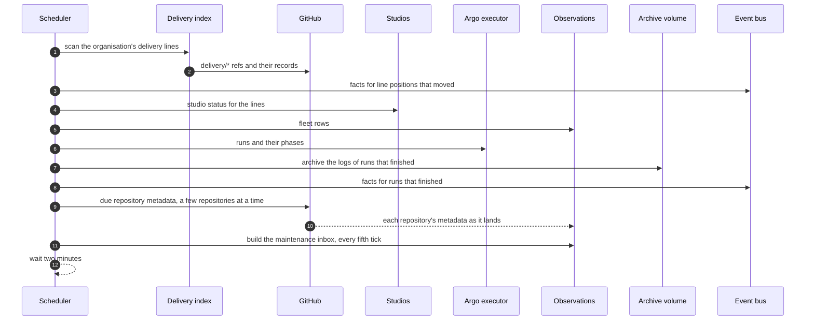

The scheduler runs one observation tick, waits two minutes, and runs the next. A tick refreshes the
snapshots the console's ordinary reads are served from, so no snapshot read reaches GitHub. The
pod reports ready after its first tick completes.

## Sequence

## Steps

1. The tick scans the organisation for delivery lines and derives each line's state from its
   records, then states one fact on the event bus for each line whose position moved since the
   previous tick. A cold start primes its view and states nothing.
2. It refreshes the studios' status for the lines and computes the fleet rows. A failed fleet read
   keeps the last board and marks it stale.
3. It reads the executor's runs, snapshots the logs of every run that reached a terminal phase
   onto the archive volume, and states a fact for each.
4. It collects repository metadata for the repositories that are due, oldest first, in a bounded
   batch and a few at a time, publishing each repository's observation as it lands. An observation
   is fresh for fifteen minutes; a failed read keeps the last good data.
5. Every fifth tick it builds the maintenance inbox across the fleet from the metadata it has
   observed.
6. The scheduler waits two minutes and runs the next tick. An explicit refresh sweeps every
   repository and the inbox in one background pass, still a few at a time, and answers at once
   with a turn to poll.

## Read next

- [A command and its outcome](../command/)
- [The observation module](../../modules/observation/)
- [Events](../../reference/events/)
