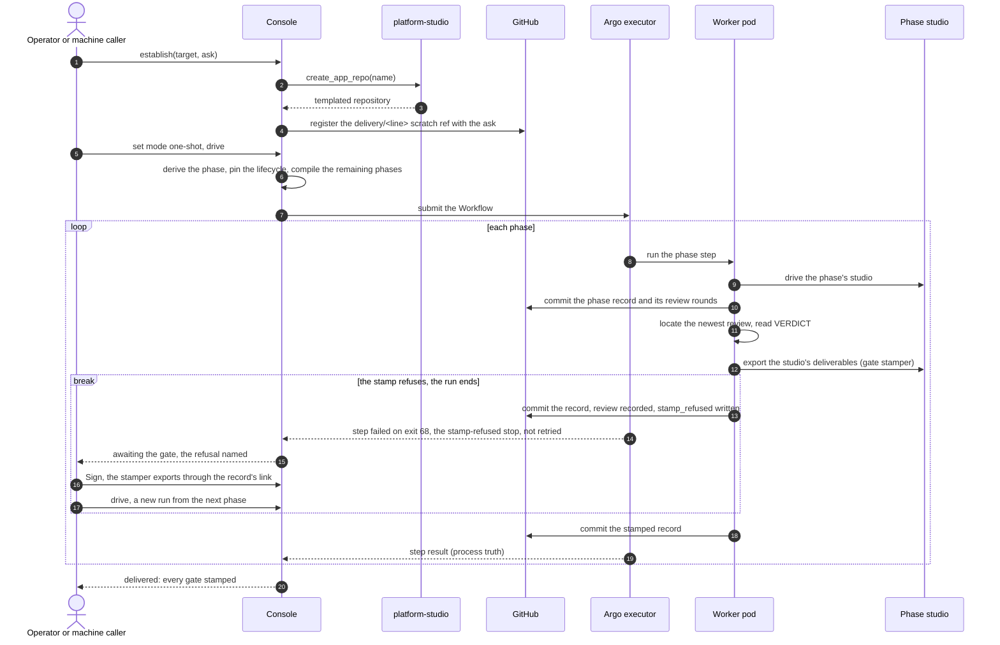

A one-shot line starts from an ask and ends delivered, with the operator's standing
pre-authorization standing in for a signature at every gate. Two cases leave a gate to the operator.
A managed app, whose code lives in another organisation's repository, records its delivery gate's
review and waits for the operator once the home's pull request lands. A gate whose stamp refuses
over a passing review ends the run on the `stamp-refused` stop: the operator signs that gate, and a
new drive takes the line on. The trigger is an establish followed
by a drive in one-shot mode; the end state is a line whose every gate is stamped, ready for Learn
and Close.

## Sequence

## Steps

1. The caller establishes the line with a target repository and the ask. The console asks
   platform-studio for a templated repository (or adopts one that exists) and registers the
   line's `delivery/<line>` scratch ref carrying the ask as the request.
2. The caller sets the line's mode to one-shot and drives it. The console derives the phase from
   the records, pins the lifecycle definition when the line has none, checks the model selection
   and credentials, and compiles every remaining phase into one Argo Workflow with no suspend
   steps.
3. The executor runs each phase as a worker pod. The worker drives its phase's studio, writes the
   phase record through the record helper, runs the phase's fresh-eyes review and commits every
   round under `.delivery/reviews/`.
4. The entrypoint locates the newest review and requires `VERDICT: PASS`. The gate stamper then
   exports the studio's deliverables through the studio's in-cluster door and the project key that
   studio holds, and writes the signature. A FAIL exits non-zero and the executor retries the phase
   fresh within its budget; a phase that still fails ends the run failed, with the worker's last
   refusal line beside it in the cockpit, for the operator to re-drive. A stamp that refuses over a
   passing review (the studio down, an export refused) ends the step on the `stamp-refused` stop,
   which is never retried, and the run ends there: the review is recorded and the refusal written
   on the record first, so the line reads awaiting that gate with the refusal in its next command.
   The operator signs the gate from the cockpit, which exports through the record's link, and a new
   one-shot drive takes the line on from the next phase; when the record itself caused the refusal,
   Sign refuses with the same line and the operator re-drives the phase.
5. The line advances on both truths: the executor's observation of the step and the record's
   state. When build and ship is stamped the line reads delivered; a managed app's build and ship
   records its review and waits at the gate for the operator's signature.
6. Learn runs the same way and stamps `learned:` into the journal. The operator closes the line:
   the console ends the line's runs, then tags `delivered/<slug>/P<n>` on the scratch tip and
   deletes the ref in one atomic update.

## Read next

- [The gate review, interactive](../gate-review/)
- [The delivery module](../../modules/delivery/)
- [The execution module](../../modules/execution/)
