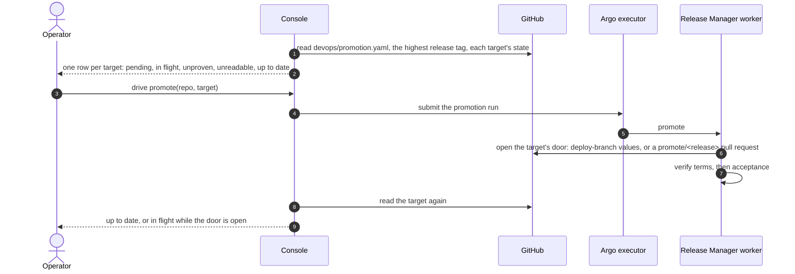

A promotion starts from the app's proven release, its highest semver tag, and a target that does
not carry it yet. It ends with the target carrying the release and its declared signal
read, or with the door in flight on the pair.

## Sequence

## Steps

1. The console reads the app's promotion contract (`devops/promotion.yaml`), its highest semver tag
   as the proven release, and each target's state, and shows one row per target.
2. A row reads pending when the proven release is ahead of what the target carries. The operator
   drives the promotion for that target.
3. The console submits a run in which the Release Manager runs the `promote` skill: its pre-flight
   confirms the entry environment serves the release, then it performs the target's door (an
   environment's values on the install's deploy branch, or a pair's `promote/<release>` pull
   request) and verifies the target's terms and then its acceptance.
4. While a door is open and has not landed the row reads in flight, and a second promotion is not
   the next act. Once the target carries the release and its signal answers, the row reads up to
   date.

## Read next

- [A bench delivery through the execution door](../bench-delivery/)
- [The promotion module](../../modules/promotion/)
