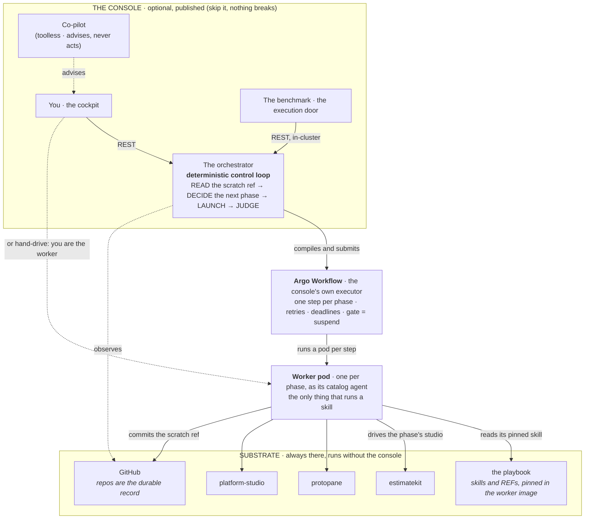

An **optional** pane onto the Foundry. It does two things and nothing else: it **watches** the fleet
and every line end to end in one view, and it **drives** the lines deterministically (Delivery,
Maintenance and Promotion, each a mode over the same shell) on top of tools that never know it
exists.

The single most important thing about it is what it is **not**. A change that blurs the line below
is a bug, however convenient.

| The Console **is** | The Console **is not** |
| --- | --- |
| An optional, published web app | Required for anything, ever |
| A **derived-state** view of a delivery across every subsystem | A source of truth, a database of record, a status field |
| A remote control that drives the existing skills and tools from one pane | A new capability; it only does what the tools and skills already expose |
| Just another app the Foundry builds and ships | A dependency the tools know about or are adapted to |
| Where the orchestration control flow is **code** | An LLM deciding the next step |

## At a glance

The orchestrator reads a line's state from its committed records, decides the next phase, compiles
it to its executor, and judges the result on two truths: what the executor observed and what the
records say. Every write it causes is performed by an owner: a worker, the playbook's gate stamper,
git or GitHub.

## Read next

- [Principles](principles/): the testable invariants every design choice answers to.
- **Modules**, one page per bounded context: [Delivery](modules/delivery/),
  [Execution](modules/execution/), [Maintenance](modules/maintenance/),
  [Promotion](modules/promotion/), [Observation](modules/observation/),
  [Settings](modules/settings/), [Studios](modules/studios/), [Admission](modules/admission/),
  [Co-pilot](modules/copilot/).
- **Flows**: [a one-shot line](flows/one-shot-line/), [the gate review](flows/gate-review/),
  [a maintenance ticket](flows/maintenance-ticket/), [promotion](flows/promotion/),
  [a bench delivery](flows/bench-delivery/), [the observation tick](flows/observation-tick/),
  [a command and its outcome](flows/command/).
- **Operations**: [run it locally](operations/run-locally/),
  [drive from the published console](operations/publish/), [drive by hand](operations/hand-drive/),
  [configure the runtime settings](operations/runtime-settings/),
  [operate the execution door](operations/execution-door/), [sign out](operations/sign-out/),
  [deploy an install](operations/deploy/), [back up the console](operations/back-up/).
- **Reference**: [API conventions](reference/api/), [configuration](reference/configuration/),
  [the gate mechanism](reference/gates/), [worker stops](reference/worker-stops/),
  [events](reference/events/), [ticket conventions](reference/ticket-conventions/),
  [the visual identity](brand/), [the glossary](glossary/).
- [Decisions](decisions/): the reasons behind the design.
