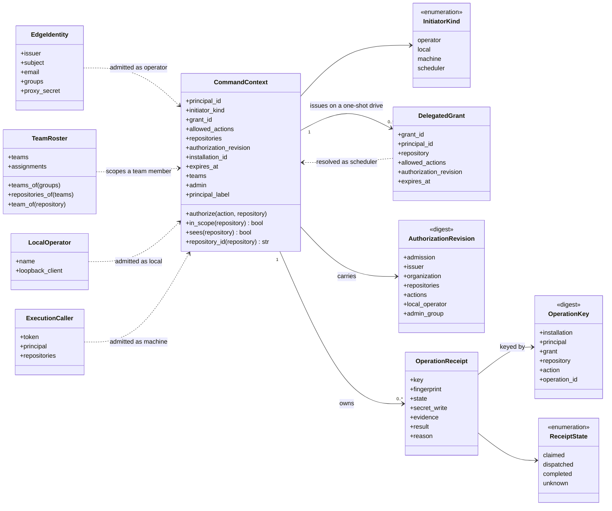
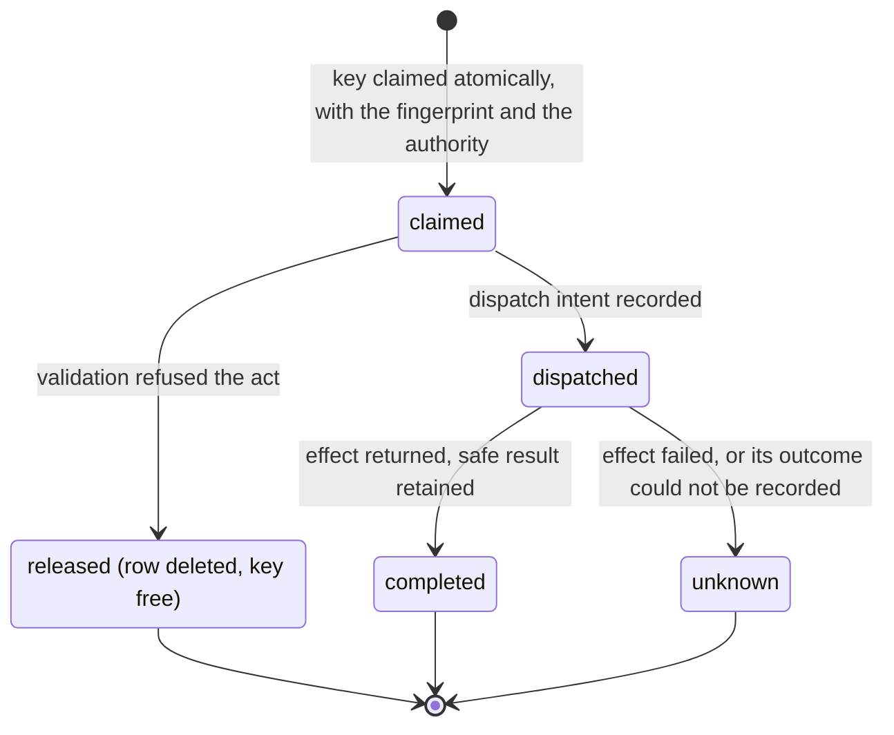
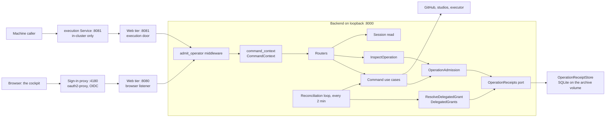
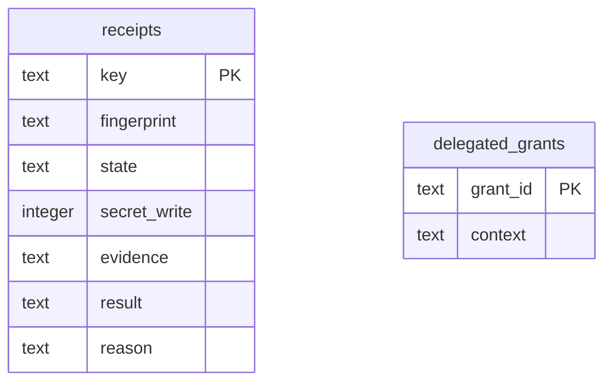

import { Tabs, TabItem } from '@astrojs/starlight/components';

Admission decides who may act on the installation and records what each act did. Every command
the other modules offer (a delivery's drive, a gate's signature, a merge, a saved setting) runs
through it: the request is admitted at the edge, turned into an immutable command context, checked
against that context's actions and repositories, and claimed under an operation key before its
effect. The cockpit reads the outcome back as complete, conflict, refused or unknown. The bench
line's acts reach the delivery and settings modules through its execution door.

<Tabs syncKey="viewpoint">

<TabItem label="Business">

### What it is

Four kinds of initiator act on an installation. Each is admitted by its own rule and holds its own
set of acts, always on the installation's repositories.

| Initiator | Admitted by | Acts as | May do |
|---|---|---|---|
| Operator | the sign-in proxy, against the app realm, behind the web tier | `issuer#subject` | every command, on the installation's repository scope. With teams on, only a member of the admin group; any other operator is a team member |
| Team member | the sign-in proxy, with teams on, outside the admin group | `issuer#subject` | every command but the team settings and the installation-wide settings, on the repositories assigned to its teams |
| Local operator | an explicit operator name on loopback, with the sign-in proxy off | the configured name | every command, on the installation's repository scope |
| Machine caller | the execution door, with its bearer token | `execution#<name>` | establish a line, list and apply agents, set the mode and phase timeout, drive, read state and run status, and close, on its own repositories |
| Scheduler | a delegated grant stored when an operator drove a one-shot maintenance run | the operator who drove it | reconcile that run, and the drive, merge and archive the operator held, on that one repository until the grant expires |

Every act is one operation, and it ends in one of four outcomes.

| Outcome | Means | Did this attempt change anything? |
|---|---|---|
| complete | the act ran and its receipt holds the result | yes |
| conflict | the evidence moved since the caller read it, or the key belongs to another request | no |
| refused | no grant permits the act, its arguments are invalid, or a source could not be read before dispatch | no |
| unknown | the act was dispatched and its outcome is not confirmed | possibly |

### Rules

- The app realm's existing users are the operators; the realm has self-registration disabled.
- Teams are on when the sign-in proxy fronts the install and an admin group is configured. A user's teams are the teams whose group the user belongs to; an admin group member is an admin. With teams off, every operator is an admin.
- A team member sees and acts on its teams' projects alone: every list it reads leaves out every other repository, and a read or an act naming another is refused. A project assigned to no team, and a run naming no repository, are an admin's alone.
- An act names the repository it touches, and a repository outside the initiator's scope is refused.
- Every act carries an operation id, and one operation id performs its act at most once.
- An act whose outcome is uncertain stays unknown until someone inspects the source; a retry under its key performs nothing.
- An act that carries a secret keeps neither the secret nor its digest, and its key cannot be replayed.
- An act taken on a revision the caller read is refused as a conflict when that revision has moved.
- The machine caller never carries a model credential: it applies a saved agent to its line, and its drive names no endpoint, provider, model or credential.
- A delegation lasts until one hour past its run's timeout, and ends early when the installation's admission policy changes.

</TabItem>

<TabItem label="Functional">

### What a user does

1. Opens the console. The sign-in proxy sends the browser to the app realm and back; from then on
   every `/api` call carries the admitted subject.
2. Presses an act. The cockpit attaches a fresh operation id and, when it holds a revision for the
   act's subject (a repository, a target or a run handle), that revision.
3. Reads the outcome. Every conflict and every unknown outcome stays listed in a band at the top of
   the cockpit with its operation id.
4. On an unknown outcome, presses **Inspect receipt** to read the persisted receipt, then checks
   the source itself. Pressing the same act again (same method, path and body) reuses the same
   operation id, so the console answers from the receipt instead of acting twice.
5. Signs out from the Session card in Settings ([sign out](../../operations/sign-out/)).

The machine caller does the same over HTTP: `Authorization: Bearer <token>` on every request and an
`Idempotency-Key` on every command ([a bench delivery](../../flows/bench-delivery/),
[operate the execution door](../../operations/execution-door/)).

A team member's cockpit shows its teams' projects, lines, runs, logs and inbox, and its home
co-pilot is grounded in them alone; the Settings page offers Teams to an admin alone
([set up teams](../../operations/teams/)).

### What the user sees

| Answer | Cockpit status | Shown as | Pressing the same act again |
|---|---|---|---|
| in flight | pending | Awaiting receipt | |
| a 2xx with a readable body | complete | Receipt received | carries a fresh key |
| a 409 other than `operation_unknown` | conflict | the band: Conflict, the server's message, and a request to refresh current state | carries a fresh key |
| a 403, a 422, a 503 `source_unavailable`, any other 4xx | refused | the server's message, at the control that sent it | carries a fresh key |
| no answer, a 2xx whose body cannot be read, a 409 `operation_unknown`, any other 5xx | unknown | the band: Outcome unknown, the operation id, and **Inspect receipt** when the answer named an operation key | carries the same key |
| a 401 from the sign-in proxy | | the browser leaves for `/oauth2/start` and returns to the same page after sign-in | |

The receipt reads as its state and reason with its safe evidence: the repository, the run handle,
the resource version and the uid, whichever the act recorded. The cockpit keeps operation ids in
the page's memory, so a reload starts with none.

The session read tells the Settings page whether a sign-in proxy fronts the install. Only then does
the page show its Session card, whose Sign out is a full-page link to the proxy's own sign-out
route; with the gate off, or the read unanswered, there is no card. Every command follows
[one path](../../flows/command/).

</TabItem>

<TabItem label="Technical">

### Domain model

- A context is immutable. `authorize` passes only when every field is set, the action is one the context allows, the repository normalises into its scope, the grant has not expired, and, when the caller names the server's current authorization revision, the context carries that revision.
- A machine context authorizes only an act that names a repository. A scheduler context authorizes only reconcile, drive, merge and archive, on a named repository, with an expiry.
- With teams on, an operator in the admin group keeps every action on the installation's scope. Any other operator holds every action but the team settings (`settings.team`, `settings.delete_team`, `settings.assign_project`) and the installation-wide ones (`settings.driver`, `settings.apply_driver`, `settings.git_identity`, `settings.delete_git_identity`, `settings.git_roles`, `settings.pair_credential`, `settings.delete_pair_credential`, `settings.save`), on exactly the repositories the roster assigns to its teams, and may open a line on a new repository only where the installation's scope names it, under the installation's owner; `admin` is false and `teams` names them. `sees` answers whether a read may name a repository: an admin every one, anyone else what its scope names.
- A repository is written `owner/name`, as a bare name under the installation's owner, or as an `https://github.com/` URL, and compared lowercased. A scope entry is an exact `owner/name` or an `owner/prefix*`; the operators' scope defaults to the organisation's repositories.
- The authorization revision is a SHA-256 of the installation's admission policy: the admission kind (`app-realm-edge`, `loopback-local` or `execution-door`), the issuer, the organisation, the repository scope, the action catalogue, the local operator and the admin group. A change to any of them changes the revision.
- The operation key is a SHA-256 of the installation, the principal, the grant (for the scheduler only), the repository, the action and the caller's operation id, which is at most 200 characters. The same operation id under another action or repository is another operation.
- The fingerprint is a SHA-256 of the request's safe payload: credential, token, secret, password and source fields are dropped and an uploaded source contributes its own SHA-256. A secret write's fingerprint is the literal `secret-write`.
- A delegated grant's id is a SHA-256 of the installation, the principal, the originating grant, the repository and the run id. It carries `maintenance.reconcile` and whichever of `maintenance.drive`, `maintenance.merge` and `runs.archive` the issuing context held, and it never outlives that context.

### Lifecycle

An operation receipt moves through four stored states; a refused validation deletes the claim.

- Authorization runs before the claim, so an act no grant permits leaves no receipt.
- A claim survives when the process stops during validation or the dispatch mark cannot be written; nothing was dispatched, a replay of its key answers unknown, and its owner can inspect it as `claimed`.
- An unknown receipt carries the reason `dispatch_outcome_unconfirmed`, followed by what failed, in a safe form (INT-FC-R190); the unknown-outcome answer carries the same. The store accepts a completion over a dispatched or an unknown receipt; the admission service records a completion only on the dispatch it ran.
- A completed secret write retains no result.

Presenting a key again reads the receipt instead of acting:

| Receipt when the key returns | Same request | Different request |
|---|---|---|
| claimed, dispatched or unknown | 409 `operation_unknown`, nothing dispatched | 409 `conflict` |
| completed | the retained result, restored to its domain type | 409 `conflict` |
| a secret write, in any state | 409 `conflict` | 409 `conflict` |

A run control's replay is authorized again against the repository its receipt retained, and a
receipt that retained none answers unknown.

### Ports and adapters

- With `auth.oidc.enabled`, the main Service targets the sign-in proxy, which authenticates against the app realm and forwards to the web tier over loopback with the admitted user's headers; without it, the Service targets the web tier.
- The browser listener forwards only `Accept`, `Content-Type`, `Idempotency-Key`, `If-Match` and `Host`. It adds the proxy secret and the client address, takes the user, email and groups only from a loopback peer (the sign-in proxy in the same pod), and clears `Authorization` and the `X-Forwarded-*` identity headers.
- With teams on, the edge rule reads the forwarded groups (comma-separated, each with or without its leading slash) against the team roster held in the console's settings. The roster is held for thirty seconds and dropped on every team write the console makes; a roster that cannot be read is served from its last read, and with none yet the request answers `503 source_unavailable`.
- A `GET` naming a `repo` the caller does not see is refused by the middleware; a read naming a run is checked against the run's repository; the list reads are filtered by `sees`.
- The door listener serves the execution routes alone and answers 404 to any other path. It forwards the caller's `Authorization`, adds the door marker and the proxy secret, and forwards no identity header. The `<release>-execution` Service publishes it only when `auth.execution.enabled` is set; the Gateway routes the main Service alone.
- The backend binds `127.0.0.1`, so only the web tier in its pod reaches it. The `admit_operator` middleware applies the admission rule to every `/api/` request except `/api/health` and `/api/ready` when the sign-in proxy is on, and to every request carrying the door marker whatever the gate.
- The edge rule admits `issuer#subject` when the proxy secret matches and the issuer and subject are present. The local rule admits `FC_LOCAL_OPERATOR` when the client, or the client address a verified web tier forwards, is loopback. The door rule admits `execution#<name>` when the proxy secret, the door marker, a served method and path, a configured token, principal and scope under the installation's owner, and a matching bearer all hold; a read naming a `repo` must name one of the caller's repositories.
- A command route takes the context, the `Idempotency-Key` as its operation id, and the `If-Match` value as its expected revision: one strong value, quoted or bare. Each command's validation compares that revision with the source's own (a line's revision, a workflow's resource version, a contract's base) before dispatch.
- The cockpit keeps the last `revision` it read for each subject from a state read, and sends it as `If-Match` on that subject's next command.
- A one-shot maintenance drive stores a delegated grant and stamps only its id on the workflow. The reconciliation loop resolves each run's grant id against the store, the run's repository and the server's current authorization revision, then reconciles that repository under the resolved context.

### HTTP surface

| Method | Route | Purpose |
|---|---|---|
| GET | `/api/operations/{operation_key}` | Read one operation receipt's state, reason and safe evidence (repository, handle, resource version, uid) for the principal and installation that own it, never its result |
| GET | `/api/config/session` | Report whether the sign-in proxy fronts the install and, when it does, its sign-out route `/oauth2/sign_out` |

### Persistence

Both tables live in `operation-receipts.sqlite3` under `FC_ARCHIVE_DIR` (`/data/archive`) on the
console's persistent volume, written with full synchronous commits; claims, dispatch marks and
grants run inside immediate transactions. `evidence` holds the authority (principal, installation,
action, repository) and the evidence the command recorded at dispatch; `result` holds the safe
result, empty for a secret write. A grant row is immutable: saving a different authority under its
id is a conflict. The volume is backed up with the run evidence ([back up](../../operations/back-up/)).

### Failure modes

| Failure | What the caller sees |
|---|---|
| Behind the sign-in proxy, a request with no subject, a missing or wrong proxy secret, or no issuer configured | 403 `permission_denied`, "An admitted operator identity is required.", on every `/api/` route but health and ready |
| The proxy session lapsed under a running page | 401 from the sign-in proxy; the cockpit sends the browser to sign in again |
| With the sign-in proxy off, a command with no local operator configured or from off loopback | 403 `permission_denied`; reads stay open |
| An action the context does not allow, or a repository outside its scope, malformed, or not on `github.com` | 403 `permission_denied`, "No current grant permits this operation." |
| A team member's read naming a repository or a run outside its teams' projects, or of the team settings | 403 `permission_denied` |
| With teams on, the team roster unreadable and never read | 503 `source_unavailable` on every admitted request |
| Through the execution door: a missing or wrong bearer, an unseated token, no principal or scope, a scope under another owner, an unserved method, or a read of another repository | 403 `permission_denied`, "An admitted execution caller is required." |
| Through the execution door, a path outside the execution routes | 404 from the web tier |
| A machine drive naming worker settings, or a machine establish carrying more than the ask | 403 `permission_denied` |
| A command with no `Idempotency-Key`, an operation id over 200 characters, or an `If-Match` that is weak, `*` or a list | 422 `invalid_evidence` |
| A key presented again with a different request, or a secret write's key replayed | 409 `conflict` |
| The expected revision moved, checked before dispatch | 409 `conflict`; the claim is released |
| A source unreadable before dispatch, or the receipt store unavailable before the dispatch mark | 503 `source_unavailable` with `Retry-After`; nothing was dispatched |
| The effect failed after dispatch, or its outcome could not be recorded | 409 `operation_unknown` with `operation_key`; the receipt reads `unknown` |
| A key presented again while its receipt is claimed, dispatched or unknown | 409 `operation_unknown`; nothing is dispatched |
| A receipt read with a malformed key | 422 `invalid_evidence` |
| A receipt read for an absent key, another principal or installation, or an action or repository outside the caller's current grant | 403 `permission_denied` |
| A route that refuses with its own status | that status, `request_refused` |
| A delegated grant absent, expired, issued under another authorization revision, or for another repository | the reconciliation loop logs the refusal and leaves the run as observed; nothing is performed on that grant |

### Claims realised

| Claim | Realised by |
|---|---|
| INT-FC-R183 | the edge rule's `_with_teams` over `TeamRosterStore`: the admin group, the caller's teams and their repositories, and the admin group in the policy revision |
| INT-FC-R184 | `CommandContext.sees`, the middleware's `repo` guard, the run-repository guard on graph, logs and status, and the viewer-filtered fleet, inbox, deliveries, runs and home co-pilot |
| INT-FC-R165 | `CommandContext.authorize`, the edge rule's proxy-secret provenance and `issuer#subject` principal, and `DelegatedGrants` resolving a server-stored grant against its expiry and the current authorization revision |
| INT-FC-R166 | `OperationAdmission` over `OperationReceiptStore`: the atomic claim, dispatch intent before the effect, unknown from dispatch on, owner-scoped receipt reads, and secret writes kept as a tombstone |
| INT-FC-R173 | the web tier's door listener, the `<release>-execution` Service, the door rule in `command_context`, and the machine checks on drive and establish |
| INT-FC-R159 | `GET /api/config/session`, reporting the gate and naming the sign-out route |
| INT-FC-R168 | the typed `ErrorResponse` every route publishes for 403, 409, 422 and 503, and the backend serving `/api` apart from the web tier's static files |
| INT-FC-R145 | the error mapping's `source_unavailable`: 503 with `Retry-After`, never 500 |

</TabItem>

</Tabs>

## Read next

- [A command and its outcome](../../flows/command/)
- [A bench delivery through the execution door](../../flows/bench-delivery/)
- [Operate the execution door](../../operations/execution-door/)
- [The delivery module](../delivery/), [the settings module](../settings/) and [the execution module](../execution/)
- [API conventions](../../reference/api/)
