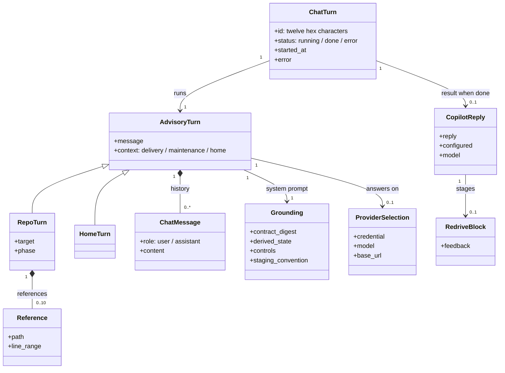
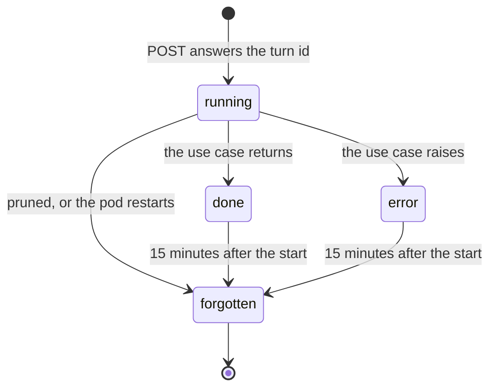
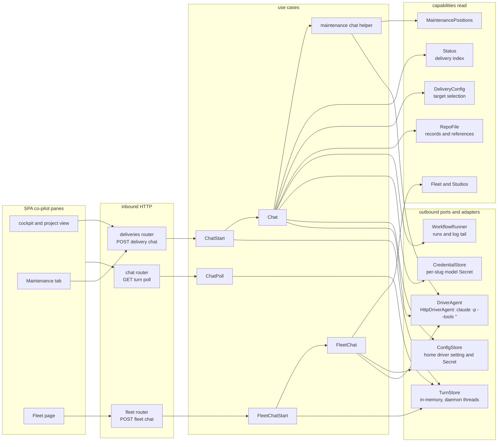

import { Tabs, TabItem } from '@astrojs/starlight/components';

The co-pilot module is the Console's advisory agent. It answers the operator in three places: the
docked console of a project's cockpit (the delivery co-pilot, which also answers in the project view
of a repo with no open line), the Maintenance tab (the maintenance co-pilot) and the Fleet page (the
home co-pilot). Each message is one toolless model turn, grounded in the contract and the derived
state of its context, started in the background and polled to its reply. It reads the
[delivery](../delivery/), [maintenance](../maintenance/) and [observation](../observation/)
projections, answers on a provider the [settings](../settings/) module holds, and stages re-drive
feedback onto the gate's Re-drive composer in the [gate review](../../flows/gate-review/). Running a
phase's skill is the worker's job, in the [execution](../execution/) module.

<Tabs syncKey="viewpoint">

<TabItem label="Business">

### What it is

The co-pilot is an advisory voice beside the operator. It explains where a delivery, a maintenance
loop or the whole floor stands, and names the next act and what to put in it. The operator presses
every control.

| | The co-pilot |
|---|---|
| Job | answers questions about a phase, the maintenance loop or the floor; advises before the operator signs or re-drives |
| Where it runs | one headless model turn per message, inside the Console pod |
| Who it is | an advisory voice, no catalog agent |
| What it reads | the contract digest of its context and that context's state: the phase's record, the newest run's log tail, the files the operator references, the loop positions, the floor |
| What it writes | nothing; feedback for a re-drive is a fenced `redrive` block in its reply, which the operator edits and fires |
| Provider | the project's own provider; the home co-pilot's provider on the Fleet page, and for a repo with no open line and no provider of its own |
| Trust | its words are opinion; the committed record is the state |

### Rules

- The co-pilot advises and never acts: it holds no tools, runs nothing and signs nothing.
- An open delivery answers only on its own provider, the one picked in the masthead, and never on the home co-pilot's.
- A repo with no open line answers on its own provider when it has one, and on the home co-pilot's provider otherwise.
- The home co-pilot answers only on the provider chosen under Settings · Home co-pilot, which is an install agent.
- A team member's home co-pilot is grounded in its teams' projects alone, and its project co-pilot answers on its teams' projects alone.
- A line on a personal seat answers its seat's owner alone; anyone else's turn ends with the reason, naming the owner.
- With no credential for the turn there is no reply; the pane names the provider to set.
- Delivery and home turns carry the distilled REF-Delivery contract; maintenance turns carry the distilled REF-Maintenance contract.
- The record's current frontmatter outranks the co-pilot's words and every log line.
- Re-drive feedback the co-pilot drafts is staged for the operator, never fired by it.

</TabItem>

<TabItem label="Functional">

### What a user does

1. **Ask the delivery co-pilot.** In a project's cockpit the co-pilot sits in the docked console
   (below the `lg` breakpoint, under the Console tab). A question is about the selected phase.
   Worktree files the operator references ride along with it; a selection in the file viewer
   travels as `path#L10-L20`, and only those lines enter the turn. A turn reads the first ten
   references.
2. **Stage a re-drive.** While a gate awaits, a reply that carries a fenced `redrive` block shows that
   block as a staged re-drive feedback card. Its Stage into Re-drive control pre-fills the gate's
   Re-drive composer with the feedback and opens it; the operator edits the text and fires the act,
   as the [gate review](../../flows/gate-review/) describes.
3. **Ask the maintenance co-pilot.** The Maintenance tab holds its own thread, grounded in the repo's
   release train and its open issues and pull requests.
4. **Ask the home co-pilot.** The Fleet page docks it open at desktop width, and its Co-pilot control
   toggles it. It answers over every visible project and every studio.
5. **Clear a thread.** Each pane clears its own thread.

### What the user sees

- While a turn runs, the pane shows it working; the reply lands as Markdown, under the name of the model that answered.
- With no credential for the turn, the pane shows a hint in place of a reply: the cockpit and the Maintenance tab point at the masthead's provider pick, the project view and the Fleet page at Settings · Home co-pilot.
- A failed turn adds `Error: <message>` to the thread as the co-pilot's line.
- Threads live in the browser for the session: one per project and context (delivery or maintenance), and one on the Fleet page. Each turn sends the visible thread as its history, and the co-pilot holds nothing beyond it.

</TabItem>

<TabItem label="Technical">

### Domain model

- A repo turn whose phase is `maintenance` is a maintenance turn and reads no references; any other phase, or none, is a delivery turn.
- The provider is resolved on every turn. A repo turn takes the repo's own credential (its per-slug Secret) with the model and `base_url` of its target selection; failing that, the home co-pilot's credential, model and `base_url`, only when the repo's derived status is `not-a-delivery`; failing both, none. A home turn takes the home co-pilot's only.
- No provider means a done turn with `reply` null, `configured` false and `model` null, never a fabricated reply.
- An unset model runs as `haiku`. Repo turns then report `haiku`; a home turn reports the driver's model, else its saved agent's name, else `driver`.
- The redrive block is the first fenced block tagged `redrive` in the reply, and only when its content is non-empty. The cockpit stages it only while the delivery awaits a gate.

### Grounding

The grounding is the system prompt a turn assembles when it runs, in this order:

| Context | What the grounding carries |
|---|---|
| Delivery (the cockpit and the project view) | the role line for the repo; the REF-Delivery digest; the phase (the one asked about, else the derived one), the overall status and the mode; the question the phase answers; the committed records; the phase's record, its first 6,000 characters; the newest delivery run's log tail, its last 50 lines cut to 6,000 characters; each reference, the whole file or its line range, 8,000 characters each; the closing contract: toolless, the operator's controls (Sign, Re-drive with feedback, Drive and Drive from here, the mode config) and the `redrive` staging convention |
| Maintenance | the role line; the REF-Maintenance digest; the release train (the version, the unreleased commits, the next version to cut, the deployed one); the open issues and pull requests, 20 of each at most, each pull request with its verdict, its checks and a contributor mark; the controls (Resolve, Review, Merge, Reconcile docs, the fleet inbox); toolless |
| Home | the role line; the REF-Delivery digest; the visible projects, 60 at most, each with its delivery status and phase, whether it is onboarded and its live address; each studio, reachable or unreachable; the console's acts (open a cockpit, Drive, Drive from a phase, sign a gate, re-open a phase, pause or resume an app, start a delivery); toolless |

The two digests are fixed text in the application's definitions. The REF-Delivery digest names the
five phases, progress derived from the records, the frontmatter `signed:` line as the only gate
truth, the per-mode gate policy and that agents never sign; the REF-Maintenance digest names the
ticket loop, the three per-act modes, the verdict gate, derived state and that agents never merge.

### Lifecycle

A chat turn lives in the pod's turn store from the request that starts it until the store forgets it.

| State | What a poll answers |
|---|---|
| running | `{"status": "running"}` |
| done | `"status": "done"` with the result flattened in: `reply`, `configured` and `model` for a co-pilot turn |
| error | `"status": "error"` with the raised message, its first 600 characters |
| forgotten | `"status": "error"` with "unknown turn - the console may have restarted; try again" |

A turn pruned while it runs discards its result. The SPA polls 400 ms after the start, doubles the
wait up to every 2 s, and stops after 200 s with "the turn is still running"; the model call itself
is bounded at 180 s. The same store and poll route also carry the fleet rescan's turn, whose done
result is the fleet (see [observation](../observation/)).

### Ports and adapters

The start use cases hand a closure to the turn store and answer its id at once; the store runs it
on a daemon thread and keeps its result or its error. `HttpDriverAgent` folds the history and the
message into one prompt of `User:` and `Assistant:` lines, then runs `claude -p` with the grounding
appended to the system prompt, JSON output, the resolved model and `--tools ""`, in `/tmp` with
`HOME` and `CLAUDE_CONFIG_DIR` there, bounded at 180 s. The reply is the JSON `result`. It selects
the endpoint's auth the way the worker does:

| The provider carries | Claude Code receives |
|---|---|
| a `base_url` | `ANTHROPIC_BASE_URL`, and the credential as both `ANTHROPIC_API_KEY` and `ANTHROPIC_AUTH_TOKEN` |
| an `sk-ant-api` key and no `base_url` | `ANTHROPIC_API_KEY` |
| any other credential, a subscription setup-token | `CLAUDE_CODE_OAUTH_TOKEN` |

The same adapter serves the [settings](../settings/) module's credential preflight: `validate` runs a
one-word turn on that auth selection with a 20 s bound; an explicit 401 or 403 reads as an invalid
credential, and a timeout or any other failure as no answer.

### HTTP surface

| Method | Route | Purpose |
|---|---|---|
| POST | `/api/deliveries/chat` | Start a co-pilot turn for one repo, the delivery co-pilot or, with phase `maintenance`, the maintenance co-pilot; answers the turn id |
| POST | `/api/fleet/chat` | Start a home co-pilot turn over the whole floor; answers the turn id |
| GET | `/api/chat/turns/{turn_id}` | Poll a started turn: running, its result, or its error |

Both start bodies carry `message` and `history` (a `role` and `content` per line); the delivery chat
adds `target`, `phase` and `references`. Both answer `{"turn": id}`. The home co-pilot's provider is
set through the settings module's `/api/config/driver` and agent routes.

### Persistence

The module owns no durable state. Turns live in the pod's memory and end with it; threads live in the
browser. It reads, and never writes, the provider stores the [settings](../settings/) module owns:
the per-slug model Secret with its target selection, and the home driver's setting with its Secret.

### Failure modes

| Failure | What the caller sees |
|---|---|
| No provider resolves for the turn: an open line with no provider of its own, or any repo without one while the Console's first scan runs; a home slot with no credential; no driver wired | a done turn with `reply` null and `configured` false; the pane shows its not-configured hint |
| The model call exits non-zero with an auth marker in its output | an error turn, "Driver authentication failed (401/403)" |
| The model call exits non-zero for any other reason | an error turn, "Driver execution failed" |
| The model call outlasts its 180 s bound | an error turn, "Driver timed out after 180s" |
| The repo's credential, the phase's record or a referenced file cannot be read | an error turn carrying the source's message |
| The run list or the log tail cannot be read | the turn answers without the run context; the pod logs a warning |
| A poll names a turn the store does not hold (pruned 15 minutes after its start, or lost to a pod restart) | `"status": "error"`, "unknown turn - the console may have restarted; try again" |
| The SPA's 200 s wait passes while the turn still runs | the thread shows "Error: the turn is still running" |
| A start body does not match its model | 422 `invalid_request` |
| An OIDC install receives a request with no admitted operator identity | 403 `permission_denied` |

Past validation and admission, a start always answers its turn id; what the model call and the reads
meet lands in the turn.

### Claims realised

| Claim | Realised by |
|---|---|
| INT-FC-R44 | `Chat`'s provider resolution: the repo's own credential, the home driver only for a repo with no open line, the not-configured answer otherwise, and `haiku` for an unset model |
| INT-FC-R54 | the grounding: the REF-Delivery digest in `Chat` and `FleetChat`, the REF-Maintenance digest in the maintenance chat helper |
| INT-FC-R55 | `ChatStart`, `FleetChatStart` and `ChatPoll` over the in-memory `TurnStore`, with its running, done, error and unknown-turn answers |
| INT-FC-R71 | the closing grounding (toolless, the operator's controls, the `redrive` convention) and `HttpDriverAgent` launching every turn with `--tools ""` |
| INT-FC-R114 | `HttpDriverAgent.validate`, the preflight on the co-pilot's own auth selection |

</TabItem>

</Tabs>

## Read next

- [The gate review, interactive](../../flows/gate-review/), where staged feedback is fired
- [Delivery](../delivery/), the line and records a delivery turn reads
- [Settings](../settings/), the providers each co-pilot answers on
- [Observation](../observation/), the index and the fleet the grounding reads
- [Execution](../execution/), the worker that runs a phase
