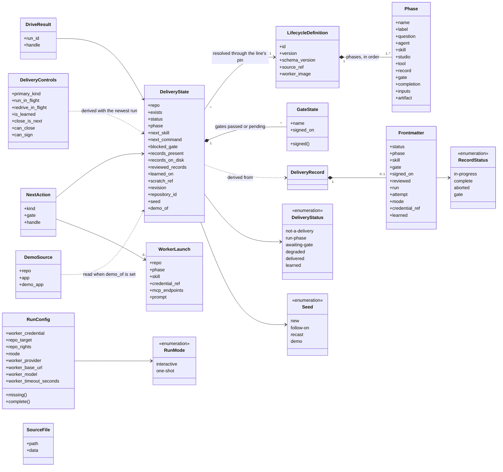
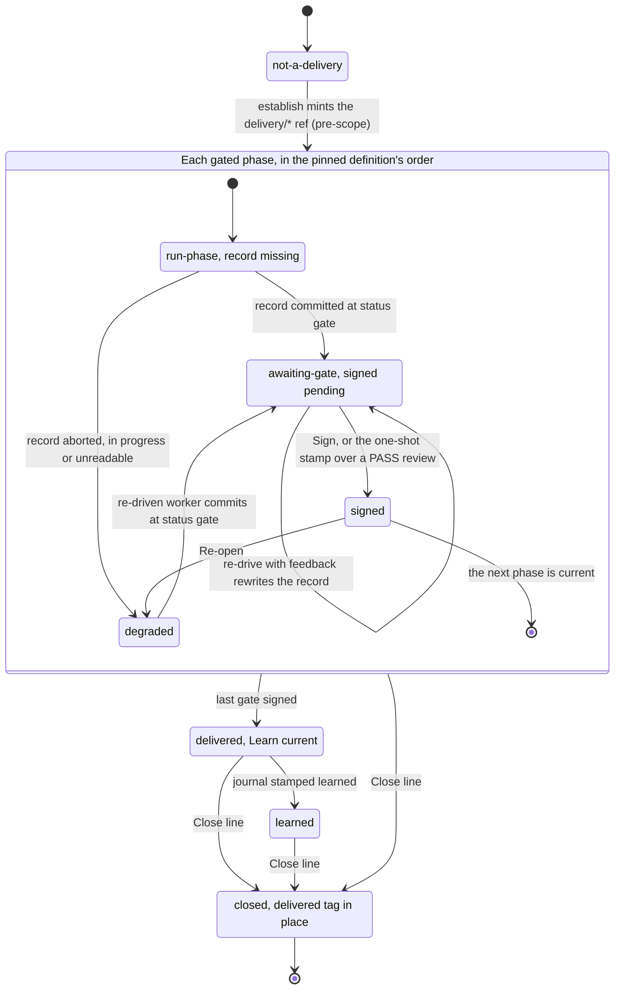
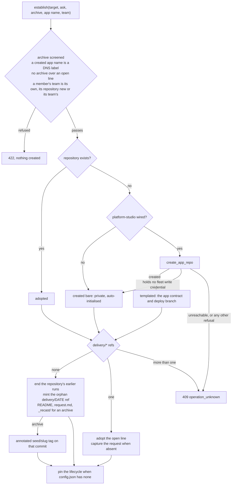
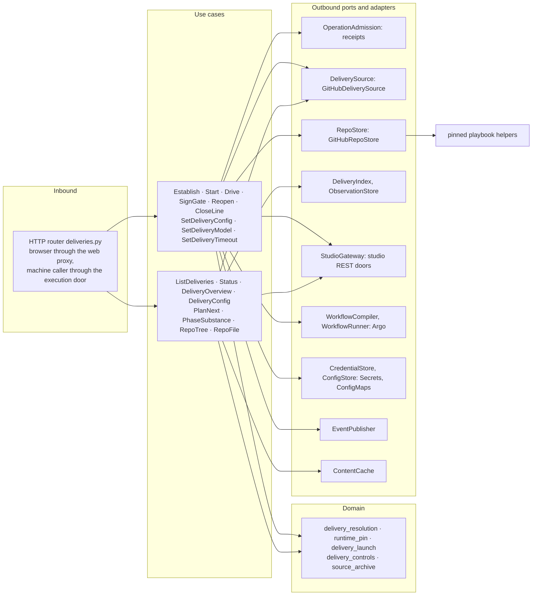
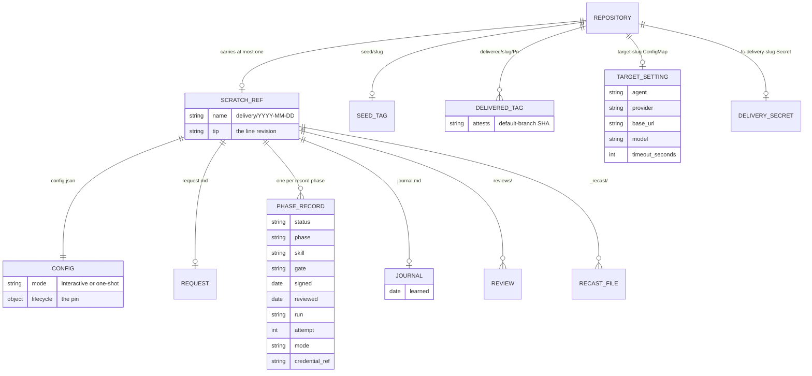

import { Tabs, TabItem } from '@astrojs/starlight/components';

The Delivery module owns the delivery line: one repository's path from a customer's ask to a live
application, through the playbook's phases, with a gate at each handoff. It derives every line's
state from the records committed on the line's scratch ref, opens lines, and carries the operator's
acts on them: drive, sign, re-open, close. It hands each run to the [execution](../execution/)
module to compile and submit, reads each phase's artifact through the [studios](../studios/), takes
a line's model and credential from [settings](../settings/), and admits every command through
[admission](../admission/).

<Tabs syncKey="viewpoint">

<TabItem label="Business">

### What it is

A **line** is one delivery of one application in one repository. It runs the phases of the
playbook's delivery lifecycle in order. Each phase answers one question, is run by one catalog agent
with one skill, and leaves one committed record; each of the first four phases ends at a gate. Learn
closes the line's learning loop and leaves no record of its own: it stamps `learned:` into the
line's journal.

| Phase | The question it answers | Agent | Skill | Studio it drives | Record | Gate |
|---|---|---|---|---|---|---|
| Scope | What is asked, and what would it cost? | architect | `deliver-engagement` | estimatekit | `proposal.md` | proposal |
| Design | What should it look and feel like? | designer | `design-session` | protopane | `design.md` | design |
| Intent + plan | What must be true, and how do we build it? | planner | `intent-session` | none: CSD intent authoring runs in the worker | `handoff.md` | plan |
| Build + ship | Is it working software, and is it live? | builder | `run-delivery-plan` | platform-studio | `build.md` | delivery |
| Learn | What did it teach, and what comes next? | librarian | `reconcile-delivery` | playbook-studio | `learned:` in `journal.md` | - |

What a line grows from, its **seed**, is read off the repository and shown beside its status:

| Seed | Read from | The line grows from |
|---|---|---|
| `demo` | the repository is named `demo-<x>` and the organisation holds `<x>` as a line (a `delivery/*` ref or a `delivered/*` tag) | a rehearsal of line `<x>`: each phase copies the source's deliverable into the demo's own key and attests the copy |
| `follow-on` | a `delivered/<slug>/P<n>` tag | an application that shipped a phase |
| `recast` | a `seed/<slug>` tag | an existing application uploaded as an archive |
| `new` | neither tag | the ask alone |

The first row that matches wins: a demo is a demo whatever its own tags say, and a delivered tag
outranks a seed tag.

### Rules

- A repository carries at most one open line. A second `delivery/*` ref is an anomaly that every
  act refuses and the line reads as degraded until the extra refs are removed.
- A line's progress is what its committed records say. A phase is done when its record is finished
  and, for a gated phase, its gate carries a dated signature.
- A gate closes only by a dated `signed:` stamp written by the playbook's gate stamper. In
  interactive mode the operator's Sign runs it, and only over a record whose fresh-eyes review is
  recorded; in one-shot mode the run's entrypoint runs it over a passing review. An agent never
  signs. A managed app's delivery gate is the exception in one-shot mode: its code lives in another
  organisation's repository, so the entrypoint records the review and leaves the signature for the
  operator, once the home's pull request lands.
- The mode is set per line and governs every run of that line.
- With teams on, a line belongs to a team from the moment it opens: a team member's line joins the team it names, the repository's own team, or its only team, and a member of several teams chooses. A member opens a line on a new repository, or on one already assigned to its team; an existing repository joins a team by an admin's assignment. An admin may name any team or none.
- A team member reads and acts on its teams' lines alone.
- What a line grows from is read off the repository's tags and name, never declared.
- An uploaded application is screened before anything is created, and lands only on the line's
  scratch ref, under `_recast/`, never on the default branch.
- Feedback on a re-drive is written to the line's journal before the run starts, and reaches only
  the phase being revised.
- Re-opening a phase un-signs its gate and keeps every downstream record, flagged for review.
- A line launches only on a worker that runs the playbook revision the line pinned.
- Closing a line keeps its whole record trail under a `delivered/` tag and leaves the repository,
  its code and every studio artifact in place.
- A model selection and credential belong to the repository as it exists when they are set: a
  drive on a repository recreated under the same name refuses until they are set again.

</TabItem>

<TabItem label="Functional">

### What a user does

1. **Open a line.** A project with no open line offers **Open a new line**: the delivery repo, an
   optional app name (the fleet name: namespace, hostname label, chart and packages; it defaults to
   the repository's name, and a `demo-<x>` repository defaults to `demo-` and the source app's
   fleet name), the customer's request in their own words, and an optional zip of an existing
   application. Opening a line needs no model and no credential.
2. **Configure it.** Set the line's mode, its model and credential (or apply a saved agent from
   [settings](../settings/)), and its per-phase timeout in hours. The timeout defaults to one hour
   and never drops below ten minutes; a later model or agent change keeps it.
3. **Drive.** The primary button drives the current phase, and the run carries every remaining
   phase in order. Each phase's own pane drives or re-drives the line from that phase; starting past
   the derived phase adopts the work the upstream studios already hold. Driving stops any older
   active run of the line as superseded.
4. **Review at a gate.** In interactive mode the run parks after each gated phase and the gate card
   offers two acts: **Sign the `<gate>` gate** accepts the record and releases the run, and
   **Re-drive with this feedback** sends the phase back with the operator's words as its work
   order.
5. **Re-open a signed phase.** **Re-open** un-signs the gate and hands the record back for work.
   The line reads degraded at that phase until it is re-driven, and every later record shows as
   needing review.
6. **Drive Learn.** On a delivered line the primary is **Drive Learn**; on a learned line it is
   **Re-drive Learn**, and the close becomes the emphasised act.
7. **Close line.** **Close line** is available on every open line in every state. It ends the
   line's runs, tags the record trail and removes the scratch ref; the repository then opens in its
   project view, ready for a further line.

A machine caller opens, configures, drives, follows and closes a line through the
[execution door](../../operations/execution-door/), with the agent applied to the line in place of
worker settings: [a bench delivery](../../flows/bench-delivery/).

The two modes:

| Mode | Gate steps in the run | What closes a gate |
|---|---|---|
| `interactive` (default) | a suspend step after each gated phase | the operator's Sign in the cockpit, refused until the phase's fresh-eyes review is recorded |
| `one-shot` | none | the operator's standing pre-authorization, applied by the entrypoint over the phase's passing review; a managed app's delivery gate waits for the operator, and a gate whose stamp refused ends the run on the `stamp-refused` stop and awaits the operator's Sign, its next command naming the refusal |

In both modes a phase that cannot finish is retried by the executor within its budget. The phase
then shows `failed`, or reads degraded when its record says `aborted`, and the operator answers it
by re-driving the phase, with feedback when it helps. Both modes write the signature through the
same stamper; [the gate mechanism](../../reference/gates/) describes it. The two sequences:
[a one-shot line](../../flows/one-shot-line/) and [the interactive gate review](../../flows/gate-review/).

### What the user sees

The cockpit has three regions: the **line card** (the phases with the gates between them, and the
line's runs folded beneath), the **substance pane** (the selected phase's artifact), and the
**docked console** (the co-pilot, the gate card and the chat). A repository with no open line opens
the same page in its project view: the worktree, the live app, the co-pilot and **Open a new line**.

The line's status, as the cockpit names it:

| Status | Label | The line | Next act |
|---|---|---|---|
| `not-a-delivery` | Not a delivery | carries no `delivery/*` ref | open a line |
| `loading` | Loading | is unobserved: the first observation has not completed | wait for the observation |
| `run-phase` | In delivery | is missing the current phase's record | drive the phase |
| `awaiting-gate` | Awaiting gate | holds a finished record whose gate is unsigned | sign the gate, or re-drive with feedback |
| `degraded` | Needs attention | holds a current record that is aborted, in progress or unreadable, or carries more than one `delivery/*` ref | clear the blocker and re-drive the phase, or remove the extra refs |
| `delivered` | Delivered | has every gate signed, Learn unstamped | drive Learn |
| `learned` | Learned | carries a dated `learned:` in its journal | close the line |

Each phase cell in the line card carries one sub-label: `running`, `failed` (with the attempt
count), `stopped by operator`, `needs review` (a record downstream of the current phase), `done`
with its signature or learned date, `current`, or `queued`.

The substance pane renders the phase's artifact first, its committed record when the studio holds
nothing, and an empty pane when neither exists: Scope shows the estimatekit project, Design the
protopane export, Intent + plan the claims of the application's `intent.yaml` beside the handoff,
Build + ship the worktree, the live app and its evidence, and Learn the journal. A read whose source
the observation could not read says so in one line.

</TabItem>

<TabItem label="Technical">

### Domain model

- `DeliveryState` is derived on every read and never stored. Its `revision` is the scratch ref's
  tip, the value a command's `If-Match` names.
- A `LifecycleDefinition` is valid only when its phase names are unique, each phase's inputs name
  earlier phases, each record is a unique bare file name, each gate is unique, completion is
  `record` or `journal` (a journal phase records `journal.md` and has no gate), and each artifact
  handler is one of `proposal`, `design`, `handoff`, `build` or `record`, or none.
- A `GateState` is signed exactly when the record's `gate:` names the phase's gate, its status is
  `complete` or `gate`, and `signed:` is an exact calendar date.
- A `RunConfig` is complete only with a worker credential, a repo target and repo rights. The line's
  own mode, model and timeout override whatever a request carries.
- `NextAction.kind` is `needs-start` (no line), `await-gate` (a pending gate) or `launch` (the next
  phase's `WorkerLaunch`, with its compiled prompt).
- `DeliveryControls.primary_kind` is `drive`, `resume` (the newest run is parked), `running`,
  `redrive` (the newest run failed or was stopped) or `unavailable` (loading or no line). Sign is
  offered while the line awaits a gate and no run is running, pending or stopping (a run parked on
  the gate does not hide it); Close whenever the line is observed.
- The delivery slug is the repository's last path segment. estimatekit holds the line's project
  under the slug verbatim and protopane under its lower-cased form with each run of other
  characters a hyphen; platform-studio holds the app under its fleet name.
- `SourceFile` is one screened file of an uploaded archive, and `DemoSource` names the line a demo
  rehearses with the two fleet names.

### Lifecycle

The resolver walks the pinned definition's phases in order and stops at the first phase that is not
done; that phase, its status and its next act are the line's. A cancelled run therefore resumes by
deriving again, and deriving writes nothing. Re-open demotes a signed record to `in-progress`, so
the line reads degraded at that phase until it is re-driven. A closed repository reads
`not-a-delivery`, and its `delivered/` tag makes the next line a follow-on.

What the resolver reads from each record's leading YAML block, and nothing else:

| Fact | Field | Rule |
|---|---|---|
| presence | the record file at the scratch ref's root | the phase's declared record exists |
| completion | `status:` | `complete` or `gate`; `in-progress`, `aborted`, any other value, or a missing or unparsable block reads degraded |
| signature | `gate:` and `signed:` | `gate:` names the phase's gate and `signed:` is an exact `YYYY-MM-DD` date; `pending`, a timestamp or a date in prose reads unsigned |
| review | `reviewed:` | an exact date marks the record reviewed, which Sign requires |
| learned | `learned:` in `journal.md` | an exact date resolves the line `learned`, read only once every gate is signed |

The derivation is one pure function shared by the GitHub source and the local filesystem source.
Prose, requirement lists and evidence in a record are for people and reviewers.

### The lifecycle pin

Each line pins the definition it runs under in its scratch's `config.json`, under `lifecycle`: the
phases, the definition's id, version and schema, the playbook revision it came from (`source_ref`),
the SHA-256 digest of the canonical definition, and the worker image that pinned it. The resolver
and the workflow compiler read the same pin, so adding or removing a phase with a supported handler
is a change to the definition alone.

- Establish writes the pin when the line's configuration carries none. A line opened by hand is
  observed with the installed definition, and its next drive adopts that definition and writes the
  pin before the run is submitted.
- A launch requires the pin's playbook revision to equal the installation's and the installed
  worker image to carry a semantic version tag or a `sha256` digest. Either refusal names its
  reason and comes before any credential is resolved.
- A pin without a playbook revision, or whose digest differs from its content, reads as an
  unavailable source.
- A worker reads its skill from the pinned playbook tree baked into its image, at
  `/opt/foundry/playbook/`, and the pinned helpers (`establish_scratch.py`, `reach_gate.py`,
  `stamp_gate.py`) ride the same image.

### Opening a line

The line id is the installation's local calendar date: `delivery/<YYYY-MM-DD>`. The register commit
is parentless, so the scratch shares no history with the default branch; register also makes the
default branch's `.gitignore` carry `.delivery/`, the mount point a worker uses for the scratch
worktree. The archive screen skips vendored and built trees (`.git`, `node_modules`, `dist`,
`build`, the caches), strips a single wrapping folder, and refuses by name every env file other
than an example and every file carrying a secret-shaped string; it also refuses a path that escapes
the tree, an empty archive, more than 4000 files, or more than 40 MB unpacked. The birth (`adopted`,
`templated`, `bare`, each with `+recast` for an archive) rides the line-started event. Start
refuses an incomplete run config, establishes, and plans the next action without submitting a run.

### Ports and adapters

Every command claims a receipt through admission, validates against a fresh read of the source
(never the warm index), and only then writes. Reads of the line serve the published observation
and call no GitHub; the tree, file and substance reads are bounded content reads keyed by the
observed revision. `GitHubRepoStore` writes the scratch through the git-data API with
parent-checked commits: Sign runs `stamp_gate.py` over the record at the approved tip with the
phase studio's in-cluster base URL for the export, and Re-open runs `reach_gate.py` to set the
record `in-progress`. The workflow compiler and runner belong to [execution](../execution/); the
studio doors to [studios](../studios/).

### HTTP surface

| Method | Route | Purpose |
|---|---|---|
| GET | `/api/deliveries` | Every observed line's derived state, with the observation's freshness and coverage. |
| POST | `/api/deliveries/close` | Close the line: end its runs, tag `delivered/<slug>/P<n>` on the scratch tip, then delete the scratch ref only while it still points at that tip. A refused delete keeps the branch, with the tag at the approved tip. |
| GET | `/api/deliveries/config` | The line's mode beside its model selection, phase timeout and whether a credential is held. |
| POST | `/api/deliveries/config` | Set the line's mode, `interactive` or `one-shot`, in the scratch's `config.json`. |
| POST | `/api/deliveries/drive` | Compile the remaining phases from the derived or a chosen phase and submit the run, journaling any feedback first. |
| GET | `/api/deliveries/file` | One file from the default branch, or from the scratch for a `.delivery/` path, cached by revision. |
| POST | `/api/deliveries/model` | Set the line's model selection and, optionally, its credential after the provider accepts it; writes nothing to git. |
| GET | `/api/deliveries/overview` | The cockpit's view: derived state, each phase's question, gate, record, studio artifact and run tone, and the action controls. |
| POST | `/api/deliveries/plan` | The next action the line would take (`needs-start`, `await-gate`, or the worker launch and its prompt), without acting. |
| POST | `/api/deliveries/reopen` | Un-sign a phase's gate and hand its record back to the record helper as `in-progress`. |
| POST | `/api/deliveries/sign` | Stamp the pending gate through the playbook's gate stamper and release the run parked on it. |
| GET | `/api/deliveries/state` | One line's derived state with its observation's freshness. |
| GET | `/api/deliveries/substance` | The selected phase's artifact: the studio's scope or design data, or the claims of the application's `intent.yaml`. |
| POST | `/api/deliveries/timeout` | Set the line's per-phase worker wall-clock budget in hours, floored at ten minutes. |
| GET | `/api/deliveries/tree` | The default branch's tree, with the scratch's tree under `.delivery/`. |
| POST | `/api/establish` | Open a line: create or adopt the repository, assign it to its team, mint or adopt its scratch ref with the ask and an optional archive, and pin the lifecycle. |
| POST | `/api/start` | Establish a line under a complete run config, then plan its next action. |

Every command takes an `Idempotency-Key` and, optionally, an `If-Match` naming the line's revision.
The full contract is on [the API reference](../../reference/api/); the events each act publishes
(line started, phase started, gate signed, phase re-opened, line closed) are on
[the events reference](../../reference/events/).

### Persistence

The line's record lives in git on its one orphan scratch ref, records at the branch root and
mounted at `.delivery/` in a working checkout; the default branch never carries a scratch commit.
`proposal.md` carries `delivers:`, the `P<n>` the close tags, and `build.md` carries `attests:`,
the default-branch SHA the close writes into the tag's annotation; a record without them closes as
`P1` with no attestation. The `seed/` and `delivered/` tags outlive the scratch ref, so a closed
line's records and a recast's source stay reachable through them. The model selection, timeout and
credential are Console-local: a ConfigMap of public fields keyed by slug and a Secret keyed by
slug, bound to the repository's identity. Live run state stays in the executor, and command
receipts on the archive volume, both outside this module.

### Failure modes

| Failure | What the caller sees |
|---|---|
| A command without an `Idempotency-Key`, or with a weak, wildcard or listed `If-Match` | 422 `request_refused`, naming the header |
| The body does not match the API contract | 422 `invalid_request` |
| `source_archive` is not valid base64 | 422 `request_refused` |
| No current grant permits the act; a machine establish carries an archive, source name, app name or team; a machine drive names worker settings; a team member names a team it is not in, or a repository another team holds | 403 `permission_denied` |
| A team member of several teams names none, of none opens a line, or opens one on an existing repository no team holds | 422 naming the problem; nothing is created |
| The line's revision differs from `If-Match` | 409 `conflict`, "The delivery revision changed" |
| A command carrying a credential (model, start, drive) is replayed under its key | 409 `conflict` |
| A precondition fails before any effect: an incomplete run config; an unknown phase or mode; the line awaits no gate; the record carries no dated `reviewed:`; no line to close; an archive refusal naming its files or limit; a created app name that is no lowercase DNS label; an archive over an open line; a pin whose playbook revision has no installed worker, or an unversioned installed image; a managed app's home credential missing; a credential the provider rejects with 401 or 403 | 422 `request_refused`, carrying the reason |
| An effect fails after the command's intent is recorded: platform-studio unreachable or refusing the scaffold; the gate stamper or record helper refusing; the scratch head moving before the commit; a `delivered/` tag already pointing elsewhere; more than one `delivery/*` ref at the write; an establish refusing inside a Start | 409 `operation_unknown` with its `operation_key`; the receipt holds the outcome unconfirmed, and the same key answers the same until it is inspected |
| GitHub or the line's configuration cannot be read; no git credential; a pin with no playbook revision or a differing digest; a tree too large to read whole | 503 `source_unavailable` with `Retry-After` |
| A record committed `aborted` or `in-progress`, or with no readable leading YAML block | the line reads `degraded`, "Needs attention", at that phase; the next act is a re-drive of it |
| More than one `delivery/*` ref on the repository | the line reads `degraded`, naming the refs; every writer refuses to pick one |
| An observation fails | reads keep the last good state with `stale` freshness and the reason; before the first observation the line reads `loading` |
| A studio holds nothing for the phase, or is unreachable, when substance is read | an empty substance; the cockpit renders the phase's committed record |

How each outcome reads in the cockpit is on [a command and its outcome](../../flows/command/).

### Claims realised

| Claim | Realised by |
|---|---|
| `INT-FC-R06` | `derive_from_records`: the phase and next act are a pure function of the committed records, so a cancelled run resumes by deriving again |
| `INT-FC-R04` | the resolver stops at a record whose gate is pending (`awaiting-gate`), and PlanNext answers `await-gate` rather than a launch |
| `INT-FC-R74` | the resolver reads a record whose status is neither `complete` nor `gate` as `degraded`, never as a signable gate |
| `INT-FC-R106` | the resolver reads a dated `learned:` in the journal, with every gate signed, as `learned`, and the phase strip marks Learn done |
| `INT-FC-R31` | `GitHubDeliverySource`: discovery by the `delivery/*` namespace with one matching-refs read per repository, and the anomaly state for more than one ref |
| `INT-FC-R37` | `GitHubRepoStore.register`: create or adopt, mint the one orphan scratch ref with the skeleton and the request, and ignore the mount point on the default branch, with no worker credential |
| `INT-FC-R148` | `unpack_source_archive` screens the upload, and register lands it under `_recast/` on the scratch's register commit |
| `INT-FC-R149` | the seed read off the `delivered/` and `seed/` tags, and the annotated `seed/<slug>` tag on the register commit |
| `INT-FC-R153` | the demo seed and `demo_of` read for a `demo-<x>` repository whose `<x>` is a line |
| `INT-FC-R167` | the resolver and the compiler consume the one validated definition pinned to the line |
| `INT-FC-R172` | `worker_image_for` and Drive: launch on the installed versioned image under the pinned revision, and adopt the installed definition on an unpinned line's first drive |
| `INT-FC-R39` | SetDeliveryConfig: the mode in the scratch's `config.json`, validated, authoritative over every run, and an unchanged save commits nothing |
| `INT-FC-R40` | Reopen and `GitHubRepoStore.reopen_gate`: the gate reads pending, the record helper opens the record `in-progress`, and downstream records stay flagged for review |
| `INT-FC-R70` | Drive with feedback: the dated journal entry is committed before the run is submitted, and the feedback reaches the first compiled worker only |
| `INT-FC-R156` | SignGate releases only the run parked on the gate it signed and stops the line's other parked runs |
| `INT-FC-R79` | CloseLine and `GitHubRepoStore.close_line`: end the runs, then the annotated `delivered/<slug>/P<n>` tag with its `attests:`, then the ref deletion |
| `INT-FC-R179` | `GitHubRepoStore.close_line`: the tag's ref created through the REST refs API, then the branch compare-deleted at the approved tip by `updateRefs`, which takes commit ids only |

</TabItem>

</Tabs>

## Read next

- [A one-shot line, ask to delivered](../../flows/one-shot-line/)
- [The gate review, interactive](../../flows/gate-review/)
- [A bench delivery through the execution door](../../flows/bench-delivery/)
- [A command and its outcome](../../flows/command/)
- [The execution module](../execution/), which compiles and runs a line's phases
- [The studios module](../studios/), [the settings module](../settings/) and
  [the admission module](../admission/)
