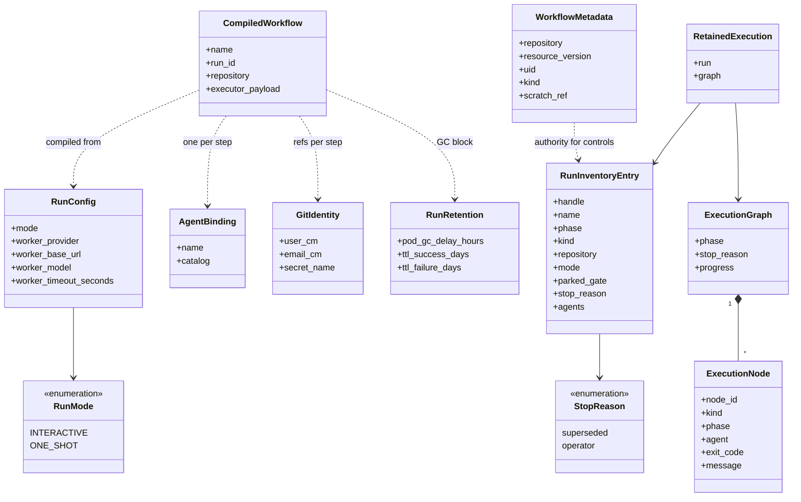
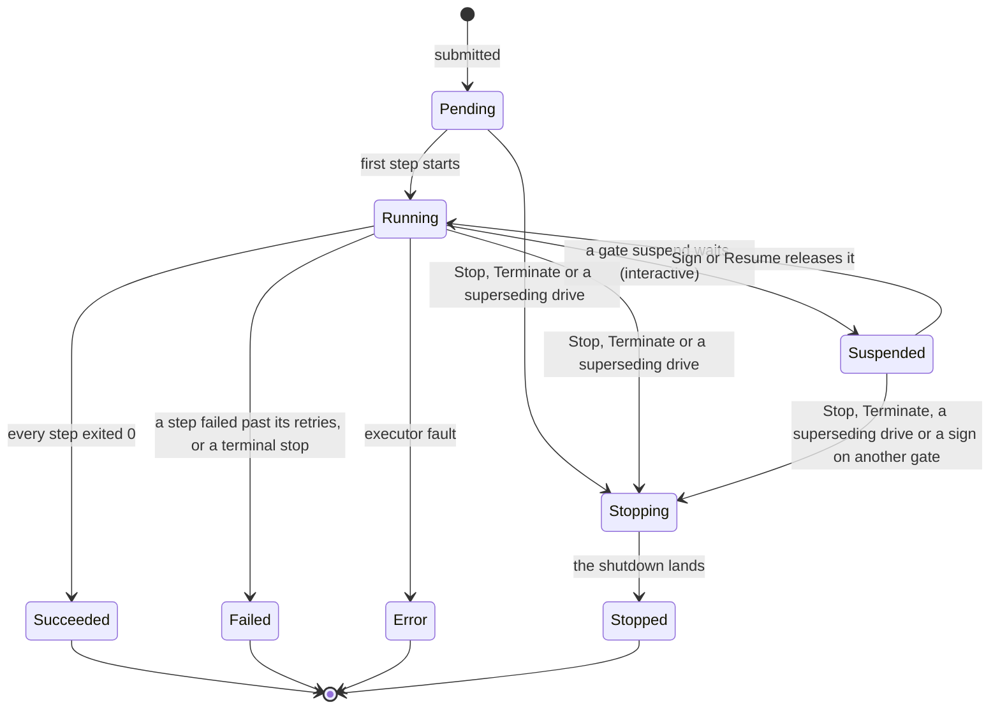
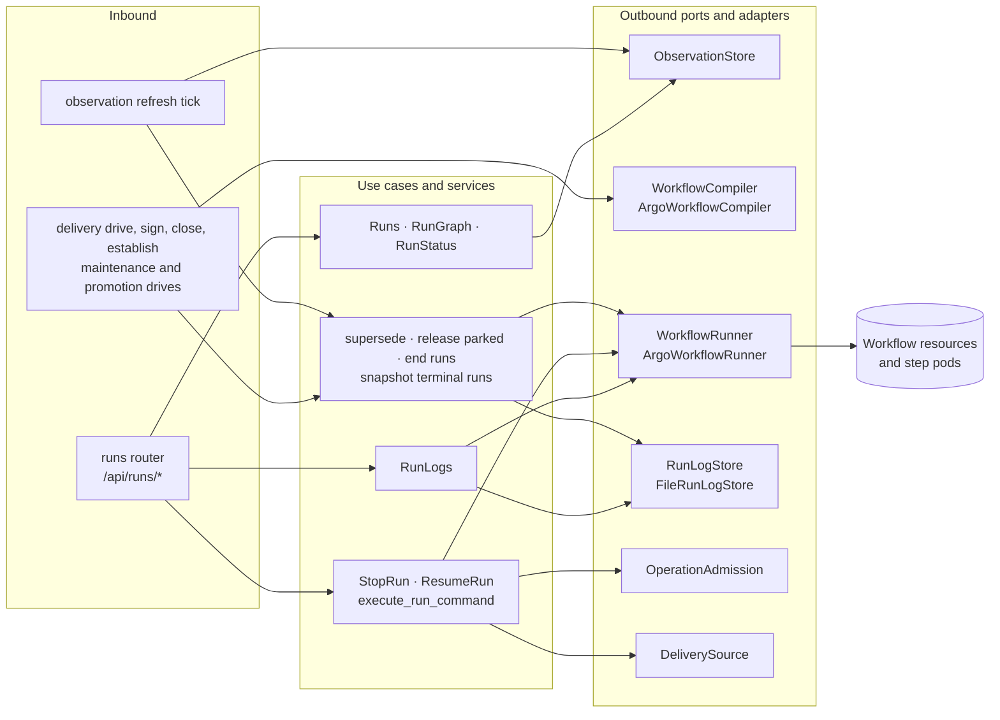
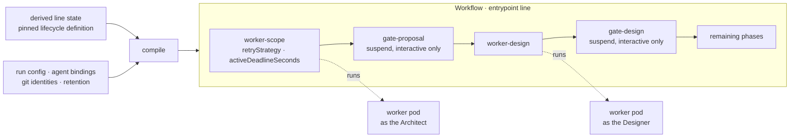
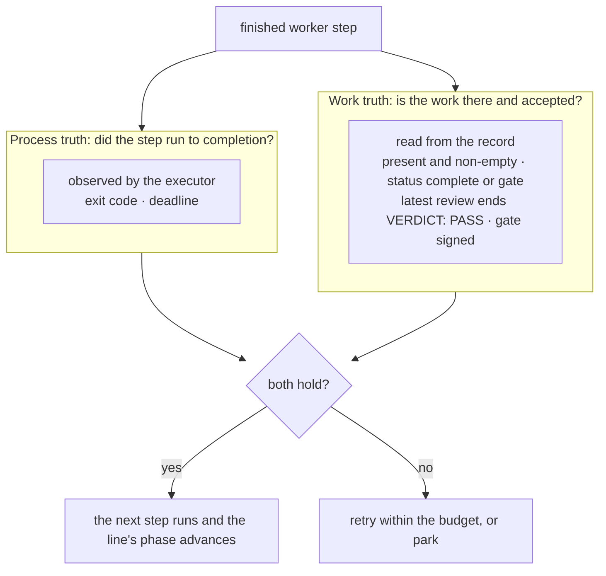
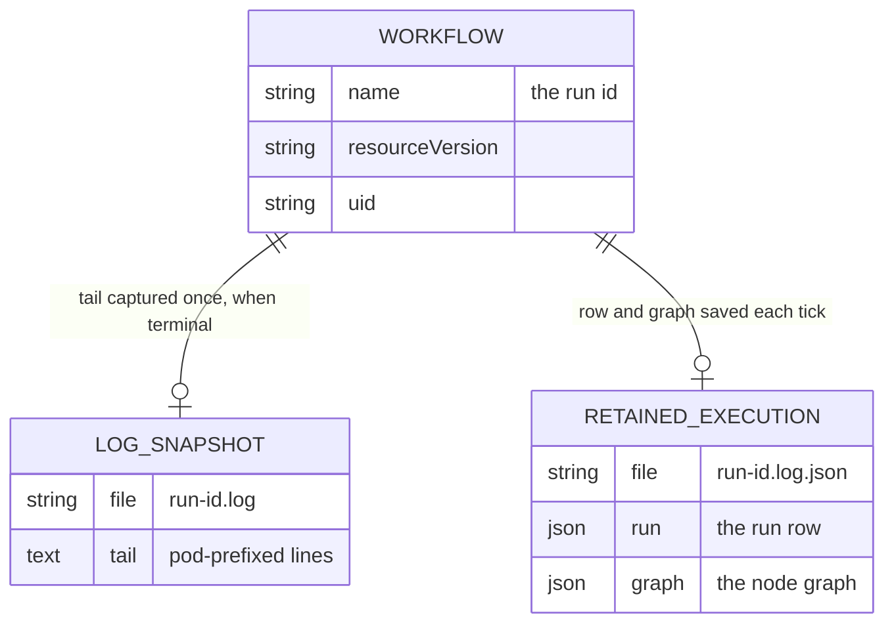

import { Tabs, TabItem } from '@astrojs/starlight/components';

Execution turns a drive into pods and reads back what the pods proved. It compiles what remains of
a delivery line, one maintenance act or one promotion door into an Argo Workflow, submits it to the
console's own single-namespace Argo Workflows executor, and observes the run: its phase, its node
graph and its step logs. It owns the run controls (Stop, Terminate, Resume) and the archive that
keeps a finished run's row, graph and log tail after the executor reclaims it. The
[delivery](../delivery/), maintenance and promotion modules decide when to drive; Execution decides
what the drive runs and what a finished step counts for.

<Tabs syncKey="viewpoint">

<TabItem label="Business">

### What it is

A **run** is one Argo Workflow the console compiled and labelled. A delivery run holds one step per
remaining phase of the line, in line order, with a suspend step after each gated phase when the line
runs interactive. A maintenance run holds one act and a promotion run holds one door.

Each step runs a **worker pod**, an activity in the durable-execution sense: a fresh, headless agent
given its complete prompt and its credentials up front, run once, and judged from the outside. It
cannot ask anyone anything mid-run. It runs as the playbook catalog agent the line's pinned lifecycle
definition names for its phase (the Architect scopes, the Designer designs, the Planner plans, the
Builder builds and ships, the Librarian learns; the Programmer and the Reviewer work tickets; the
Release Manager promotes), on the provider and model the target's selection names, so a worker is
bound to no single vendor. It reads its skill from the pinned playbook payload in its image. What it
says about its own work is a claim until a check confirms it.

The executor holds every run's live state: the current step, the attempts each step has taken,
whether the run waits at a gate. Git holds the record of what the work produced. Execution reads both
and acts on neither a worker's prose nor a cached view.

### Rules

- A phase advances only when two independent truths hold: the executor saw its step exit 0 inside its
  deadline (process truth), and the record the step committed says the work is done and its gate
  closed (work truth).
- The worker decides neither its retries nor its acceptance. The executor retries a failed step up to
  three times; a terminal stop (exit 64 to 68) is never retried and parks the run.
- No agent signs a gate. In one-shot the playbook's gate stamper closes the gate over the phase's own
  passing fresh-eyes review; in interactive the review is recorded and a human signs.
- A team member reads its teams' runs alone: the run history leaves out every other repository's run,
  and a run's graph, logs and status are refused for a run of another repository or of none.
- A delivery line has at most one live run: a drive stops every live run of the line, as superseded,
  before it submits its own.
- A run stopped on purpose is a stop, never a failure, and the run records who stopped it: the
  operator, or the console on a later drive.
- Resume never releases an unsigned gate. Sign is the act that approves a gate and releases the run
  parked on it.
- A line's runs end with the line: closing a line, or establishing one over a repository that holds
  none, stops and then deletes the line's runs, their evidence archived first.
- Credentials reach a worker only by reference. No compiled Workflow, record or commit carries a
  secret value.
- A step whose catalog agent has no assigned git identity gets none, so it cannot clone or push.

</TabItem>

<TabItem label="Functional">

### What a user does

1. **Drive** a line, a ticket or a promotion from its own surface. The run appears at the top of that
   surface's run band.
2. **Watch** it. The band lists the surface's runs, most recent first. Unfold a row for its node graph
   and select a step to read that step's log tail; the Logs pane follows the whole run's tail.
3. **Stop** a run to drain it gracefully, or **Terminate** it to kill it at once. Both record the
   operator as who stopped it.
4. **Sign** the gate a run is parked on, in the delivery cockpit, to approve the gate and release the
   run. **Resume** is the fallback for a run that stayed parked after its gate was signed; on an
   unsigned gate it refuses and names Sign.
5. **Re-drive** a phase. The later drive supersedes the live run and starts again from the derived
   phase, or from the phase the operator names.

### What the user sees

Every run shows one phase, derived once and read identically by its row, its graph and the cockpit
pill:

| Phase | What it means |
|---|---|
| `Pending` | Submitted; no step has started |
| `Running` | A step is working |
| `Suspended` | Parked on a gate's suspend step; the row names the gate it waits for |
| `Succeeded` | Every step exited 0 |
| `Failed` | A step failed past its retries, or stopped itself on a terminal exit. Red, and always a real failure |
| `Error` | The executor itself errored on a step |
| `Stopping` | A Stop or Terminate was asked for and the run is draining; a draining step can run to its deadline |
| `Stopped` | Closed on purpose. Amber; hovering it names who ended it |

A run that reached its own outcome before anyone stopped it keeps that outcome. Every row except the
most recent carries `· superseded`, which says where the run sits in the history and is independent of
how it ended. A row lists the catalog agents that ran its steps, each worker node names its own, and
the step's log opens by announcing it. A failed worker node shows its exit
code and the executor's message. The run-completed event and the maintenance pane name a terminal
exit in the console's own words, as listed on [worker stops](../../reference/worker-stops/); any
other code keeps the executor's wording.

This module carries [a one-shot line](../../flows/one-shot-line/),
[the interactive gate review](../../flows/gate-review/) and
[a maintenance ticket](../../flows/maintenance-ticket/).

</TabItem>

<TabItem label="Technical">

### Domain model

- A run's handle is `live:workflow.argoproj.io/` followed by its name, and its name is its run id.
  With live drive off the runner returns a `dry-run:` handle and submits nothing.
- A run's `kind` is the one ownership coordinate it carries: a scratch-ref annotation (delivery), a
  maintenance label or a promotion label. A Workflow with none, or with two, has no kind, and every
  control refuses it.
- `phase` is Argo's word with two promotions: `Suspended` while a gate's suspend node waits, and
  `Stopping` or `Stopped` once the console's stop label is set.
- `parked_gate` is the waiting suspend node's name without its `gate-` prefix, so a sign releases a run
  by comparing two names.
- `WorkflowMetadata` is read fresh from the executor for every control; the inventory entry is the
  observed copy the reads serve.
- A `RetainedExecution` is a run's row and graph as last observed, kept on the archive volume after
  its Workflow is gone. A record written before a field with a default existed reads that field as
  its default; a record with an unknown key, or without a field that has no default, is unreadable.
- `ttl_failure_days` is never below `ttl_success_days`.

### Lifecycle

The executor's own phases are Pending, Running, Succeeded, Failed and Error, and a shutdown ends in
Failed. The console writes its stop label, `foundry-console/stop` set to `superseded` or `operator`, in
the same patch that sets `spec.shutdown`, and reads it back: `Stopping` while the run is live,
`Stopped` once Argo reports Failed or Error. `Succeeded`, `Failed`, `Error` and `Stopped` are terminal
everywhere, the log capture included.

### Ports and adapters

The reads (`/api/runs`, the graph, the status) serve the observation the refresh tick publishes and
never call the executor. Each tick lists the console's Workflows, reads every run's graph, archives
each row and graph, captures each terminal run's log tail once, and merges archived runs whose
Workflow is gone back into the history. Log reads go to the executor first and to the archive second.

Stop and Resume share one command path: authorize the action and claim the operation receipt, read
the Workflow's ownership metadata fresh, check the caller's grant on its repository, the `If-Match`
revision and the control's own check (a failure releases the claim), then patch with the observed
resource version as a precondition.
No Argo server or CLI is deployed: the runner drives the Workflow resource through the Kubernetes API.

| Service account | Resource | Verbs |
|---|---|---|
| console | `workflows`, `workflows/status` | create, get, list, watch, patch, update, delete |
| console | `pods`, `pods/log` | get, list |
| console | `configmaps`, `secrets` | get, list, create, update, patch, delete |
| worker | `workflowtaskresults` | create, patch, get |
| worker | `pods` | get |

Both are namespace Roles. The worker reaches git and the MCP doors over the network with the
credentials it is handed, never through Kubernetes.

### The compiled Workflow

The compile is pure: given the line's derived state and pinned definition, the run config, each
step's agent binding and git identity, and the retention setting, it returns the Workflow the runner
submits. No model runs in it. The phases run from the derived phase, or the phase the drive names, to
the end of the line; Learn compiles only on a delivered line or when the drive names it. A re-drive's
feedback reaches the first compiled worker's prompt only. The compile refuses a delivery whose state
resolved no scratch ref, and names why.

| Delivery concept | In the Workflow |
|---|---|
| the remaining line | one Workflow, entrypoint `line`, one step group per phase in line order |
| a phase | a `worker-<phase>` template: the worker image with its entrypoint named as the command and the phase prompt as its argument |
| retries | `retryStrategy`: limit 3, policy `Always`, an expression that refuses exits 64, 65, 66, 67 and 68 |
| a phase timeout | `activeDeadlineSeconds`: the target's worker timeout, at least 600 seconds, 3600 by default |
| an interactive gate | a `gate-<gate>` suspend step after the phase |
| a one-shot gate | no step: the worker stamps it |
| who runs the step | `FC_AGENT`, and the template's `foundry-console/agent` label |
| the pinned definition | `FC_LIFECYCLE_DEFINITION` with its digest, id and version on every worker |
| what a step says back | one output parameter on every worker: `refusal`, the last line a stopping step gave |
| evidence retention | `podGC` `OnWorkflowCompletion` after the pod GC delay; `ttlStrategy` with the success and failure TTLs |

A maintenance run compiles its act (a one-shot ticket compiles resolve, then review) and a promotion
run one `worker-promote` step. Both carry the approved commit as `FC_SOURCE_REVISION`, and neither has
a suspend step.

The Workflow's own metadata says whose run it is:

| Key | Where | Carries |
|---|---|---|
| `foundry-console/run` | label | the run id; the runner refuses any Workflow without it |
| `foundry-console/repository` | annotation | the repository the run acts on |
| `foundry-console/scratch-ref` | annotation, delivery | the line's scratch ref |
| `foundry-console/maintenance`, `foundry-console/ticket` | labels, maintenance | the act and its ticket |
| `foundry-console/promotion` | label, promotion | the promotion target |
| `foundry-console/mode` | label | the run mode, or the maintenance ceremony |
| `foundry-console/repo-slug` | label | the repository's slug |
| `foundry-console/source-revision` | annotation, maintenance and promotion | the approved commit |
| `foundry-console/delegated-grant` | annotation | the grant a scheduled run carries |
| `foundry-console/stop` | label, set by a stop | `superseded` or `operator` |
| `foundry-console/agent`, `foundry-console/phase` | labels on each worker template | who ran the step, and its phase |

### The worker pod

Each step runs `worker-entrypoint.sh` in the worker image, under the worker service account. Every
input comes from the environment the compiler set; the phase prompt is its one argument.

1. Refuse to start when the image's playbook revision differs from the pinned `FC_PLAYBOOK_REF`, or
   when a record-leaving phase has no scratch ref.
2. Clone the repository as the step's git identity and mount the line's scratch ref at `.delivery/`
   as a linked worktree.
3. Write the MCP configuration for the step's doors outside the clone: the playbook door always, the
   phase's studio, and any studio a mid-line start adopts. Beside them sits the approver, the
   agent's permission-prompt tool, which allows every ask the session raises.
4. Run the agent once, headless, as its catalog agent: the agent's paragraph appended to its system
   prompt, the editing tools denied when its posture is read-only. Its turns stream into the pod log
   as they happen. On a key whose organisation policy turns bypass off, every ask goes to the
   approver; deny rules still refuse, and each answer is printed after the turn as `[approved]`.
5. Read how the turn ended, in order: the model's session wall, a park sentinel confirmed by its
   ticket label, the record's presence, the record's status.
6. Strip a `signed:` date the agent wrote itself back to `pending`, and write the run's figures (the
   `run_*` keys) into the record through the record helper.
7. At the gate, take the record's latest round under `.delivery/reviews/` by version order, require
   it to end `VERDICT: PASS`, and run the playbook's `stamp_gate.py` with that file as `--review-log`.
   One-shot stamps the gate. Interactive records `reviewed:` and leaves `signed: pending`, as does a
   managed app's build gate, which its home's merge closes. When a one-shot stamp refuses over the
   passing review, the review is recorded with `signed: pending` and the stamper's refusal line goes
   into the record as `stamp_refused:`, so the line reads awaiting that gate with the refusal in its
   next command; the step then ends on the `stamp-refused` stop (step 8).
8. Delete the MCP configuration, push the scratch onto its ref by explicit refspec, and exit by the
   record's status, or with 68 when the one-shot stamp refused.
9. A maintenance or promotion act writes no record. The entrypoint checks its real artifact on GitHub
   instead: the ticket's open pull request, a direct commit, a posted verdict, or the promotion's door.

Every way an attempt can end maps to one exit and one executor action:

| Attempt ends as | Exit | Executor |
|---|---|---|
| Record committed at `complete` or `gate` and its latest review passed; one-shot stamped the gate, interactive recorded the review | 0 | Next step: the gate's suspend (interactive) or the next phase (one-shot) |
| One-shot review passed but the stamp refused (a `REFUSED:` or `FAIL:` line); review recorded, `stamp_refused:` written, the record pushed | 68 `stamp-refused` | No retry; the run fails and parks, the line awaiting the gate's Sign |
| One-shot stamp refused and recording the review refused too | 1, naming both refusals | Retry |
| One-shot stamp exited non-zero with no refusal line | 1 | Retry |
| Agent turn failed: crash, tool or API error | the agent's own code | Retry |
| Agent turn failed on the model's session or usage wall | 67 `session-limit` | No retry; the run fails and parks |
| A resolve parked its ticket as delivery-scale or wrong-repo, sentinel and ticket label both present | 65 or 66 | No retry |
| Turn exited 0 with no record, an empty record or `status: aborted`; Learn with no dated `learned:` | 64 `degraded` | No retry |
| Record at its gate with no review, or a latest review that does not pass | 1, the scratch pushed as evidence | Retry, with the failing round as the next attempt's prior |
| Record status other than `complete`, `gate` or `aborted` | 1 | Retry |
| Maintenance or promotion act left no artifact on GitHub | 1 | Retry |
| Step passed its `activeDeadlineSeconds` | killed | Retry |

After the last retry the step fails and the run ends `Failed`. The line's own state is the delivery
module's to derive from its records, where an aborted or unfinished record reads as degraded. What
each terminal stop means and what clears it is on [worker stops](../../reference/worker-stops/).

### What the worker is handed

A worker holds three credentials, each by reference: the Workflow names a Secret or ConfigMap and the
executor resolves it into the pod's environment. None is written into the clone, a remote URL or the
git config, and none reaches the agent's own environment: the entrypoint starts the agent without
them, so an environment listing prints none of them. Where each is stored and edited is the
[settings module's](../settings/).

| Credential | In the pod | Resolved from | How the worker uses it |
|---|---|---|---|
| Model credential | `FC_MODEL_CREDENTIAL` | the repository's credential Secret, keyed by its slug, key `worker_credential` | the agent CLI's token, as `CLAUDE_CODE_OAUTH_TOKEN`, which the CLI keeps from the commands it runs; with a base URL set, `ANTHROPIC_BASE_URL` and an `apiKeyHelper` reading the key from a 0600 file, so a gateway reads it from either header |
| Git identity | `FC_GIT_USER`, `FC_GIT_EMAIL`, `FC_GIT_TOKEN` | the ConfigMap and Secret of the identity assigned to the step's catalog agent | the commit author; a credential helper scoped to this one repository (and a demo line's source of the same owner) hands git the token over a pipe from a 0600 file; the agent's `gh` reads it through a wrapper first on its PATH |
| MCP access | `FC_MCP_<DOOR>_USER`, `FC_MCP_<DOOR>_PASS` | the door's ConfigMap `fc-mcp-<door>` and Secret `fc-mcp-<door>-key` | one Basic header per door in the agent's MCP config, for `https://<door>.<domain>/mcp` |

The model selection rides beside them as plain values: `FC_PROVIDER`, `FC_BASE_URL`, `FC_MODEL`. The
record cites the credential through `FC_CREDENTIAL_REF`, the Secret's name, which the record helper
writes as `credential_ref`. A worker that performs a door onto a repository the foundry does not own
also receives that pair's token, `FC_PAIR_TOKEN`, behind a credential helper scoped to that
repository's path and the `$FC_PAIR_DOOR` script, both reading it from a 0600 file.

### The two truths

- **Process truth** is the executor's observation: the step's exit code, and whether it stayed inside
  `activeDeadlineSeconds`. The entrypoint, deterministic shell around the agent, sets the exit from
  what it checked. A step starts only after the one before it exited 0.
- **Work truth** is what the records say: the record is present and non-empty, its status is
  `complete` or `gate`, its gate's latest review ends `VERDICT: PASS`, and its gate line carries a date
  only the stamper writes. The delivery module derives the line's phase from these records,
  independently of any run.
- The checks are fail-closed. An absent or empty record, an `in-progress` status left by a crash, a
  missing review or a forged signature reads as not done.

### HTTP surface

| Method | Route | Purpose |
|---|---|---|
| GET | `/api/runs` | The run history the refresh tick observed, most recent first: live Workflows and archived runs, with the observation's freshness |
| GET | `/api/runs/graph` | One run's node graph (worker steps, gates, groups) with its derived phase and who stopped it; phase `unknown` for a handle never observed |
| GET | `/api/runs/logs` | A run's pod-prefixed log tail, live from the step pods (`tail` lines per container, 400 by default), else the archived snapshot; `node` scopes either to one step |
| POST | `/api/runs/resume` | Release a run's waiting gate suspends; a delivery run must belong to the current line and its gate be signed |
| GET | `/api/runs/status` | One run's observed phase; `unknown` for a handle never observed |
| POST | `/api/runs/stop` | Stop a run gracefully, or terminate it with `terminate` set, recording the operator as who stopped it |

Stop and Resume are commands. Each takes the run's `handle` in its body, needs an `Idempotency-Key`
header, and accepts an `If-Match` naming the resource version the caller observed. A replayed key
returns the retained result.

### Persistence

The Workflow object in-cluster holds the live run state. The executor reclaims its pods after the pod
GC delay and the object itself after its success or failure TTL. The archive volume
(`FC_RUN_LOG_DIR`, `/data/run-logs` by default) holds two files per run, each written to a temporary
file, flushed and renamed into place. The refresh tick captures a terminal run's tail (5000 lines
per container) once; an empty capture is kept, so a run whose pods are gone is probed once. On each
snapshot write, a log snapshot older than the failure TTL is pruned together with its run's retained
record, and a retained record with no snapshot is pruned once its own last write is older than the
failure TTL.

| Run retention | Default | Range | Governs |
|---|---|---|---|
| `pod_gc_delay_hours` | 1 | 1 to 48 | how long a finished run's pods, and so its live logs, outlive it |
| `ttl_success_days` | 7 | 1 to 90 | how long a succeeded run's Workflow object lives |
| `ttl_failure_days` | 30 | 1 to 90, never below the success TTL | how long any other run's Workflow lives, and the prune horizon of the log snapshots and retained records |

The horizons are the `run-retention` setting, read at every compile; unset or unparsable values take
the defaults. The line's records live in git and belong to the [delivery module](../delivery/); the
credentials live in Secrets and ConfigMaps and belong to the [settings module](../settings/).

### Failure modes

| Failure | What the caller sees |
|---|---|
| The caller holds no grant for `runs.stop` or `runs.resume` on the run's repository | 403 `permission_denied` |
| Stop or Resume with no `Idempotency-Key`, a weak or multi-valued `If-Match`, or a malformed handle | 422 `request_refused` with the reason |
| A log read with a malformed handle | 422 `invalid_evidence` |
| A body that does not match the contract | 422 `invalid_request` |
| No executor configured, a Workflow that cannot be read, incomplete ownership metadata, or a dry-run handle | 503 `source_unavailable` with `Retry-After` |
| A Workflow without the console's run label, or without exactly one execution kind | 409 `conflict` |
| `If-Match` names another resource version, or the Workflow changes between the read and the patch | 409 `conflict`; refresh and act again |
| Resume of a delivery run that is not the current line's | 409 `conflict` |
| Resume while the line's fresh state says the gate is unsigned | 409 `conflict` naming the gate and Sign |
| Resume of a delivery run with no delivery source configured | 503 `source_unavailable` |
| An operation id reused for a different request | 409 `conflict` |
| A control whose dispatch is unconfirmed, and any replay of its key | 409 `operation_unknown` with `operation_key`; the key stays unknown across restarts |
| Resume of a run with nothing suspended | 200, `resumed` reads `nothing-suspended` |
| A graph or status for a handle never observed | 200, phase `unknown` |
| The live log read fails and no snapshot is archived | 503 `source_unavailable`; with a snapshot, the snapshot is served |
| Run collection fails on a refresh tick | `/api/runs` keeps the last observed rows and reports stale or unavailable freshness |
| A retained record cannot be read | The tick merges every other retained record into the history, and the board's freshness reads `source_unavailable` |
| A terminal run's log capture fails | The capture stays pending for the next tick; a run whose capture failed is neither marked captured nor deleted |
| A delivery drive whose state resolved no scratch ref | The drive refuses with 422, naming the reason |
| A step fails past its retries, or stops on a terminal exit | The run ends `Failed`; its node carries the exit code |

### Claims realised

| Claim | Realised by |
|---|---|
| `INT-FC-R23` | `compile_workflow`: one worker step per remaining phase, in line order |
| `INT-FC-R24` | the compiler's `gate-<gate>` suspend steps, interactive only |
| `INT-FC-R181` | the entrypoint's `stamp-refused` stop over a refused one-shot stamp: the review recorded, the refusal written on the record, exit 68 |
| `INT-FC-R182` | every step's `refusal` output, read onto the graph node and named beside a failed run in the cockpit |
| `INT-FC-R25` | the worker template: bounded `retryStrategy`, `activeDeadlineSeconds`, the credential by Secret ref |
| `INT-FC-R89` | the per-agent git identity refs, and none for an unassigned agent |
| `INT-FC-R18` | the entrypoint's gate step: a recorded review in interactive, a stamp over a passing review in one-shot |
| `INT-FC-R19` | the retry expression and the entrypoint's exits: transient attempts retried, terminal stops parked |
| `INT-FC-R113` | `run_policy`'s terminal exits and stop names, held equal to the entrypoint, the maintenance pane and the worker stops page |
| `INT-FC-R42` | `parse_runs` and `parse_graph` over the executor's own Workflow objects |
| `INT-FC-R43` | `ArgoWorkflowRunner`'s stop, resume and log reads over the Kubernetes API |
| `INT-FC-R124` | the stop label written with the shutdown, and `derive_phase` |
| `INT-FC-R105` | `ResumeRun`'s check against the line's fresh state |
| `INT-FC-R108` | the terminal-run log capture and `RunLogs`' fallback to the snapshot |
| `INT-FC-R109` | node-scoped log reads, live and from the snapshot |
| `INT-FC-R110` | `RunRetention`, the GC block compiled into every Workflow, and `FileRunLogStore`'s prune |
| `INT-FC-R194` | the archive codec's field defaults, and `RetainedEvidenceUnreadable` carrying the records read past an unreadable one |
| `INT-FC-R157` | `helper_end_runs`: archive the line's runs, then delete them |

</TabItem>

</Tabs>

## Read next

- [A one-shot line, ask to delivered](../../flows/one-shot-line/)
- [The gate review, interactive](../../flows/gate-review/)
- [A maintenance ticket, resolve to merge](../../flows/maintenance-ticket/)
- [The delivery module](../delivery/): the derived state a drive compiles from
- [The settings module](../settings/): where the worker's credentials and the run retention are stored
- [The admission module](../admission/): grants, operation keys and receipts
- [Worker stops](../../reference/worker-stops/): what each terminal exit means and what clears it
