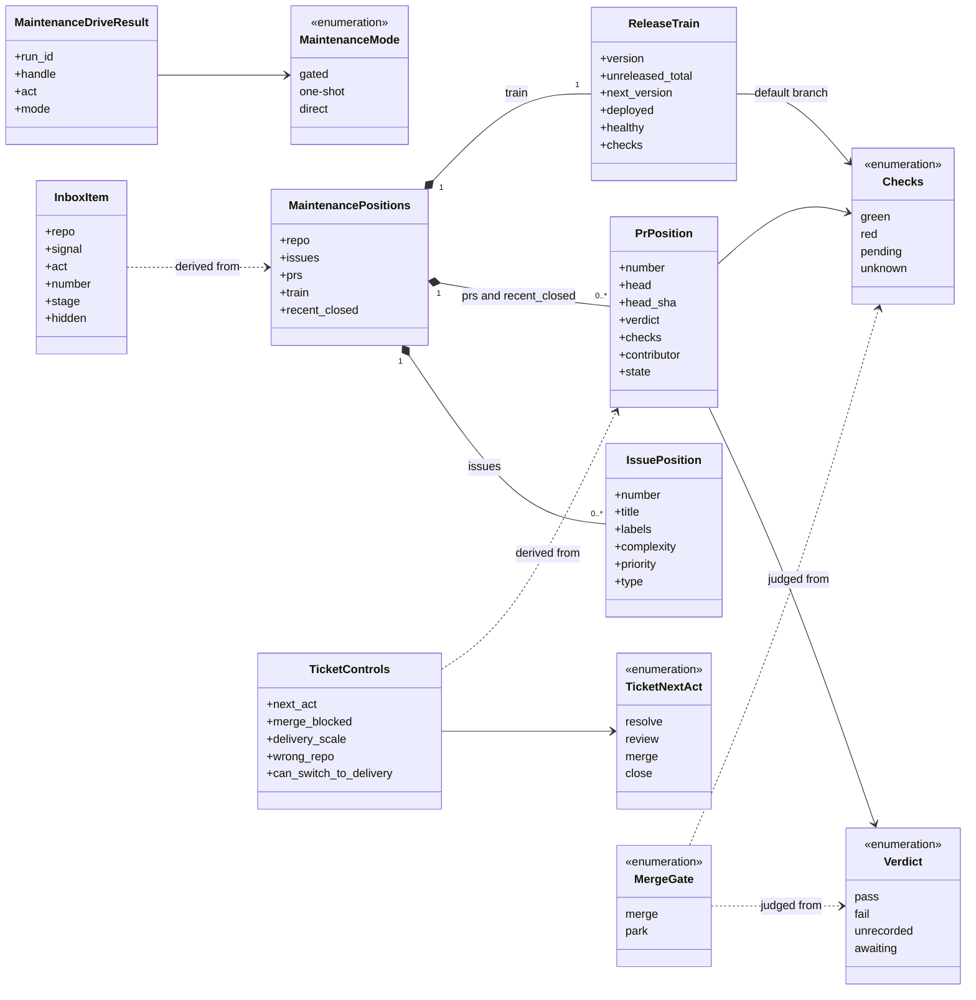
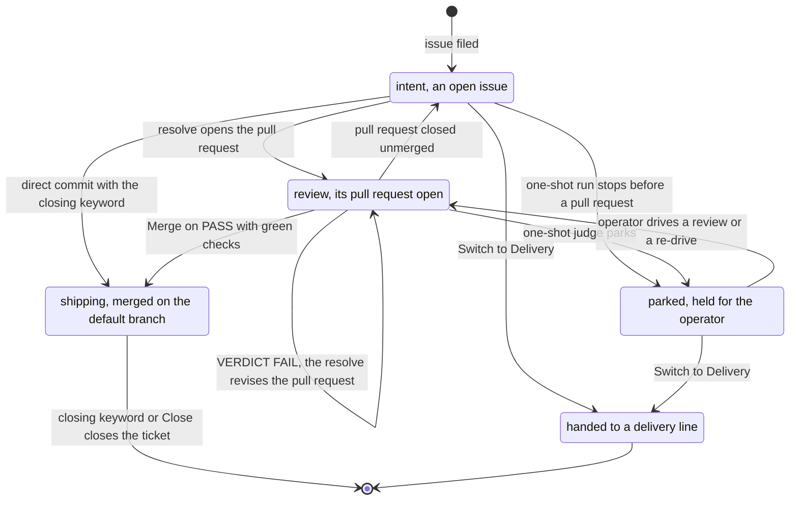
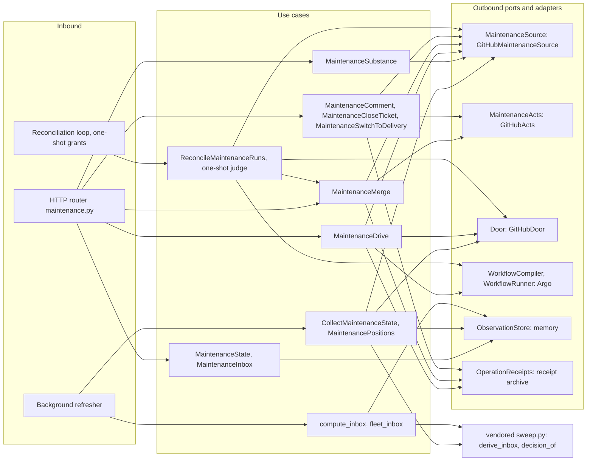

import { Tabs, TabItem } from '@astrojs/starlight/components';

Maintenance is the cockpit's standing loop over a shipped repository. It reads one repository's
tickets, pull requests and release train as derived state, sweeps the same derivation across the
fleet into one inbox, and drives the playbook's maintenance acts as worker runs on the
[execution](../execution/) module. Every act it performs on the repo host runs under the
console-role git identity that [settings](../settings/) assigns, and a ticket too large for the loop
leaves it for a [delivery](../delivery/) line. The markers it reads off a ticket are the
[ticket conventions](../../reference/ticket-conventions/).

<Tabs syncKey="viewpoint">

<TabItem label="Business">

### What it is

Delivery takes an app from 0 to 1; maintenance is the standing loop that takes it from 1 to n. The
loop is the playbook's `REF-Maintenance`: file a real issue, triage it, resolve it on a branch with a
conventional commit that references the ticket and a pull request, review it with fresh eyes, merge,
ship, run live. The console renders and drives that loop, and every act it offers maps to one `gh`
or `git` command, so the loop also runs by hand. Delivery and maintenance are both always-on modes of
a project: a repository in the middle of a delivery line has its Maintenance tab all the same.

The records are the repo host's own. The issue is the intent record, the pull request with its
reviews and checks is the review record, and the tags, the unreleased commits and the deployed
revision are the shipping record.

The ceremony is chosen per act, the sibling of the delivery run modes:

| Mode | Ceremony | Who merges |
| --- | --- | --- |
| **gated** (the default) | ticket, branch, pull request, fresh-eyes verdict, merge | the operator, in the cockpit: the merge is the sign |
| **one-shot** | the same, driven as one run: `resolve-ticket` then `review-pr`; a recorded `VERDICT: FAIL` re-drives the resolve on the reviewer's findings, revising the open pull request, within the attempt budget | the engine, only over a recorded `VERDICT: PASS` with green checks; anything else parks the pull request. Over a Managed app the loop ends at the home pull request carrying the PASS, reported as theirs to merge |
| **direct** | a conventional commit on the default branch that references the ticket and carries its closing keyword; no branch, no pull request | nobody: the pipeline's fail-close is the net; never a repository's standing default |

### Rules

- Nothing merges unreviewed. A Merge, pressed by the operator or fired by the engine, needs a counted
  `VERDICT: PASS` on the pull request and green checks on its head, both read at the moment of the merge.
- A review takes part only when it carries a `VERDICT:` token and its author is the repository's
  owner, a member of its organisation or a collaborator; its last token is its verdict. A PASS counts
  on an approving review, a FAIL on an approving or a request-changes review, and the last counted
  verdict decides.
- The reviewer is never the merger. A review by the pull request's author or by the console-role
  identity records nothing and reads `VERDICT: UNRECORDED`: nothing merges or re-drives on it, the pull
  request waits for an independent reviewer, and a counted PASS or FAIL always outranks it.
- A red CI blocks the merge in every mode, and checks that cannot be read count as red.
- A team member's fleet inbox holds its teams' repositories alone, and every act on another repository is refused.
- The mode the operator picks is the mode that runs, whoever authored the pull request. Whether the
  console's token may land a given pull request is the repository's own gate: branch protection,
  CODEOWNERS, required checks.
- A console Merge executes under the console-role git identity and lands by rebase, so the pull
  request's commits reach the default branch one by one and its closing keyword closes the ticket.
  The press is the operator's OIDC-gated act in the cockpit; in one-shot mode the engine fires the
  same merge under the grant the operator's drive issued for that run.
- A worker never merges, never closes an issue by hand and never signs; no merge credential rides a pod.
- One ticket is one pull request. A re-drive over a failed review revises the open pull request, and a
  one-shot ticket gets two resolve runs, the first and its one fix round, before a still-failing review
  goes to the operator.
- A Managed app's merge belongs to its home: the console refuses the press there.

</TabItem>

<TabItem label="Functional">

### What a user does

The operator meets the loop in the fleet Inbox, opens a repository's Maintenance tab, picks a ticket
and moves it along its line. The resolve and docs acts run as the Programmer agent and the review act
as the Reviewer, each under the git identity [settings](../settings/) assigns to that agent.

| Act | What it does | By hand |
| --- | --- | --- |
| Resolve | drives `resolve-ticket` on the ticket in the chosen mode; over a pull request whose review returned FAIL, that review's findings ride as the work order and the worker revises the same pull request | `resolve-ticket` |
| Review | drives `review-pr` on the ticket's open pull request; the review ends on `VERDICT: PASS`, `VERDICT: FAIL` or `VERDICT: UNRECORDED` | `review-pr` |
| Merge | merges the pull request by rebase, on the head the console just read | `gh pr merge --rebase` |
| Close | closes a ticket whose pull request merged without closing it | `gh issue close` |
| Switch to Delivery | offered on a ticket labelled `foundry-delivery-scale` while the repository has no open delivery line: reads the prepared brief back off the ticket, hides the ticket with `foundry-hidden`, and opens the Delivery view with the brief in its open-a-line form | `gh issue edit --add-label` |
| Comment | posts a comment on an issue or a pull request, over the API | `gh issue comment` |
| Reconcile docs | drives `reconcile-docs` as a check run that reports each drift between docs and code and files nothing, over the API | `reconcile-docs` |

A ticket labelled `foundry-wrong-repo` offers no resolve: the pane names the repository that owns the
code, and moving the issue is the operator's act on the host. The whole sequence of one ticket is the
[maintenance ticket flow](../../flows/maintenance-ticket/).

### What the user sees

The Maintenance tab opens on the open backlog, each ticket with its complexity, priority and type
badges. A picked ticket opens its line of four cells, Ticket, Resolve, Review and Merge, each
`pending`, `current`, `done`, `failed` or `stalled` with a one-line detail, and the pane opens on the
first cell that is stalled, failed or current. A blocked Merge names its reason: no fresh-eyes PASS
recorded, a FAIL whose findings are the work order, an UNRECORDED review awaiting an independent
reviewer, or checks that are not green. A pull request none of the console's own identities authored carries a
contributor badge, which changes nothing about how it is reviewed or merged. Each one-shot drive shows
the engine's own line for it: waiting on checks, re-driving on the findings with its attempt count,
merged on the recorded PASS, proven and theirs to merge, or parked with the reason.

The Inbox is one queue across every non-archived repository, ordered by signal, then repository, then
number:

| Signal | Raised by | Act |
| --- | --- | --- |
| `running` | a maintenance run Running or Pending; its ticket's own row folds into it | watch |
| `red-ci` | red checks on a pull request that resolves no open ticket, or a red default branch | investigate |
| `drift` | a deployment the platform reports unhealthy, or a target serving the proven release that does not answer | investigate |
| `pr-review` | a pull request that resolves no open ticket, awaiting a review, awaiting an independent reviewer, or passed and awaiting its merge | review, merge |
| `unreleased` | a releasable tail on the default branch, with the version the train would cut | release |
| `promotion` | a declared target short of the proven release, awaiting its home's review, or unreadable | promote, watch, investigate |
| `issue` | an open ticket, with its stage: `open`, `awaiting-review`, `awaiting-merge`, `changes-requested` or `checks-red` | resolve, review, merge, investigate |

A row from a repository carrying the `foundry-hidden` topic, and the row of a ticket carrying the
`foundry-hidden` label, is marked hidden and left off the queue until Settings reveals hidden items.
A view whose read failed, or whose source the observation could not read, says so in one line.

</TabItem>

<TabItem label="Technical">

### Domain model

- Every value is frozen and derived on read; the same inputs always yield the same positions.
- `verdict` comes from the vendored verdict reader; `awaiting` is the fail-closed default.
- `checks` folds fail-closed: a failed, cancelled, timed-out or action-required run is red, an
  unfinished one pending, no runs at all unknown, and a check list longer than the page read pending.
- A pull request resolves ticket #n only when its branch carries `{type}/{n}-{slug}` and its title or
  body references `#n`.
- `recent_closed` holds the repository's closed pull requests, read page by page, with `state`
  merged or closed and no verdict or checks.
- `next_version` is empty unless the commits since the latest semver tag carry a releasable one: a `!`
  or a `BREAKING CHANGE` footer cuts a major, a `feat` a minor, a `fix` a patch.
- `contributor` is display only and gates no act.
- `complexity` and `priority` are empty when the issue body carries no recognised marker.
- `MergeGate` is `merge` only for `pass` with `green`; a `fail` within the attempt budget re-drives
  instead of parking.
- A Managed app's positions carry each ticket's one home pull request, found through the pointer
  comment its resolve left on the ticket, and an empty train.

### Lifecycle

A ticket's position is derived on every read, never moved by a write:

Intent is an open issue with no pull request resolving it; review is an open pull request that does;
shipping is the merged pull request, which the train counts as unreleased until the pipeline cuts the
next tag. Parked is the one-shot ledger's word for a drive the engine stopped judging: the run stopped
on a named exit (`delivery-scale`, `wrong-repo`, `degraded`, `session-limit`) or failed, the verdict is
unrecorded or awaiting, the checks are red or unknown, or the attempt budget is spent, which the row
reads as degraded. The next drive for the ticket supersedes its ledger row.

### Ports and adapters

`MaintenanceSource` and `MaintenanceActs` are the GitHub API under the console-role token; each act
uses the endpoint and payload its `gh` command uses, and the merge pins the head SHA it read. `Door`
reads a Managed app's home pull request on the pair's credential and never lists the home's pull
requests. The compiler builds a drive on the shared worker template: one `resolve-ticket` step for a
gated or direct resolve, `resolve-ticket` then `review-pr` for a one-shot resolve, one `review-pr`
step for a review, and one `reconcile-docs` check step, with no merge step in any of them. The state
and inbox reads are served from the observation store; only the substance read and the commands reach
GitHub on the request. Every command claims an operation receipt by its `Idempotency-Key` before any
effect, and a one-shot drive also issues the delegated grant under which the reconciliation loop
later judges and merges. The vendored sweep is a byte-identical pin of the playbook's: the inbox's
signals, order, folds and stages, and the one verdict reader, come from it.

### HTTP surface

| Method | Route | Purpose |
| --- | --- | --- |
| POST | `/api/maintenance/close` | Close a ticket whose pull request merged without closing it, as `gh issue close` does |
| POST | `/api/maintenance/comment` | Post a comment on an issue or a pull request, as `gh issue comment` does |
| POST | `/api/maintenance/drive` | Compile and submit one act (`resolve`, `review` or `reconcile-docs`) as a worker run in the requested ceremony mode, gated when unstated |
| GET | `/api/maintenance/inbox` | The fleet inbox from the warm cache, hidden rows left out unless `include_hidden` |
| POST | `/api/maintenance/merge` | Merge a pull request by rebase over a current independent PASS and green checks, pinned to the head it read |
| GET | `/api/maintenance/state` | One repository's derived positions, acts and modes, one-shot ledger rows, ticket lines and controls, with freshness |
| GET | `/api/maintenance/substance` | The selected item's native content, read live: an issue, a pull request with its diff and reviews, the docs signals, or the releases |
| POST | `/api/maintenance/switch-to-delivery` | Read a delivery-scale ticket's prepared brief and hide the ticket with `foundry-hidden` |

### Persistence

The module owns no table and writes no `.maintenance/` directory or tracker copy: positions, verdicts,
the train and the inbox are derived from GitHub and the executor. It holds three things beside them.
The per-repository `maintenance_state` snapshot and the fleet inbox live in the console's in-memory
observation store, rebuilt by the background refresher. The one-shot ledger, one row per repository
and ticket, lives in the same store and is re-derived from the executor's run labels (act, ticket,
repository, mode) after a restart. Each command's receipt and each one-shot run's delegated grant are
kept in the console's receipt archive, through the [command path](../../flows/command/).

### Failure modes

| Failure | What the caller sees |
| --- | --- |
| No current grant for the act: no verified edge identity, a repository outside the installation's scope, a call through the execution door, or an expired one-shot grant | 403 `permission_denied` |
| A command without an `Idempotency-Key`, or with an `If-Match` that names no single strong revision | 422 `request_refused` |
| A request body that does not match the contract | 422 `invalid_request` |
| A drive refused before submit: an unknown act or mode, a resolve on a ticket that is not open, a review on a pull request that is not open, a malformed promotion contract, or a Managed home whose credential is not configured; or an empty comment | 422 `request_refused`, naming the reason; nothing is submitted |
| The source moved: the `If-Match` revision differs from the pull request head or the drive's source revision | 409 `conflict` |
| A Merge with no current independent PASS and green checks, on a pull request that is not open, or over a Managed app whose home owns the merge | 409 `conflict`, naming the reason |
| GitHub unreachable, rate-limited or refusing a read, or no console-role token held, during a substance read or a command's preflight | 503 `source_unavailable` with `Retry-After` |
| An act that reached dispatch and failed or lost its answer: the host refused the merge, an acknowledgement was malformed, or no console-role token was held | 409 `operation_unknown` with its `operation_key`; the receipt records the outcome as unconfirmed, and the same key answers the same until it is inspected |
| The same `Idempotency-Key` sent again after the act completed | the retained result, with no second act |
| An observation tick fails for a repository | state and inbox keep the last observation with freshness `stale`, or `unavailable` before the first one, reason `source_unavailable`; an observation older than fifteen minutes reads `stale` with `observation_expired`; before any observation, state answers `positions: null` with freshness `loading` |
| A one-shot run ends without succeeding | its ledger row reads `parked:` with the stop's name, or with the run's phase when the stop has none |
| A one-shot verdict that is not PASS or FAIL, or a PASS on red or unknown checks | `parked:` with the verdict and the checks; pending checks hold the row for up to thirty judge ticks first |
| A one-shot FAIL with the budget spent, or with no persisted credential to re-drive | `degraded:` after two attempts, over to the operator; or `parked:` naming the missing credential |
| A one-shot resolve that went green with no open pull request carrying the ticket | `parked: no open PR carries the ticket`, or the merged pull request when one landed |
| A Managed drive whose ticket carries no home pointer, or whose home pull request cannot be read on the pair's credential | `parked:` naming the home |

### Claims realised

| Claim | Realised by |
| --- | --- |
| INT-FC-R58 | `MaintenancePositions` and `derive_positions`: positions derived on read and stored nowhere |
| INT-FC-R59 | `derive_train`: version, unreleased commits by type, and the next version |
| INT-FC-R61 | `GitHubActs` behind `MaintenanceActs`: each act as its `gh` command, under the console-role git identity, refusing without a credential |
| INT-FC-R62 | `CollectMaintenanceState` and `MaintenanceSubstance`: state, substance and action for every repository, one mid-delivery included |
| INT-FC-R64 | `parse_mode`: the request's mode, validated, gated when unstated, never rewritten |
| INT-FC-R65 | `judge_one_shot` and `helper_act_on_verdict`: the engine merges only over a recorded PASS with green checks |
| INT-FC-R66 | `decide` over the vendored `decision_of`: one verdict reader for the lifecycle strip, the substance pane, the inbox and the judge |
| INT-FC-R67 | `MaintenanceDrive` and the maintenance compiler: drives in the delivery launch shape, `reconcile-docs` as a check run |
| INT-FC-R68 | `fleet_inbox` and `compute_inbox`: the org-wide queue, archived repositories excluded |
| INT-FC-R75 | `judge_resolve_fail` and `helper_redrive_oneshot`: the bounded re-drive on a recorded FAIL |
| INT-FC-R86 | `MaintenanceCloseTicket`: the Close act for a merged ticket left open |
| INT-FC-R100 | `MaintenanceSwitchToDelivery` and `delivery_prompt_of`: the prepared brief read back, the ticket hidden |
| INT-FC-R119 | `helper_track_oneshot` and `helper_derive_oneshot_ledger`: one ledger row per ticket, judged in isolation |
| INT-FC-R122 | `fleet_inbox` as an adapter over the vendored sweep's queue rules |
| INT-FC-R132 | `MaintenanceMerge` and `helper_judge_managed_drive`: no merge over a Managed app, a one-shot run ending at the home pull request |

</TabItem>

</Tabs>

## Read next

- [A maintenance ticket, resolve to merge](../../flows/maintenance-ticket/): the sequence of one ticket
- [Execution](../execution/): the executor the drives run on
- [Settings](../settings/): the git identities and the console role the acts run under
- [Delivery](../delivery/): where a delivery-scale ticket goes
