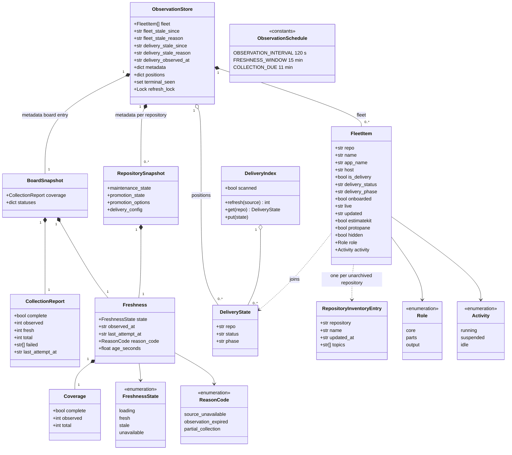
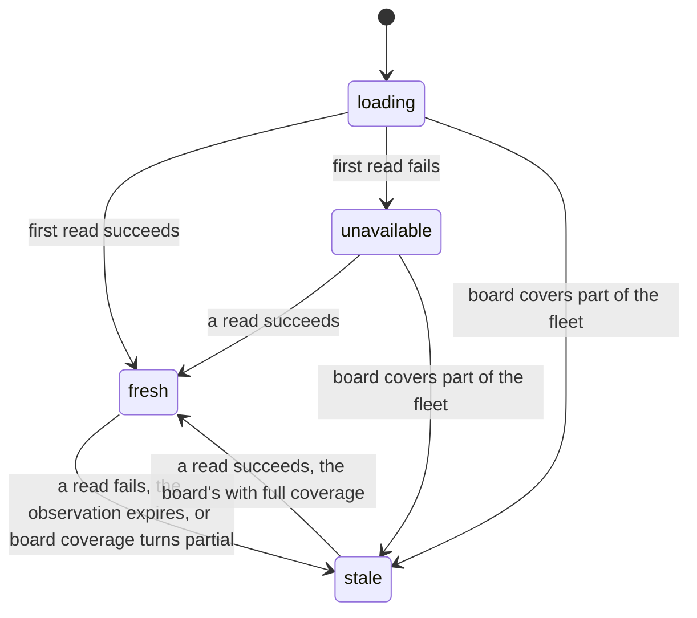
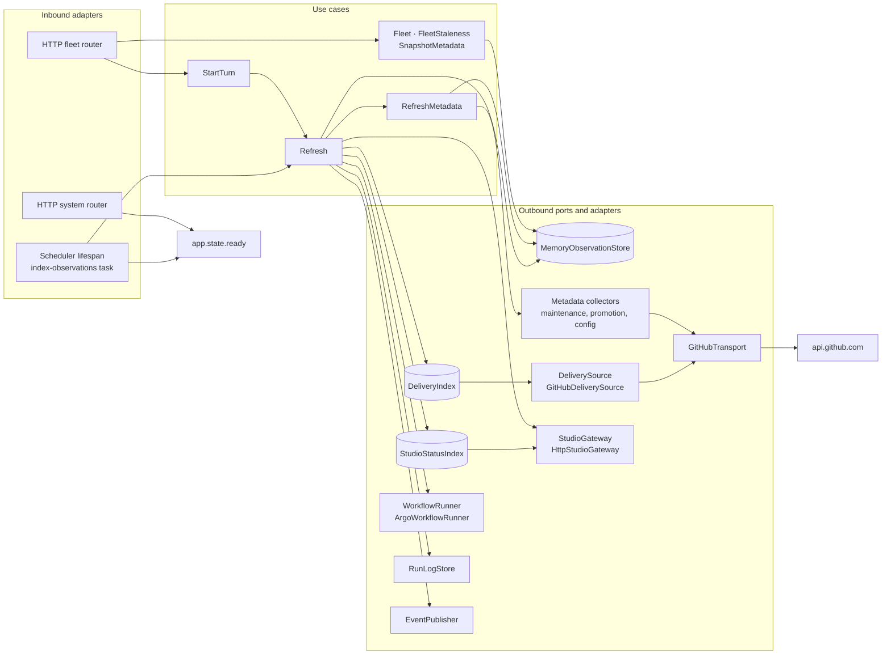

import { Tabs, TabItem } from '@astrojs/starlight/components';

Observation keeps the Console's picture of the organisation's repositories and says how current it is. A scheduler inside the backend ticks every two minutes: it scans the organisation for delivery lines, projects the fleet, collects the repository metadata that is due, and publishes each result as a snapshot stamped with its freshness and coverage. Every metadata read in the Console serves those snapshots, on the [Delivery](../delivery/), [Maintenance](../maintenance/), [Promotion](../promotion/) and [Studios](../studios/) pages as on the Fleet board, so loading a page's state never calls GitHub. The module also answers the pod's readiness and liveness probes, and states on the event bus what each tick finds has moved.

<Tabs syncKey="viewpoint">

<TabItem label="Business">

### What it is

The fleet is every unarchived repository of the Console's organisation, one row each. A row says whether the repository carries a delivery line and where that line stands, whether a worker is running for it, whether it is onboarded on the platform and whether its app is running, which role it plays in the Foundry, and whether the estimation and prototyping studios hold a project for it. Beside the fleet, each repository has a metadata snapshot: its maintenance positions, its promotion state and options, and its delivery configuration.

An observation is one reading of these facts, and it is fresh for 15 minutes. Each observation carries when it was made, when it was last attempted, and how much of what it covers was read.

### Rules

- A metadata read serves the last published observation and never reads GitHub, before the first observation as after it.
- An observation older than 15 minutes reads as stale, whatever it holds.
- Each repository's metadata is collected before its observation expires, oldest attempt first, and is read again only once it is due, except by an explicit refresh.
- A read that fails keeps the last good observation and reports it as stale, or as unavailable when there is none.
- A scan that could not be completed replaces nothing: the delivery index keeps its last complete scan, and the board its last complete projection.
- The explicit refresh reads every repository in one sweep, and the request that starts it returns at once.
- A repository carrying the `foundry-hidden` topic stays off the board unless hidden projects are asked for.
- The observation is one for the whole installation; each read of it shows the caller's projects. A team member's board, and the explicit refresh's answer, show its teams' projects alone; an admin's shows every project.
- Observation leaves the last 100 requests of each GitHub credential's rate budget to commands.
- The pod takes traffic once its first tick has completed, whatever that tick found; liveness depends on nothing.
- The tick states each moved delivery position and each run that turned terminal, once; after a restart it states nothing it merely found.

</TabItem>

<TabItem label="Functional">

### What a user does

- **Open the Fleet board.** The board reads `GET /api/fleet` and shows every project row.
- **Show hidden projects.** Settings · Show hidden projects adds the repositories carrying the `foundry-hidden` topic, dimmed; the browser keeps the choice.
- **Refresh the fleet.** The refresh control beside the view controls starts an explicit sweep with `POST /api/fleet/refresh`, receives a turn id at once, and polls the [Co-pilot](../copilot/) module's turn endpoint until the sweep's fleet lands. A poll that outlasts its own deadline keeps watching the same turn, so the produced fleet reaches the board without a reload or a second sweep.
- **Probe the pod.** The kubelet asks `/api/ready` through the web tier every 10 seconds and `/api/health` inside the backend container every 30 seconds.

### What the user sees

A project's cockpit and its maintenance pane show a line only when a read fails, or when the observation could not read its source (`unavailable`, or `source_unavailable`): "Showing the last read" with the cause while earlier data stays on screen, else "Read unavailable" with the cause.

The refresh control reports its outcome in a live region: "Refreshed", "Updated" with the time the last sweep landed, "Still refreshing - the board will catch up", "Refresh failed" with the sweep's error, "Held - the org could not be read", or "Showing the last board" with the error of a board read that failed while the last rows stay on screen. A board standing on a held scan carries a "Board held since" banner stamped with the first failed tick and the reason; a board with no rows has nothing held, and its empty state names the cause instead.

The API reports a delivery row's `activity` as running, suspended (parked on a gate) or idle, and as blank when the executor could not be read. The board shows it in words: a running line as building, a suspended one or one awaiting a gate as needing your sign-off, and otherwise the line's state (ready to drive, degraded, delivered, learned and ready to close). The [observation tick](../../flows/observation-tick/) follows one tick end to end.

</TabItem>

<TabItem label="Technical">

### Domain model

- `observed_at` moves only when a read succeeds; `last_attempt_at` moves on every attempt, and the due rule reads it.
- A failed read replaces a snapshot's freshness and nothing else: the values of its last successful read stay.
- A repository's coverage counts its four reads (maintenance state, promotion state, promotion options, delivery configuration); the board's counts the repositories with any observation against the fleet's size.
- Expiry is judged at read time: a fresh snapshot whose `observed_at` is more than 15 minutes old reads as `stale` with `observation_expired`, beside its `age_seconds`; a snapshot already stale keeps its own reason.
- A repository is due once its last attempt is `COLLECTION_DUE` old, two intervals short of the window.
- The delivery index replaces its inventory only from a scan that completed, and a state a command wrote through during the scan outlives it. `scanned` stays false until the first scan completes, so a delivery status reads `loading` until then.
- `fleet_stale_since` is stamped by the first failed fleet projection and kept across later failed ticks; a successful projection clears it.
- `delivery_stale_since` is stamped the same way by the delivery scan alone, and a completed scan clears it and stamps `delivery_observed_at`. While it is set, the delivery list, state and overview read `stale` with `source_unavailable`, observed no later than `delivery_observed_at`, or `unavailable` when no scan has completed.
- A fleet row joins its platform app on the normalised repository name. `role` is `core` for the install's platform repository (`FC_PLATFORM_REPO`) and for the playbook as playbook-studio names it, outranking any manifest role; otherwise it is the joined app's `parts` or `output`, or null.
- `activity` is set only on a delivery row, and is null when the executor is not wired or could not be read.

### Lifecycle

Every snapshot, the board's and each repository's, moves through the same four freshness states.

| State | `reason_code` | When |
| --- | --- | --- |
| `loading` | empty | no observation has been attempted |
| `fresh` | empty | the last read succeeded and is under 15 minutes old; for the board, every repository is fresh and every source answered |
| `stale` | `source_unavailable` | the last read failed, and the last good data is served |
| `stale` | `observation_expired` | the last successful read is more than 15 minutes old |
| `stale` | `partial_collection` | board only: the sources answered, and some repository is not fresh |
| `unavailable` | `source_unavailable` | a read failed and no read has ever succeeded |

### Ports and adapters

The lifespan starts two tasks beside the HTTP server: `index-observations`, which runs `Refresh` and sleeps 120 seconds, and the maintenance module's delegated reconciliation loop. The first `Refresh` to return or raise sets `app.state.ready`, and a tick that raises is logged as `Observation tick failed` before the next one runs. `Refresh` holds one lock for the whole tick, so the explicit sweep and the scheduled tick never interleave, and it runs every read inside the transport's background scope. A tick publishes these observations:

| Observation | Read from | Published to | On a failed read |
| --- | --- | --- | --- |
| Delivery index | the organisation's inventory and one `delivery/*` probe per repository, 8 at a time | `DeliveryIndex` | the last complete scan stays, stamped with `delivery_stale_since` and its reason |
| Studio status | each studio's health and each delivery slug's artifacts | `StudioStatusIndex` | each failed entry keeps its last value |
| Fleet | the inventory, the delivery index, the platform apps, the estimation and prototype slugs, the executor's delivery runs | `fleet` | the last board stays, stamped with `fleet_stale_since` and its reason |
| Runs | the executor's runs and their graphs; each terminal run's log is captured to the run-log archive, and archived runs are merged back | `runs`, `graphs`, run statuses on the board entry | the last rows and graphs stay; an archived record that cannot be read withholds only itself |
| Repository metadata | four reads for each due repository: the 24 oldest-attempted, 4 at a time, each published as its reads complete; the sweep takes every repository | `metadata` per repository | the last values stay, and the freshness turns stale |
| Maintenance inbox | the published metadata and runs, on every fifth tick from the first, and on the sweep | `inbox` | the last queue stays |
| Board freshness | the outcome of everything above | `metadata` board entry | always written |

The tick states two kinds of fact through `state_fact`, which drops and logs a failed publish without touching the tick's outcome. A delivery whose derived position moved since the last tick states `com.foundry.delivery.phase.entered`, `gate.reached`, `run.degraded`, `line.delivered` or `line.learned` by its destination, and a run that reached a terminal phase states `com.foundry.delivery.run.completed`, once per run. The first tick after a start records the positions and terminal runs it finds and states nothing. The types and their data are on the [events reference](../../reference/events/).

Every GitHub adapter of the Console shares one `GitHubTransport`, the commands' as well as the observation's:

| Bound | Rule |
| --- | --- |
| Authority | `https://api.github.com` only; a redirect keeps the host and the GET method or is refused |
| Credential | every request carries one; rate budgets are kept per credential |
| Concurrency | 4 requests in flight and 32 queued; a full queue refuses at once |
| Deadline | 20 seconds per read by default, covering its pages, retries and waits |
| Retries | reads only: up to 3 attempts on a 5xx, a network failure, or a rate limit whose wait of at most 2 seconds fits the deadline; a write is attempted once |
| Conditional reads | up to 1024 responses cached and revalidated by `ETag` or `Last-Modified`; a 304 serves the cached body, and a git blob or tree addressed by its sha is served from the cache without a request |
| Pagination | follows `rel="next"`; a 101st page, a repeated page or the deadline ends the read as a source failure |
| Response bound | 2,000,000 bytes per response |
| Rate limit | a zero remaining budget or a `Retry-After` blocks the credential until its reset; a blocked read waits only when the wait fits |
| Command reserve | inside an observation, a read is deferred once the credential's remaining budget is 100 or less |

A 401, 403, 429 or 5xx that is not retried, and every exhausted or deferred read, ends as `SourceUnavailable` carrying a retry hint. A 404, 409 or 422 reaches the caller as the host's answer.

### HTTP surface

| Method | Route | Purpose |
| --- | --- | --- |
| GET | `/api/fleet` | The fleet board from the warm cache: every project row (hidden repositories only with `include_hidden=true`), `stale_since` and `stale_reason` while the board is held, and the board's `freshness`. |
| POST | `/api/fleet/refresh` | Start an explicit sweep in the background and return its turn id at once; the turn, redeemed at `GET /api/chat/turns/{turn_id}`, resolves to the body `GET /api/fleet` returns. |
| GET | `/api/health` | Liveness: `status` `ok`, with no dependency on any source. |
| GET | `/api/ready` | Readiness: 503 with `ready` false until the first observation tick has completed, then 200 with `ready` true. |

### Persistence

Observation keeps every collection in process memory: the observation store, the delivery index and the studio status cache. A restarted pod starts every snapshot at `loading`, withholds readiness until its first tick completes, and that tick primes the narration without stating anything.

### Failure modes

| Failure | What the caller sees |
| --- | --- |
| The organisation's inventory, or a studio's inventory, cannot be read: no credential, the host down or refusing, a malformed listing | `GET /api/fleet` serves the last board with `stale_since` from the first failed tick and `stale_reason`; the board's freshness is `stale`, or `unavailable` when it was never observed, with `source_unavailable`; the board shows its held banner |
| A studio's health or a delivery slug's artifacts cannot be read | the studio status cache keeps each failed entry's last value; the board's freshness reads `source_unavailable` |
| A delivery probe fails on any repository | the delivery index keeps its last complete scan and the tick states no position facts; the board's freshness reads `source_unavailable` |
| The executor cannot be read | the run inventory keeps the last tick's rows, every row's `activity` is null, and the board's freshness reads `source_unavailable` |
| One of a repository's four reads fails | the repository keeps its last values; its freshness turns `stale`, or `unavailable` when never observed, with `coverage.observed` counting the reads that answered out of 4; the board reads `stale` with `partial_collection` |
| An observation outlives the 15-minute window | the read reports `stale` with `observation_expired` and the observation's `age_seconds` |
| A credential's budget reaches the command reserve | observation reads are deferred as source failures, handled as the rows above; commands keep the remaining budget |
| A transport bound is crossed: a full queue, the deadline, the response size, the page bound or a cycle, a foreign redirect | `SourceUnavailable`, handled as a source failure above; a command that meets it answers 503 `source_unavailable` with `Retry-After` |
| A tick raises | `Observation tick failed` in the log; the next tick runs 120 seconds later, and readiness is granted all the same |
| The explicit sweep raises, or its board is still held | the turn resolves as an error, or the SPA reports the held result as a failed refresh; neither reads as "Refreshed" |
| The turn is lost to a pod restart | the turn endpoint answers an `unknown turn` error, and the control stops waiting on the turn |
| The pod's first tick has not completed | `GET /api/ready` answers 503 with `ready` false and the Service routes no traffic to the pod; `GET /api/health` stays 200 |
| No admitted operator identity while the install fronts operators with OIDC | 403 `permission_denied` on `/api/fleet` and `/api/fleet/refresh`; `/api/health` and `/api/ready` are exempt |
| `include_hidden` is not a boolean | 422 `invalid_request` |
| The event bus cannot be reached | the fact is dropped and logged at warning; the tick's outcome is unchanged |

### Claims realised

| Claim | Realised by |
| --- | --- |
| `INT-FC-R164` | the read use cases serve published snapshots only, and a failed read keeps the last good data with its freshness |
| `INT-FC-R169` | `RefreshMetadata`: due-based, oldest-first, bounded collection on `ObservationSchedule` |
| `INT-FC-R107` | `POST /api/fleet/refresh`: the locked sweep run as a turn |
| `INT-FC-R144` | `Refresh` holding the board and the index on a failed scan, and `FleetStaleness` stating it |
| `INT-FC-R30` | `DeliveryIndex`: the in-memory delivery cache refreshed out of band |
| `INT-FC-R145` | `GitHubTransport`: bounded retries, refusals and deferrals |
| `INT-FC-R125` | the lifespan's readiness flag and `GET /api/ready`, beside the dependency-free `GET /api/health` |
| `INT-FC-R137` | the tick's position and terminal-run narration through `state_fact`, primed silently on a cold start |
| `INT-FC-R38` | the fleet projection joining the inventory, the delivery index and the platform apps |
| `INT-FC-R81` | the fleet row's `activity`, read from the executor and unknown without it |
| `INT-FC-R47` | `Fleet` excluding `foundry-hidden` repositories unless `include_hidden` |
| `INT-FC-R101` | the fleet row's `role` from the joined manifest app |
| `INT-FC-R147` | the fleet row's `core` role for the platform repository and the playbook |

</TabItem>

</Tabs>

## Read next

- [The observation tick](../../flows/observation-tick/)
- [Delivery](../delivery/), which reads the delivery index this module keeps
- [Maintenance](../maintenance/), whose positions and inbox come from these snapshots
- [Studios](../studios/), whose status cache the tick refreshes
- [Events](../../reference/events/)
