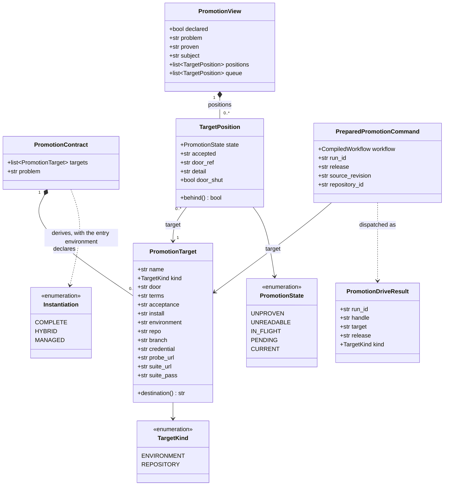
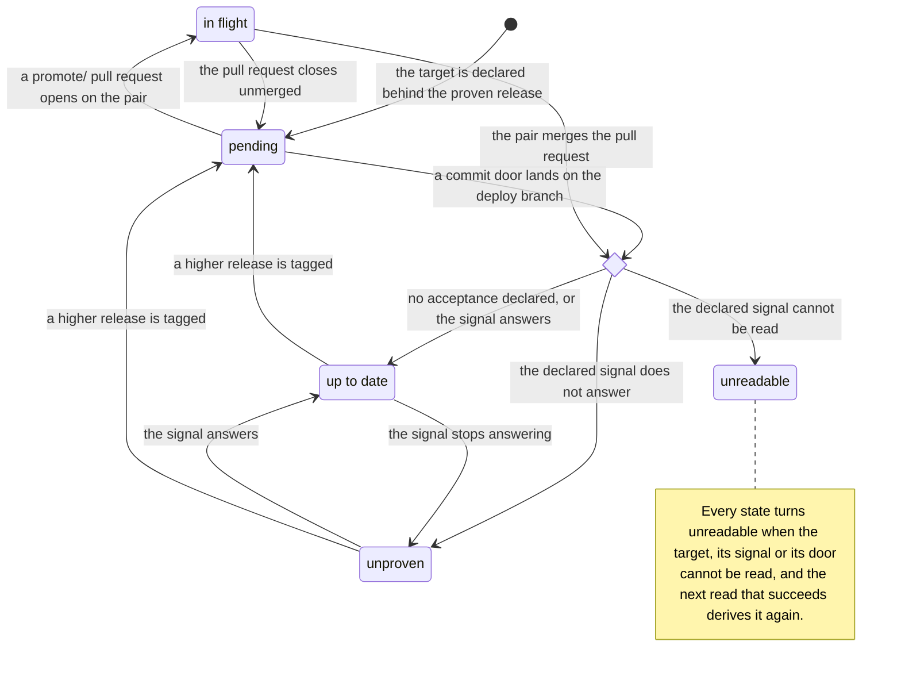
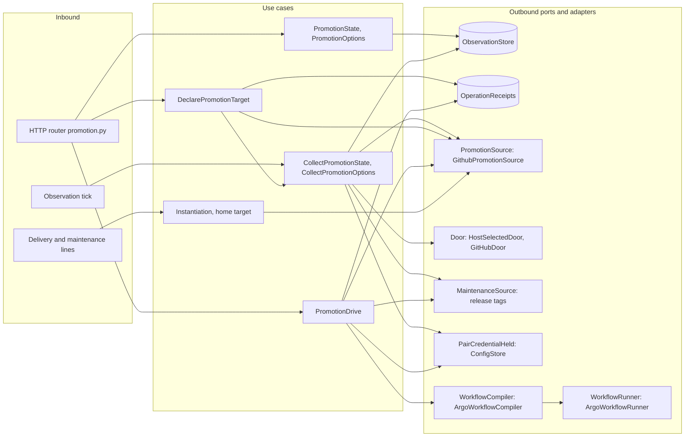

import { Tabs, TabItem } from '@astrojs/starlight/components';

The Promotion module is the Console's third mode, beside Delivery and Maintenance. It shows one row per target an app's promotion contract declares and where each stands against the proven release, and it carries the two acts on them: declaring a target and driving a promotion. It owns no state. Its rows are derived from git and the repo host on each [observation](../observation/) tick; its writes are one commit to the app's own contract and one worker run of the `promote` skill, which [execution](../execution/) runs; the credentials a door needs are held in [settings](../settings/). The delivery and maintenance lines ask it one more question: which way the foundry holds an app.

<Tabs syncKey="viewpoint">

<TabItem label="Business">

### What it is

Every build reaches its install's entry environment on its own. Every move beyond the entry environment is a promotion, and an app's promotion contract, `devops/promotion.yaml` in its own repository, declares where its releases may go. Each destination it declares is a target, of one of two kinds:

| Kind | Destination | Door | Terms |
| --- | --- | --- | --- |
| `environment` | an environment of an install the foundry runs | a commit to the app's `deploy-<install>` branch | `version`: the release's image tags and chart pin |
| `repository` | another organisation's repository and base branch | a `promote/<release>` pull request, theirs to merge | `source`: the release's source tree |

A target's acceptance says what proven-there means: `none` (the promotion closes at deployed), a `probe` URL that must answer, or a `suite` whose published verdict must read as passed.

The proven release is the highest release the app has tagged. The module compares it with what each target carries and names the next act for each target. Whether that release is proven live (its artifacts published, its CI green, its entry environment serving it) is checked by the `promote` skill's pre-flight before any door opens.

An app's instantiation, which way the foundry holds it, is derived from the same repository. A `complete` app runs on an install and declares no repository target. A `hybrid` app runs on an install and declares a repository target: a door back to a home the foundry does not own, where proven releases are promoted. A `managed` app runs on no install: its repository target is its home, the address its delivery and maintenance lines land their pull requests through, and promotion never reaches it.

### Rules

- A target is an environment of an install or another organisation's repository.
- An install's entry environment is never a target: every release deploys into it, and a promotion there would be overwritten by the next release.
- Each target is declared under a unique lowercase name, and each environment destination once.
- A repository target names the credential the platform holds for that pair; the secret stays with the platform and never enters the contract.
- Promotion moves only what an entry environment proves: an app with no entry environment is `managed` and is not a promotion subject, and an app that has tagged no release has nothing to promote.
- A pair's repository is read only on the credential that pair granted, never on the foundry's own.
- A door that cannot be opened is reported ahead of anything else about its target.
- A door in flight outranks the version comparison: a second promotion is not the next act.
- Acceptance is judged only where a target declares one, so a target that closes at deployed is never unproven.
- A state that could not be read is reported as unreadable, never as current.
- The `promote` skill, run by the Release Manager, is the one act that performs a door; the Console refuses what it can know is impossible and runs the skill in a worker.

</TabItem>

<TabItem label="Functional">

### What a user does

1. Open the Promotion mode on an app. The pane shows the proven release and one row per declared target: its name, destination and kind, its door, terms and acceptance, the release it carries, and its state.
2. Declare a target with **Declare a target**. For **An environment we run**, pick an install and one of its environments; the form lists only the environments the app's deploy branches carry, without the entry environment, and says so when no install carries another. For **Another organization's repo**, give their `owner/name`, the base branch and the name of the credential the platform holds. An optional probe URL becomes the target's acceptance; left empty, the target closes at deployed. Submitting commits the re-rendered `devops/promotion.yaml` to the app's default branch with the message `feat(promotion): declare the <name> target`, and the pane shows the contract as committed.
3. Press **Promote** on a pending row. The Console submits one worker run of the `promote` skill for that target at the proven release, and the row names the release and the run it is driving. The row's state moves on a later read, once the worker's door has landed.
4. On a row whose door is shut, register the credential the row names in Settings, under Pair credentials.

### What the user sees

| Row state | Label | When | What the row offers |
| --- | --- | --- | --- |
| `pending` | pending | the proven release is ahead of what the target carries, and no door is open | `promote <repo> <target>` and the Promote button |
| `in-flight` | in flight | a `promote/*` pull request is open on the pair's base branch | the pull request, awaiting their review |
| `unproven` | unproven | the target carries the proven release and its declared signal does not answer | the detail naming the signal |
| `unreadable` | unreadable | what the target carries, or its declared signal, could not be read | the detail naming what could not be read |
| `unreadable`, door shut | door shut | the contract names no credential for the pair, or the platform holds none under that name | `register <credential> in Settings → Pair credentials`, or, with none named, `name a credential for this pair in the contract` |
| `current` | up to date | the target carries the proven release, and its declared signal answers or it declares none | nothing to do |

Rows that want attention come first, in the order unproven, unreadable, in flight, pending, each sorted by target name; up-to-date rows follow in contract order.

What the pane shows for the app as a whole:

| The app | What the pane shows |
| --- | --- |
| carries no `devops/promotion.yaml` | a no-contract card offering **Declare a target** |
| has no entry environment | a `managed` card naming its repository target as its home |
| declares targets and has tagged no release | a nothing-proven card |
| carries a contract that does not parse | a banner naming the first malformation, above the rows of the targets that do parse |
| declares `targets: []` | the proven release and an empty list |

Across the fleet, every app's observed rows feed the fleet inbox as its `promotion` signal. The [promotion flow](../../flows/promotion/) follows one release from pending to up to date.

</TabItem>

<TabItem label="Technical">

### Domain model

- Nothing in the model is stored: every read derives it from the contract, the app's deploy branches, its tags and the pair's pull requests.
- An `environment` target names `install` and `environment`, and a `repository` target names `repo` and `branch`. Where the contract leaves them out, an environment's door and terms read as `commit` and `version`, a repository's as `pull-request` and `source`, and acceptance as `none`; an `acceptance:` key holding a nested `probe:` reads as `probe`.
- A target name appears once per contract. A target missing its name, its kind or its kind's fields is dropped, and `problem` names the first such malformation.
- `door_shut` is set only on a `repository` target, and a shut target carries no `accepted` and no `door_ref`.
- `behind` holds for `pending` and `unproven`; `queue` holds every position that is not `current`, in attention order.
- An install's entry environment is known when its deploy branch carries exactly one environment, and that one is never offered as a target. Where a branch carries several, none is excluded from the options, and the `promote` skill's pre-flight refuses an entry environment.
- `subject` is empty for a promotion subject, `managed` for an app with no entry environment and `nothing-proven` for an app that declares targets and has tagged no release; neither of the last two carries positions.
- `Instantiation` is `managed` with no entry environment, `hybrid` with one and a declared repository target, `complete` otherwise, and `complete` when no promotion source is configured; a failed read is a source failure. Only a `managed` app has a home: its first declared repository target.
- A drive's `run_id` is derived from its operation key, so a replay names the same run.

### Lifecycle

A target's state is derived on every read; the diagram shows how it moves between reads as releases are tagged and doors open and land. Each read applies these rules in order, and the first that holds decides:

1. The door cannot be opened: `unreadable`, with `door_shut` and the reason.
2. What the target carries could not be read: `unreadable`.
3. A `promote/*` pull request is open on the pair: `in-flight`.
4. The target carries the proven release: `current` when it declares no acceptance or its signal answers, `unproven` when the signal says no, `unreadable` when the signal could not be read.
5. Otherwise: `pending`.

Before any target is read, the app itself is judged: an app with no contract is not declared, an app with no entry environment is `managed`, and an app that declares targets with no tagged release is `nothing-proven`. In the last two cases no target is read from the repo host.

### Ports and adapters

- The two reads serve the snapshot the observation tick publishes and never reach the repo host.
- `GithubPromotionSource` reads the install side only: the contract off the default branch, an environment's `values.yaml` off `deploy-<install>`, the install list from the app's `deploy-*` branches, probes and suite verdicts. It writes one thing, the contract, as a commit whose parent is the revision the declaration was validated against.
- A pair is read through the `Door`, selected per call from the host its credential was registered with, on that credential alone.
- A declaration recomputes the app's state on dispatch and publishes it, so the pane shows the committed target before the next tick.
- A drive validates and compiles before anything is submitted. It compiles one Argo Workflow of one step: the `promote` skill, read from the pinned playbook copy in the worker image, run by the Release Manager under its assigned git identity and pinned to the validated default-branch revision. A repository door carries the pair's credential as a Secret reference beside that identity, and git reaches it through a credential helper scoped to the pair's repository.
- The worker's instruction names the target, its destination and its door, and leaves the act's steps to the skill. Before the run ends, the worker's entrypoint checks that a door exists: an open `promote/<release>` pull request on the pair for a repository target, or, for an environment target, any of the app's deploy branches pinning the release in a `tag:` or `version:` line.

### HTTP surface

| Method | Route | Purpose |
| --- | --- | --- |
| GET | `/api/promotion/state` | The app's promotion view from the observed snapshot: whether a contract is declared, its malformation, the proven release, the subject, and one row per target in attention order, with the snapshot's freshness |
| GET | `/api/promotion/options` | What a target can be declared on, from the observed snapshot: each install the app is onboarded to, its entry environment, and its other environments, with the snapshot's freshness |
| POST | `/api/promotion/target` | Declare one target: validate it against the contract's rules and commit the re-rendered contract to the app's default branch; answers the target, the commit and the recomputed view |
| POST | `/api/promotion/drive` | Drive one declared target's door: refuse what cannot run, then submit a worker run of the promote skill at the named release or the highest tagged one; answers the run id, the workflow handle, the target, the release and the target's kind |

Both commands require an `Idempotency-Key` and accept an `If-Match` naming the default-branch revision the caller read.

### Persistence

The module owns no store. Every fact it reads or writes lives in git or on the repo host:

| Fact | Where it lives |
| --- | --- |
| The contract | `devops/promotion.yaml` on the app's default branch |
| The proven release | the app's highest semver tag |
| The installs and their environments | the app's `deploy-<install>` branches and the `<environment>/values.yaml` files on them |
| What an environment target carries | the first `tag:` in its `<environment>/values.yaml` on `deploy-<install>` |
| What a pair accepted | the release named by the newest merged `promote/<release>` pull request on the pair's base branch |
| A door in flight | an open `promote/*` pull request on the pair's base branch |
| The observed snapshot | the `promotion_state` and `promotion_options` entries of the app in the observation store |
| A command's outcome | its receipt in the operation-receipt store |

### Failure modes

| Failure | What the caller sees |
| --- | --- |
| No observation of the app has been published | `state` answers `declared: false` with `problem` "Observation pending", `options` answers `readable: false`, both with freshness `loading` |
| An observation of the app fails, including a failed read of the contract, a deploy branch or the pair's pull requests | the last published snapshot, with freshness `stale` and reason `source_unavailable`, or `unavailable` when none was ever published |
| The snapshot is older than the freshness window | freshness `stale` with reason `observation_expired` |
| The Console has no repo-host source | `state` answers `declared: false` and `options` `readable: false`; a declaration answers 503 `source_unavailable`, a drive 422 `request_refused` |
| The contract does not parse | `problem` names the first malformation and the targets that parse still derive; a declaration or a drive answers 422 `request_refused` naming it |
| What a target carries cannot be read: its deploy branch or values file is absent, or no door serves the pair's host | the row is `unreadable`: "the target's state could not be read" |
| The declared signal cannot be read: a probe that does not answer, a suite answer that is not a 2xx or lacks its pass rule, an acceptance with no URL or of a kind the Console does not read | the row is `unreadable`, naming the signal that could not be read |
| The declared signal says no: a probe answering 4xx or 5xx | the row is `unproven` |
| The door cannot be opened | the row is `unreadable` with `door_shut: true` and "the door cannot be opened: " followed by the reason; the pair is not read, and a drive answers 422 `request_refused` with the same reason |
| A declaration breaks a contract rule: a name that is not a lowercase label, a name, or an environment destination, already declared, the install's entry environment, a pair not written `owner/name`, no base branch, no credential name | 422 `request_refused` naming the rule |
| A drive the Console knows cannot run: a release not among the app's tags (an app with none included), a `managed` app, a target the contract does not declare, a shut door, a repository target with no resolved pair credential, no worker credential, a phase timeout under 600 seconds, no git identity assigned to the Release Manager | 422 `request_refused` naming the refusal; an undeclared target's answer lists the targets the contract declares |
| A body or query that does not match the API contract | 422 `invalid_request` |
| A command without an `Idempotency-Key`, or whose `If-Match` is weak, a wildcard or a list | 422 `request_refused` |
| `If-Match` names a revision the default branch has moved past | 409 `conflict`: "The contract revision changed; refresh before declaring a target." for a declaration, "promotion source revision changed" for a drive |
| An `Idempotency-Key` reused for a different request | 409 `conflict` |
| An `Idempotency-Key` replayed | the retained answer when the first request completed; 409 `operation_unknown` with its `operation_key` while its outcome is unconfirmed |
| The commit or the submission fails after dispatch, including the default branch moving between validation and write | 409 `operation_unknown` with its `operation_key`; the receipt records the outcome as unconfirmed |
| A source the command needs is unavailable: the default-branch revision, the worker settings, the agent catalog or the Release Manager in it, the repository's identity binding | 503 `source_unavailable` with `Retry-After` |
| The caller holds no grant for the action on the repository | 403 `permission_denied` |
| The worker ends with no door found | the run fails and the row stays `pending`. For an environment target the check passes when any deploy branch pins the release, the entry environment's included; when the entrypoint cannot reach the remote to check, it skips the check and the run's own exit stands |

### Claims realised

| Claim | Realised by |
| --- | --- |
| INT-FC-R127 | the position derivation judging a shut door first, and the view reading no pair whose door is shut and every other pair through the `Door` on its own credential |
| INT-FC-R128 | the promotion compiler: one step running the `promote` skill, the pair credential by Secret reference, a repository door with no resolved credential refused |
| INT-FC-R129 | the drive's preparation, refusing every promotion it can know is impossible before a pod exists and answering each as a 422 |
| INT-FC-R130 | the `Instantiation` use case and the home-target helper, deriving the tier from the entry environment and the declared repository target |
| INT-FC-R133 | the position derivation and the attention order, held to the playbook's vendored promote fixture corpus |
| INT-FC-R134 | the view answering the subject, `managed` or `nothing-proven`, before any target is read |
| INT-FC-R138 | the promotion step bound to the Release Manager |
| INT-FC-R158 | the promotion prompt carrying the shared landing rule of a headless turn |
| INT-FC-R164 | the state and options reads, served from the published snapshot without reaching the repo host |

</TabItem>

</Tabs>

## Read next

- [The promotion flow](../../flows/promotion/): one proven release moving to one target
- [Observation](../observation/): the tick that collects every app's promotion snapshot, and the fleet inbox that carries its `promotion` signal
- [Execution](../execution/): the executor that runs the promote worker
- [Settings](../settings/): pair credentials, the Release Manager's git identity and the worker settings a drive needs
- [The API reference](../../reference/api/)
