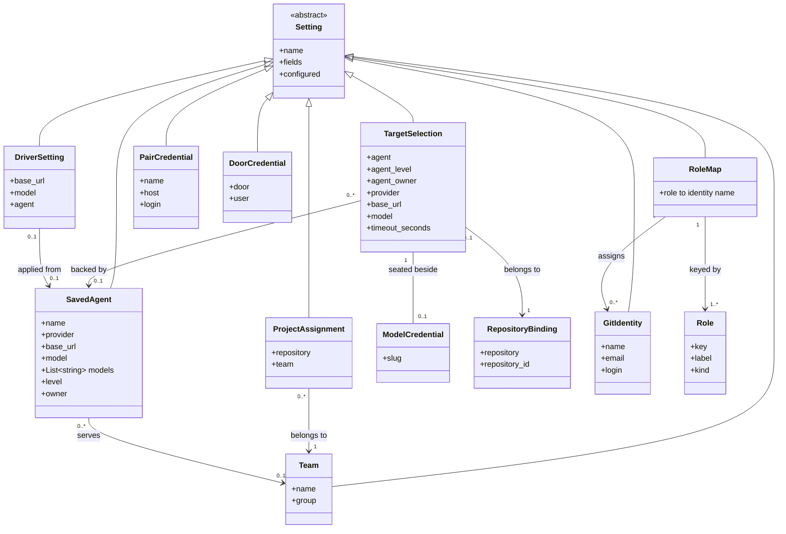
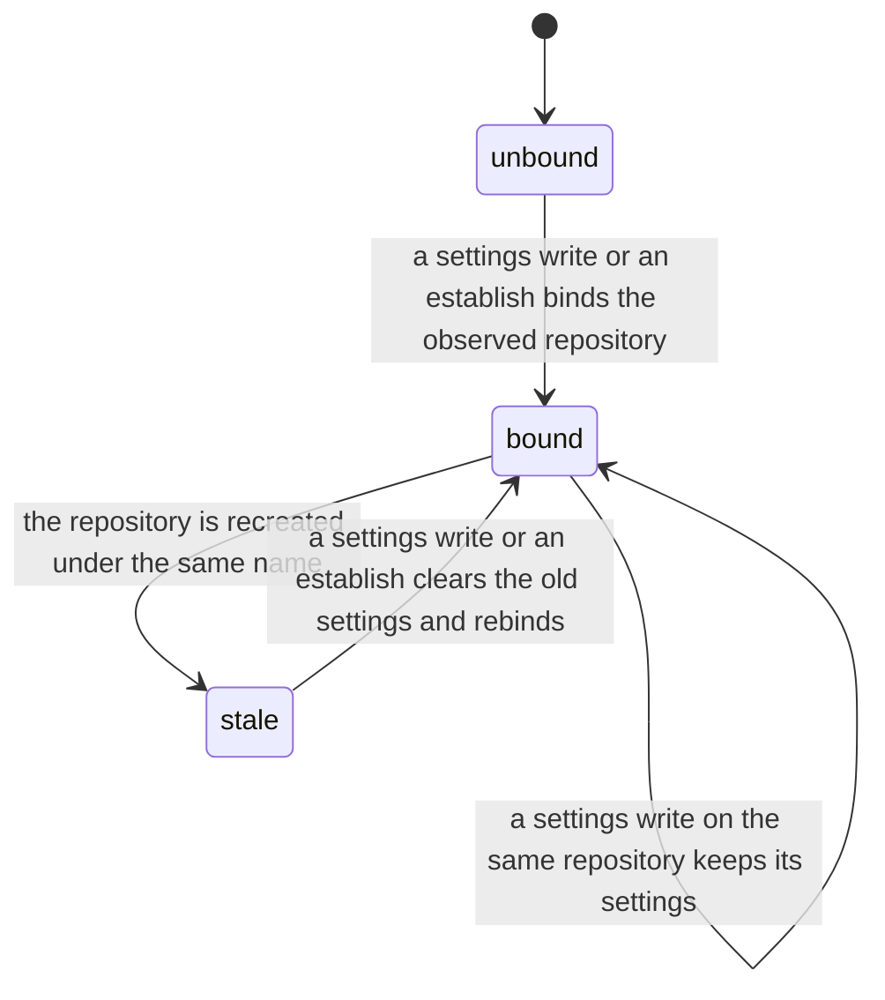
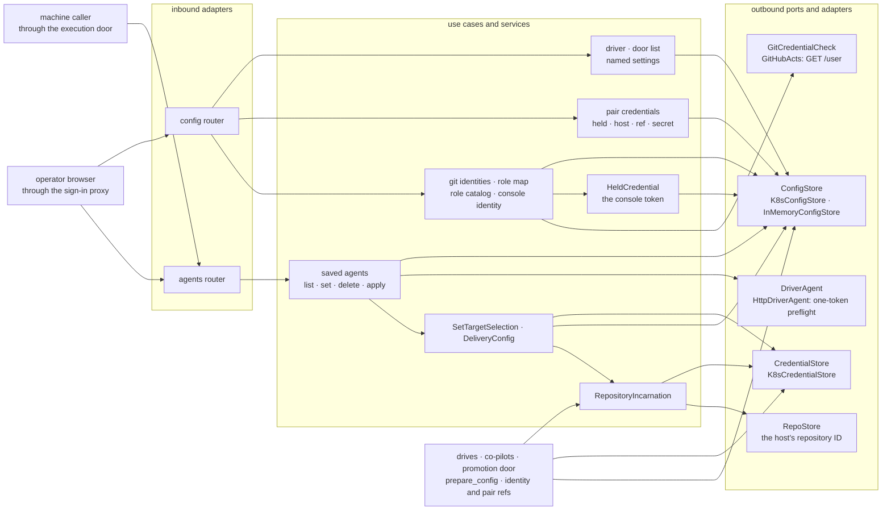

import { Tabs, TabItem } from '@astrojs/starlight/components';

The settings module holds every runtime setting an operator edits in the Console rather than in git
or in the install's configuration: the saved agents and each target's model selection, the git
identities and the roles they are assigned to, the per-door MCP credentials, the pair credentials,
the home co-pilot's driver and any other console-wide setting. Each setting is a named pair of
Kubernetes objects in the Console's namespace, a ConfigMap of public fields and an optional Secret,
read live, so a change takes effect with no redeploy. The [execution](../execution/),
[maintenance](../maintenance/) and [promotion](../promotion/) modules read these settings when they
compile a run, the [co-pilot](../copilot/) module answers on the driver and a target's credential,
and the [admission](../admission/) module authorizes and records every write.

<Tabs syncKey="viewpoint">

<TabItem label="Business">

### What it is

| Setting | What it holds | Read by |
|---|---|---|
| Saved agent | a model endpoint: a provider label, a `base_url`, its credential, the models it serves, and whom it serves: the whole install, one team, or one person. The Settings page lists saved agents as saved providers | a target selection or the driver, when the agent is applied to it |
| Team | a name and the identity-provider group whose members belong to it | admission, which gives each member its teams' projects |
| Project assignment | the team one repository belongs to | admission, and every read of the projects |
| Target selection | for one repository, a delivery or a maintenance-only one: the saved agent that backs its runs and who owns it, the model chosen on that agent, and the worker's wall-clock budget. The target's model credential is seated beside it | every drive of that repository, and its co-pilot |
| Git identity | a machine-user: display name, commit email, GitHub login and PAT | the steps of each catalog agent it is assigned to, and the console's own acts |
| Role map | which git identity each catalog agent, and the console role, runs as | the run compiler and the console's GitHub adapters |
| Pair credential | the repo-host token another organisation granted for one pair, registered under the name a promotion contract declares, with the host it reaches | the promotion door, and a delivery whose home is that pair |
| Door credential | the Basic-auth user and password of one MCP door | every worker that connects to that door, and the studio health probes |
| Home co-pilot driver | the endpoint, model and key the Fleet page's co-pilot answers on, and the name of the agent applied to it | the co-pilot module |
| Named setting | any other console-wide setting, such as the run-retention horizons | the module that owns the setting |

A worker holds three of these: its target's model credential, the git identity assigned to its
step's catalog agent, and the credential of each door it connects to. How the worker carries them
is in the [execution module](../execution/).

### Rules

- No credential lives in git. A read reports whether a secret is set, never its value.
- A write that carries an empty secret keeps the stored one, so editing a setting's public fields needs no re-entry.
- One saved credential backs many models: the model is chosen separately from the agent, for a target and for the home co-pilot alike.
- An agent with no credential cannot be applied.
- A saved agent serves the whole install, one team, or one person. An admin adds an install agent, any member of a team adds that team's, and anyone adds their own. Each person is offered the install's agents, their teams' and their own; an admin sees every agent and edits any, and applies only the ones it would be offered.
- An agent name belongs to one agent: another owner's name is not taken over by saving under it.
- An agent saved before agents had owners serves the whole install.
- Applying an agent records whom it serves beside the target's selection. A line set to a personal seat is driven by that seat's owner alone, and its co-pilot answers its owner alone; anyone else is refused with the reason and applies a team or install agent instead. A line set to a direct endpoint, or applied before agents had owners, drives as before.
- The home co-pilot answers everyone, so it takes an install agent.
- The execution door lists and applies install agents alone.
- With teams on, every installation-wide setting (the home co-pilot, git identities and their roles, pair credentials, the MCP doors' credentials, the run retention) is an admin's to write; a team member's Settings page offers its providers and its own view toggles.
- The teams and their projects are an admin's to set. A team is one group of the identity provider; a project belongs to at most one team, and a project assigned to none is visible to admins only. Deleting a team leaves its projects unassigned.
- The named-setting door reads and writes the run retention and the MCP doors' credentials alone; every other setting has its own door.
- Applying an agent copies its credential to the target or the driver. A rotated agent credential reaches a target or the driver when the agent is applied to it again, and deleting an agent leaves the copies seated.
- Seating a target's model or credential writes nothing to the repository, so a maintenance-only repository gains no scratch from it.
- Each catalog agent commits as the identity assigned to it, wherever it works, so the Reviewer and the Programmer can be different GitHub accounts. No identity is shared or default: an agent left unassigned has none.
- The console's own merge, comment and close, and its GitHub reads, run as the identity assigned to the console role, and have no token while none is assigned.
- A pair credential is registered from the secret the pair granted, never minted. It is not a git identity: no role can be assigned to it, and its login never counts as one of the console's own.
- A credential its provider or GitHub explicitly refuses is not seated. An endpoint that gives no answer does not block the save; the first real run judges the credential.
- A repository's target settings belong to the repository as it exists on the host: a drive on a repository deleted and recreated under the same name refuses until they are set again.

</TabItem>

<TabItem label="Functional">

### What a user does

1. **Saves an agent** on the Settings page: a name, a provider label, the `base_url` (empty for Claude's own endpoint), the credential, the models the endpoint serves and, with teams on, whom it serves: everyone (an admin), one of their teams, or only them. A Claude subscription token, minted once with `claude setup-token`, is saved like any other credential. The Console tries a supplied credential with a one-token turn before it seats it; editing a saved agent keeps its credential unless a fresh one is typed.
2. **Picks the home co-pilot** (Settings, Home co-pilot) by applying a saved agent and one of its models; the default is the agent's own default model.
3. **Picks a target's model** on the target's page by applying a saved agent and one of its models. The target's model control then shows the agent and the model. Setting an endpoint directly, and the worker's timeout, are the [delivery](../delivery/) module's controls over the same selection.
4. **Saves git identities**: a name, the commit email, the GitHub login and a PAT, which the Console tries against GitHub before it seats it. It **assigns** them on the role grid, one row per catalog agent with the steps that agent runs, then the console's own acts.
5. **Sets each MCP door's** user and password. The list of doors is derived from the line's studio map: the playbook studio first, then each phase's owner studio.
6. **Registers a pair credential** under the name a promotion contract declares, with the host it reaches (`github.com` when none is given), the login and the secret the pair granted. Correcting the host or the login of a held credential needs no secret.
7. **Sets the run-retention horizons** (Settings, Run retention); the [execution](../execution/) module clamps them and applies them from the next drive.
8. **Sets up the teams** (Settings, Teams; an admin, with teams on): saves a team under its name with its identity-provider group, assigns each project to a team, and unassigns or deletes. The projects no team holds are listed as visible to admins only.

A machine caller, the benchmark, reaches two of these operations through the
[execution door](../../operations/execution-door/): it lists the saved agents and applies one, with
a model, to a line of its own. Its drive then names no worker settings, and the line runs on that
agent ([a bench delivery](../../flows/bench-delivery/)).

### What the user sees

- Each list shows public fields and a configured tick; a secret value is never shown.
- With teams on, each saved provider shows whom it serves, and Edit and Delete are offered only on the providers the caller may change. A target's provider picker offers the providers the caller may apply; a line on a personal seat names its owner and says only they drive it.
- A refused credential or PAT shows the refusal the provider or GitHub gave, and nothing is seated.
- The role grid lists the catalog agents (the five phase workers, the Programmer, the Reviewer, the Release Manager) with the steps each runs, then the console's acts. A blank row is an unassigned agent.
- Applying an agent to a target answers with the target's configuration: mode, provider, `base_url`, model, agent, the timeout in hours, and whether a credential is seated.
- The home co-pilot row shows the applied agent, its `base_url`, the model, and whether a key is set.

</TabItem>

<TabItem label="Technical">

### Domain model

- A setting's secret is held apart from its fields; `configured` says whether it is set, and a write with an empty secret keeps it.
- A saved agent's models default to its single default model, so a model list always offers one.
- Applying an agent records its name, provider, `base_url` and the chosen model in the selection, and copies its credential into the target's model credential (or the driver's key). A direct endpoint set clears the agent name.
- A saved agent's `level` is `install`, `team` or `user`, and its `owner` is empty, the team's name, or the person's principal (`issuer#subject`), shown by their email. A missing level reads as `install`.
- Applying an agent records its level and owner as the selection's `agent_level` and `agent_owner`. The owner follows the seated key: a model, endpoint or timeout write that keeps the key keeps it, a direct set that keeps a personal seat's key is refused to anyone but its owner, and seating a typed credential clears it. `prepare_config` refuses a drive whose `agent_level` is `user` and whose `agent_owner` is not the caller, and, for the execution door, any level but `install`.
- A team's group is stored without its leading path slash, and the groups the sign-in proxy forwards are compared the same way.
- A selection write keeps the stored timeout unless it sets one; the timeout defaults to one hour and is floored at 600 seconds.
- The roles are the catalog agents the Console hands steps to, read from the line's bindings, plus `console`. Unknown role keys are dropped and an empty value unassigns.
- A git identity resolves to object references only when it holds a PAT; an unassigned role or an identity with no PAT resolves to none.
- A pair credential is held only while its secret is: a record without one resolves to nothing.

### Lifecycle

The target settings of one repository name, as the repository binding sees them.

The binding records the repository's full name and the host's numeric ID. A settings write over an
unbound repository, either act over a stale one, and an establish that creates the repository first
delete the selection and the model credential retained under its name; when the repository cannot
be observed, nothing is written. A drive in `bound` is admitted; in `unbound` or `stale` it is
refused until a settings write or an establish binds the repository. Every other setting is
Console-wide and has no lifecycle beyond being written and deleted.

### Ports and adapters

Every write passes the admission module's operation admission before it touches a store, under an
action of its own (`settings.agent`, `settings.apply_delivery`, `settings.git_roles` and the rest).
The execution door admits a machine caller to two of these operations alone: listing the agents
and applying one to a repository in its scope. Saving an identity, deleting one or reassigning the
roles invalidates the held console token, so the next GitHub call resolves it afresh; a five-minute
hold bounds an edit made to the Secret outside the Console. The drives read the selection through
`prepare_config`, which verifies the repository binding, overlays the selection's provider,
`base_url`, model and timeout on the run's configuration, and refuses a target with no seated
credential; maintenance and promotion drives also resolve each required agent's identity through
`prepare_agents`.

### HTTP surface

| Method | Route | Purpose |
|---|---|---|
| GET | `/api/agents` | List the saved agents the caller may see, the models each serves, whether each holds a credential, whom it serves, and whether the caller may apply and edit it |
| POST | `/api/agents` | Save or update a saved agent; a supplied credential is tried against its endpoint first, and an empty one keeps the stored credential |
| DELETE | `/api/agents/{name}` | Delete a saved agent and its credential; the targets and the driver it was applied to keep their copies |
| POST | `/api/agents/{name}/apply-delivery` | Apply a saved agent and one of its models to a target: record the selection, seat the agent's credential for the target, and return the target's configuration |
| POST | `/api/agents/{name}/apply-driver` | Apply a saved agent and one of its models to the home co-pilot driver |
| GET | `/api/config/driver` | Read the home co-pilot driver: `base_url`, model, the applied agent, and whether a key is set |
| POST | `/api/config/driver` | Set the driver's endpoint and model directly, with no named agent; an empty `api_key` keeps the stored key |
| GET | `/api/config/git-identities` | List the git identities: name, email, login, and whether a PAT is set |
| POST | `/api/config/git-identities` | Save or update a git identity; a supplied PAT is tried against GitHub first, and an empty one keeps the stored PAT |
| DELETE | `/api/config/git-identities/{name}` | Delete a git identity and its PAT |
| GET | `/api/config/git-roles` | Read the role map and the catalog of assignable roles |
| POST | `/api/config/git-roles` | Replace the role map; unknown roles are dropped and an empty value unassigns a role |
| GET | `/api/config/mcp-doors` | List the MCP doors a worker connects to, derived from the line's studio map |
| GET | `/api/config/pair-credentials` | List the pair credentials: name, host, login, and whether a secret is held |
| POST | `/api/config/pair-credentials` | Register or amend a pair credential; registering one requires its secret |
| DELETE | `/api/config/pair-credentials/{name}` | Delete a pair credential and its secret |
| GET | `/api/config/setting/{name}` | Read a named setting's public fields and whether its secret is set |
| POST | `/api/config/setting/{name}` | Write a named setting's public fields and, optionally, its secret |
| GET | `/api/config/teams` | List the teams, each with its group and its projects; an admin's read alone |
| POST | `/api/config/teams` | Save a team under its name with its identity-provider group; an admin's act alone |
| DELETE | `/api/config/teams/{name}` | Delete a team and its project assignments; an admin's act alone |
| POST | `/api/config/team-projects` | Assign a project to a team, or to none with an empty team; an admin's act alone |

### Persistence

Every object lives in the Console's namespace. A Secret holds its value under the key `value`
unless the row names another. `<name>` is the setting's name lower-cased, with every other character
a hyphen; `<repo>` is the repository's name without its owner, lower-cased the same way.

| Setting | ConfigMap: public fields | Secret |
|---|---|---|
| saved agent | `fc-agent-<name>`: name, provider, base_url, model, models (one per line), level, owner, owner_label | `fc-agent-<name>-key`: the endpoint credential |
| target selection | `fc-target-<repo>`: agent, agent_level, agent_owner, agent_owner_label, provider, base_url, model, timeout_seconds | the target's model credential, the next row |
| team | `fc-team-<name>`: name, group | none |
| project assignment | `fc-project-<repo>`: repository, team | none |
| target model credential | none | `fc-delivery-<repo>`, key `worker_credential` |
| repository binding | `fc-repository-identity-<repo>`: repository, repository_id | none |
| git identity | `fc-gitid-<name>`: name, email, login | `fc-gitid-<name>-key`: the PAT |
| role map | `fc-git-roles`: one key per role, an identity's name as the value | none |
| pair credential | `fc-pair-<name>`: name, host, login | `fc-pair-<name>-key`: the pair's token |
| door credential | `fc-mcp-<door>`: user | `fc-mcp-<door>-key`: the password |
| home co-pilot driver | `fc-driver`: base_url, model, agent | `fc-driver-key`: the `api_key` |
| run retention | `fc-run-retention`: pod_gc_delay_hours, ttl_success_days, ttl_failure_days | none |
| run credential | none | `fc-run-<run id>`, key `worker_credential`, for a drive whose request carries its own credential |

A write replaces a ConfigMap's whole field set and writes the Secret only when a secret is supplied;
a delete removes both objects. A Workflow carries only these objects' names. Each value is read in
the cluster when a pod starts, or by the Console server-side.

### Failure modes

| Failure | What the caller sees |
|---|---|
| The settings store cannot be read, or holds a malformed object | `503 source_unavailable` with `Retry-After`; a drive that reads the selection refuses the same way |
| A command carries no `Idempotency-Key`, or an `If-Match` that names no single strong revision | `422` naming the header; nothing is written |
| The caller holds no grant for the action, or names a repository outside its scope | `403 permission_denied` |
| An agent, identity or pair credential whose name reduces to nothing | `422` saying it needs a name |
| The provider answers 401 or 403 to an agent's credential | `422` "credential rejected by the provider"; nothing is seated. A timeout or a transport failure seats it |
| GitHub refuses a PAT, or the PAT authenticates as an account other than the declared login | `422` "git token rejected" with what GitHub answered; nothing is seated. A save with no PAT does not call GitHub |
| Applying an agent that is not saved or holds no credential | `422` "agent ... has no credential" |
| Applying another team's or person's agent, through the execution door anything but an install agent, or to the home co-pilot anything but an install agent | `422` naming the agent and why it is not the caller's to apply |
| Saving an install agent as a non-admin, a team agent for a team the caller is not in, or under a name another owner's agent holds; deleting an agent the caller may not edit | `422` naming the reason; nothing is written |
| A drive, a one-shot re-drive or a co-pilot turn on a line set to another person's personal seat | `422` naming the seat's owner and asking for a team or install agent; a one-shot re-drive parks with the same reason |
| A team read or write, or an installation-wide setting's write, by anyone but an admin | `403 permission_denied` |
| A direct model or endpoint set keeping another person's personal seat's key | `422` naming the seat's owner; nothing is written |
| A team with no name or group, a group another team holds, or an assignment to a team that does not exist | `422` naming the problem |
| A named-setting read or write naming anything but the run retention or an MCP door | `403 permission_denied` |
| Registering a pair credential with no secret while none is held | `422` naming the credential and the secret it needs |
| A store write or delete is not confirmed after the command was admitted, or the target's repository cannot be observed while an agent is applied to it | `409 operation_unknown` with its `operation_key`; inspect the setting before another attempt under a fresh key. An unobserved repository is neither bound nor cleared |
| A command that carried a secret is sent again under the same operation id | `409 conflict`: a secret-bearing key is never replayed. A completed command without a secret answers its retained result |
| A drive whose target has no seated credential and whose request carries none | `422` "no worker credential is configured" |
| A drive whose target settings are bound to another incarnation of the repository, or to none | `503 source_unavailable` asking for repository identity reconciliation; applying an agent or establishing the line rebinds |
| A maintenance or promotion drive whose catalog agent has no assigned identity holding a PAT | `422` naming the agent with no git identity. A delivery step whose agent is unassigned compiles with no git credentials and cannot push |
| No identity is assigned to the console role | the console's merge, comment and close refuse, and the GitHub reads that ride its token raise `source_unavailable`; the last observation is held |
| A read of the console's identity fails while a token is held | the held token keeps serving; an empty answer never replaces it and is retried on the next call |

### Claims realised

| Claim | Realised by |
|---|---|
| `INT-FC-R46` | the saved-agent registry: listed without its credential, applied to the driver or a target with a model chosen apart, and refused when it holds no credential |
| `INT-FC-R73` | applying one agent to several targets and to the driver: one stored credential, a different model on each |
| `INT-FC-R51` | `SetTargetSelection` recording the applied agent and model Console-local; a direct set clears the agent name |
| `INT-FC-R45` | the `fc-target-<repo>` selection and the `fc-delivery-<repo>` credential, reused by every later drive through `prepare_config` |
| `INT-FC-R72` | the apply and model paths writing ConfigMaps and Secrets only, never the repository |
| `INT-FC-R114` | the provider preflight on saving an agent's credential, closed on a 401 or 403 and open on no answer |
| `INT-FC-R27` | the driver's `base_url` and model round-tripped through the store, its key reported as set and never returned |
| `INT-FC-R29` | each MCP door's credential as a named setting, its secret never returned, over the derived door list |
| `INT-FC-R88` | the git-identity registry: saved, listed and deleted without the PAT's value |
| `INT-FC-R90` | `SetGitRoles`: unknown roles dropped, an empty value unassigning, no seeded assignment |
| `INT-FC-R140` | `GitRoleCatalog`: the roles are the catalog agents with the steps each runs, plus the console's acts |
| `INT-FC-R142` | the GitHub preflight on saving a PAT, refusing a 401, a 403 or another account's token |
| `INT-FC-R92` | `ConsoleIdentitySetting` and the credential resolver: the console's token is the console role's identity, and none while it is unassigned |
| `INT-FC-R143` | `HeldCredential`, invalidated by every identity and role write, never holding or evicting on an empty answer |
| `INT-FC-R126` | the pair-credential registry: registered from a supplied secret, amended without one, resolved to a value or a Secret name, never one of ours |
| `INT-FC-R171` | `RepositoryIncarnation`: a settings write binds the repository as it exists, and a drive refuses settings bound to another |
| `INT-FC-R186` | the owner level on `SetAgent`, `ListAgents`, `DeleteAgent` and the apply acts, read by `agent_access` |
| `INT-FC-R187` | the selection's `agent_level` and `agent_owner`, and `refuse_foreign_seat` in `prepare_config`, the one-shot re-drive and the project co-pilot |
| `INT-FC-R188` | `ListAgents` and `ApplyAgentToDelivery` offering a machine caller install agents alone, and `refuse_foreign_seat` on a machine drive |
| `INT-FC-R189` | `GetSetting` and `SetSetting` admitting the run retention and the MCP doors' credentials alone |

</TabItem>

</Tabs>

## Read next

- [A bench delivery through the execution door](../../flows/bench-delivery/), where a machine caller applies a saved agent to its line
- [Runtime settings](../../operations/runtime-settings/), the procedures for seating and rotating these settings
- [The execution module](../execution/), how a worker carries its model credential, git identity and door credentials
- [The maintenance module](../maintenance/), where the console role's identity merges and the assigned identities read as the console's own
- [The co-pilot module](../copilot/), which answers on the driver and on a target's credential
- [The admission module](../admission/), which authorizes and records every settings write
- [The configuration reference](../../reference/configuration/), for what an install sets rather than an operator
