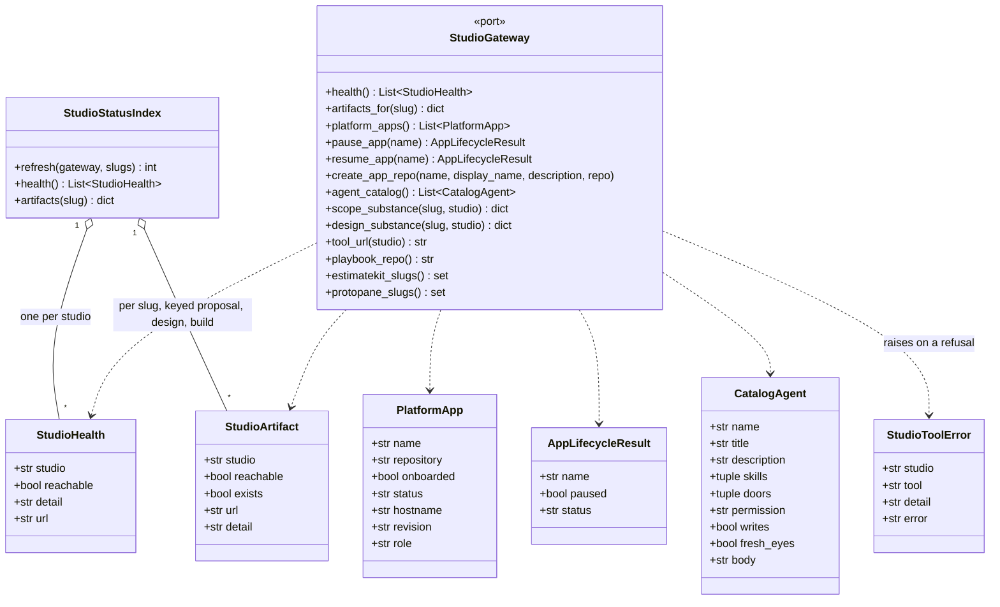
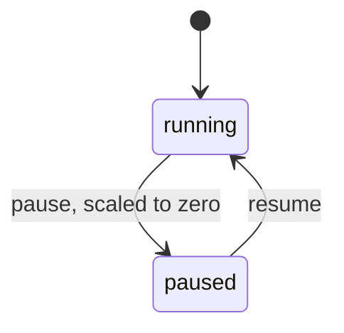
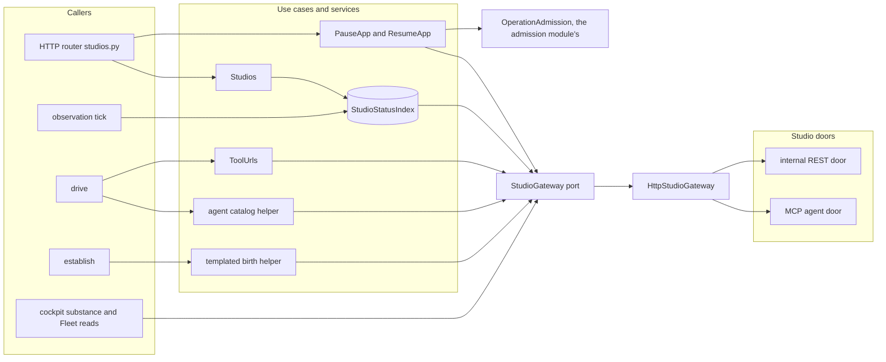

import { Tabs, TabItem } from '@astrojs/starlight/components';

The studios module is the console's one gateway to the four studios a delivery line works through:
estimatekit for scope, protopane for design, platform-studio for build and ship, and
playbook-studio for the playbook's skills and agent catalog. It owns the outbound studio port and
its HTTP adapter, the cache of cross-studio status, the pause and resume acts on platform apps, and
the key each studio holds a delivery's project under. The [delivery module](../delivery/) shows
the studios' artifacts and substance in the cockpit. The [observation module](../observation/)
refreshes the status cache on every tick. A drive reads the agent catalog and each studio's export
door. The [settings module](../settings/) holds the per-door credentials the agent-door calls
carry.

<Tabs syncKey="viewpoint">

<TabItem label="Business">

### What it is

A studio is a tool the delivery line drives. Each one serves one phase:

| Studio | Phase | What it holds for a delivery |
|---|---|---|
| estimatekit | Scope | the estimation project: requirements, phases, assumptions, activities, architecture and its audit |
| protopane | Design | the prototype: its theme and its screens |
| platform-studio | Build + ship | the app's entry on the install, its live status, and the template the delivery's repository is born from |
| playbook-studio | Learn | the playbook: its skills and its agent catalog |

Workers author in the studios through the agent door. The console reads what the studios hold
and renders it in the cockpit. It performs three acts on platform-studio: it asks for a templated
repository when a line is established, and it pauses and resumes an app.

### Rules

- A page load never waits on a studio. Studio status is served from a cache the observation tick
  refreshes, and a studio that is down reads as unreachable.
- Each studio holds a delivery's project under a key that its own naming rule derives from the
  delivery slug. The worker, the gate export and the cockpit name the same project before and after
  the phase creates it.
- A phase's substance is the studio's own artifact, rendered in the cockpit, and a link is not
  substance. When the studio holds nothing, the committed record shows, marked as a record. With
  neither, the pane stays quietly empty.
- Pausing and resuming an app is platform-studio's lifecycle toggle. The console checks the grant
  and the app's revision, records the command, and leaves the deployment to platform-studio.
- A studio's refusal of a command (pause, resume, the repository scaffold) is an answer with a
  name, never read as an empty result, and no call is retried through another door. The catalog,
  playbook-repository and substance reads answer empty on a refusal, and the pane shows what it
  could read.
- The steps the console launches are handed to agents from the playbook's catalog. The console
  binds each step to a catalog agent and never authors one.

</TabItem>

<TabItem label="Functional">

### What a user does

1. Opens the Studios page to see each studio's reachability, the phase it serves and its public
   link.
2. Reads the platform holdings on the same page: every onboarded app with its live status.
3. Pauses a running app or resumes a paused one from its holding card. The Fleet reloads after
   the act, and a refusal shows beside the holdings heading.
4. In a delivery's cockpit, reads each phase's studio artifact on the line card: whether it exists,
   a short detail, and a deep link into the studio.
5. Selects the scope or the design phase to read its substance natively in the wide pane.

### What the user sees

The line card carries one artifact for each phase that drives a studio. The intent and plan phase
drives none and carries none.

| Phase | Artifact | Detail when it exists | Detail otherwise |
|---|---|---|---|
| Scope | the estimatekit project, linked at `/projects/<key>` | `estimation project` | `no project`; `unreachable` when the studio did not answer |
| Design | the protopane prototype, linked at `/p/<key>` | the screen count | `no prototype`; `unreachable` |
| Build + ship | the platform app, linked at its own hostname | the app's live status | `not onboarded` when no app in the inventory ships from the repository; `registered, not onboarded` when the app has no manifest entry; `unreachable` |

The substance pane follows one order: the artifact, then the record, then a quiet empty state.

| Phase | Artifact, rendered natively | Record, when the studio holds nothing | Empty state |
|---|---|---|---|
| Scope | the estimatekit project: summary and audit verdict, the requirement spine with each requirement's phases, the phase decomposition, the assumptions register, the activities with the per-phase estimate in man-days, and the architecture (guidelines, per-phase components, each phase's diagram as its source with the studio's render) | `proposal.md`, under a warning that it is not a live estimation, naming the slug the cockpit looked up | a note naming the slug |
| Design | the protopane prototype: each screen rebuilt in a sandboxed frame from the theme, the screen markup and the studio's canvas runtime | `design.md`, the locked identity | a note that the screens render here once design runs |

A gate that freezes a studio's deliverables exports them through the same internal door and under
the same project key: see [the one-shot line](../../flows/one-shot-line/).

</TabItem>

<TabItem label="Technical">

### Domain model

- `StudioArtifact.exists` is null when the studio did not answer, and `reachable` is false then.
- A `PlatformApp`'s `repository` is `owner/name` or a bare name. It is the row's `repo`, else the
  owner and name in the manifest's `repo_url`, else the app's name. A declared `repo_url` wins.
  A `repo` that names neither it nor its last segment, other than the app's own name, makes the
  inventory unavailable.
- A `PlatformApp` is `onboarded` when its inventory row carries a manifest. Its `hostname` is the
  manifest's, and its `revision` is the row's or the manifest's.
- One malformed inventory row (no name, a malformed manifest or repository, a fact that is not a
  string) makes the whole inventory unavailable.
- A `CatalogAgent` is parsed from the roster's wire shape. A row with no name is no agent. The title
  defaults to the name, `writes` to true and `fresh_eyes` to false. With no catalog in hand, a
  display title is derived from the name: `release-manager` reads Release Manager.
- `StudioToolError.error` is the studio's exception class. It is the REST body's `error` field, or
  else a known class named at the head of the MCP reason (`AlreadyExistsError`, `SyncFailedError`,
  `PrFailedError`, `InvalidAppNameError`). Otherwise it is empty.

### Lifecycle

platform-studio owns an app's live status and performs both transitions. The Studios page offers
Pause on a running app, Resume on a paused one, and no toggle on any other status. A pause is
acknowledged only as `paused: true`, and a resume only as `paused: false`.

### Ports and adapters

`Studios` reads only the cache. `StudioStatusIndex.refresh` is the one path that probes every
studio and every delivery slug, and only the observation refresh calls it, on its tick or when
forced. `PauseApp` and `ResumeApp` read the platform inventory fresh before they dispatch.
`ToolUrls` and the agent catalog are read once per drive, and establish calls the templated birth
helper for a repository it does not already hold. `HttpStudioGateway` is the one adapter. It picks
the door per call, as the table below lists.

### Doors

Each studio serves three doors, one protocol per caller:

| A studio's door | Caller | Protocol and auth |
|---|---|---|
| Human: the SPA and `/api` on the public host | a person in a browser | REST behind OIDC (Keycloak) |
| Agent: `/mcp` | worker and co-pilot agents, and the console's probes and inventory reads | MCP with per-door Basic |
| Internal: `/api` on the in-cluster `internal` Service port | the console's backend | REST, in-cluster only |

The internal door targets the studio's app container directly, past its OIDC sidecar, on a Service
port the platform's Gateway never routes. The door exists only inside the cluster, and its port
names the east-west trust boundary. The cockpit's substance reads and every platform-studio call,
writes included, ride it. The agent credential signs none of the cockpit's acts.

| Studio | Internal port | Internal door calls | Agent door calls |
|---|---|---|---|
| estimatekit | 8001 | project summary, audit, data-file listing and files, rendered architecture diagrams | `list_projects`, for artifact existence and the Fleet match |
| protopane | 8801 | project export, the canvas runtime, token config and theme stylesheet | `list_projects` |
| platform-studio | 8001 | `GET /api/apps`, `POST /api/apps/<name>/pause` and `/resume`, `POST /api/repos/app` | none beyond the probe |
| playbook-studio | none | none | `list_agents`, the agent catalog; `get_sync_status`, the playbook's repository |

Every studio's health is an MCP initialize handshake on the agent door. The gateway's agent-door
calls go to the studio's in-cluster Service, `/mcp/` on port 8000 (8800 for protopane). They carry
the public host in the `Host` header, as the MCP transport's host guard requires, and the Basic
credential stored for that door as `mcp-<studio>`. Deep links in the cockpit and on the Studios page
go to the public host, `https://<studio>.<domain>`, through the OIDC gate.

The console itself serves no `/mcp`. Its own execution door belongs to the
[admission module](../admission/).

### Typed refusals

| Door | What the studio answers | Raised as |
|---|---|---|
| Internal | a status other than 2xx | `StudioToolError` carrying the body's `error` class and `detail`: `AlreadyExistsError` at 409, `SyncFailedError` and `PrFailedError` at 502 |
| Internal | no connection, a timeout, or a body that is not JSON | `SourceUnavailable`, after one attempt |
| Agent | a JSON-RPC `error` envelope, or a result carrying `isError` | `StudioToolError` carrying the studio's own reason |
| Agent | an envelope that is not a JSON object, or a result that is not one | `SourceUnavailable` |

An empty agent-door result is an empty read, distinct from a refusal. A transport failure on the
internal door is the studio unavailable, and the call goes through no other door. Establish reads
the templated birth's refusal by its class:

| `create_app_repo` answers | The repository is |
|---|---|
| success | templated |
| `AlreadyExistsError` | adopted |
| `SyncFailedError`, the studio holding no write credential | born bare, logged |
| `InvalidAppNameError` over a repository that already exists | born bare, logged |
| any other refusal | not created: the helper raises with the studio's reason and establish fails |
| no studio gateway wired | born bare |

### Project keys

The delivery slug is the repository's last path segment: `org/name` and `path\to\name` both give
`name`. Each studio derives its own key from it:

| Studio | Key for a delivery | For repository `SolveOS` |
|---|---|---|
| estimatekit | the slug verbatim | `SolveOS` |
| protopane | the slug lower-cased, each run of other characters a hyphen, trimmed; `project` when nothing remains | `solveos` |
| platform-studio | the app's fleet name. The cockpit joins an app to its delivery on the declared repository's last segment, both sides reduced to lower-case letters and digits | the app's own name |
| playbook-studio | none | none |

For estimatekit and protopane, one definition of each key serves the worker's prompt, the gate
export, the cockpit's artifact match and the substance reads. platform-studio keys on the fleet
name the handoff pins, which the prompt names; its phase's `FC_SLUG` carries the delivery slug,
which no export reads. At drive time `ToolUrls` maps each phase's studio to its internal base
URL, `http://<studio>.<studio>.<svc-domain>:<port>`. The compiler hands it to the worker as
`FC_TOOL_URL`, beside `FC_SLUG`, the key an exporting studio holds. The gate stamper exports the
proposal from estimatekit and the design from protopane through that URL. playbook-studio has no
internal door, so its phase carries an empty URL.

### HTTP surface

| Method | Route | Purpose |
|---|---|---|
| GET | `/api/studios` | Each connected studio's reachability, detail and public link, from the warm status cache, with the freshness of the last observation tick |
| POST | `/api/studios/apps/{name}/pause` | Scale a platform app to zero through platform-studio's lifecycle toggle, admitted as a command on the app's repository; answers the app's name and `paused: true` |
| POST | `/api/studios/apps/{name}/resume` | Resume a paused platform app through platform-studio's lifecycle toggle, admitted as a command on the app's repository; answers the app's name and `paused: false` |

Both commands require an `Idempotency-Key` header. An optional `If-Match` names the app's observed
revision. The command authorizes its action (`studios.pause` or `studios.resume`) and reads the
platform inventory fresh. It finds the app by name and requires its repository as `owner/name`. It
then authorizes the action on that repository and compares the revision. Last, it claims an
operation receipt through the [admission module](../admission/) and dispatches the toggle.

### Persistence

The module owns no durable store. It holds two in-memory caches:

| Cache | What it holds | Lifetime |
|---|---|---|
| The studio status index | each studio's health, and each delivery slug's artifacts | replaced on every observation tick; a failed tick keeps the last-known entries |
| The protopane canvas | the studio's Tailwind runtime, token config and theme stylesheet | fetched once per studio and kept once all three have arrived |

The pause and resume receipts belong to the admission module.

### Failure modes

| Failure | What the caller sees |
|---|---|
| A studio is down when the tick probes it | its `/api/studios` row reads `reachable: false`, detail `unreachable`; the read itself never fails |
| The tick could not complete the studio scan | the cache keeps its last-known entries; `freshness.state` is `stale`, or `unavailable` before any observation, with `reason_code` `source_unavailable` |
| No tick has completed | `studios` is empty and `freshness.state` is `loading` |
| The last observation is older than fifteen minutes | `freshness.state` is `stale`, `reason_code` `observation_expired` |
| A command carries no `Idempotency-Key`, or an `If-Match` that is weak, `*` or a list | 422 `request_refused` |
| No grant permits the action, or the app's repository is outside the grant's scope | 403 `permission_denied` |
| No platform-studio is wired, its inventory is unreachable or malformed, the app is not in it, or its repository names no owner | 503 `source_unavailable` with `Retry-After`; nothing is dispatched |
| The `If-Match` revision differs from the app's observed revision | 409 `conflict` |
| The toggle was dispatched and platform-studio refused it, could not be reached, or acknowledged it malformed | 409 `operation_unknown` with its `operation_key`; the receipt records the outcome as unconfirmed |
| The same key is sent again | the retained answer when the first completed; 409 `operation_unknown` while it is in flight or unknown |
| A substance read finds no project, or the studio does not answer | `{}`; the pane shows the record, then the empty state. An itemized section that cannot be read drops only itself, a diagram without its render keeps its source, and a missing canvas leaves the screens on the theme tokens alone |
| An artifact probe gets no answer | `reachable: false`, `exists: null`, detail `unreachable` on the line card |
| The agent catalog is unreachable, refused or empty | an empty catalog and a warning in the log; the drive runs each worker under its agent's name with no catalog posture or character |
| A phase's studio has no internal door, or no gateway is wired | an empty `FC_TOOL_URL`: the phase stamps export-free, and a tooled gate handed none is refused by the stamper |
| playbook-studio cannot name its repository | an empty answer, read as unknown; the Fleet leaves the playbook row unmarked |
| A studio refuses an agent-door call | `StudioToolError` with the studio's reason, never an empty result |

### Claims realised

| Claim | Realised by |
|---|---|
| `INT-FC-R34` | `StudioStatusIndex`, refreshed only by the observation tick, which `Studios` serves from |
| `INT-FC-R35` | `artifacts_for` and the index's per-slug artifacts, which the delivery overview maps onto the line |
| `INT-FC-R36` | the gateway's per-studio health and `GET /api/studios` |
| `INT-FC-R41` | `PauseApp` and `ResumeApp`, dispatching platform-studio's toggle; the Fleet reloads after the act |
| `INT-FC-R53` | `scope_substance` and `design_substance` over the internal REST door, each `{}` when the studio holds nothing or does not answer |
| `INT-FC-R56` | the scope itemization: requirements with their phases, phases, assumptions, activities and estimate, architecture with each diagram's source |
| `INT-FC-R115` | the agent-door call, raising `StudioToolError` on both MCP refusal shapes |
| `INT-FC-R118` | the internal REST door for every platform-studio call, a non-2xx answer raised as a typed `StudioToolError` |
| `INT-FC-R139` | `agent_catalog` over playbook-studio's door, `parse_catalog_agent`, and the catalog helper's logged degradation |
| `INT-FC-R147` | `playbook_repo`, asking playbook-studio for its clone's upstream and answering unknown on any failure |
| `INT-FC-R151` | `studio_project_key`, `tool_url` and `ToolUrls`: the export door and the key each studio holds |

</TabItem>

</Tabs>

## Read next

- [A one-shot line, ask to delivered](../../flows/one-shot-line/)
- [The delivery module](../delivery/)
- [The observation module](../observation/)
- [The settings module](../settings/)
- [The admission module](../admission/)
