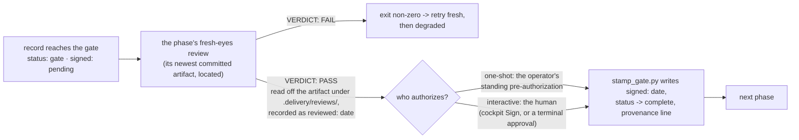
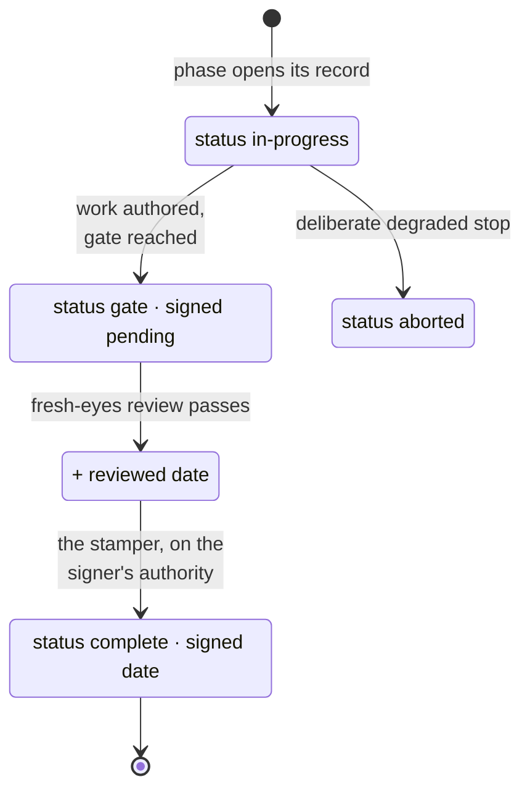

One page, the whole mechanism: what closes a gate, the single deterministic stamper every runner
executes, the two axes that decide who authorizes, and the evidence trail a stamp leaves. The
line around it is the [delivery module](../../modules/delivery/); the doctrine it implements is the
playbook's REF-Delivery section 1, "How a gate closes".

## One transaction, every mode

A gate closes in exactly one way, whoever drives:

1. The phase's record reaches the gate in the canonical state: `status: gate`, `signed: pending`.
2. The phase's **fresh-eyes adversarial review** passes, and the pass is **recorded** in the
   record's frontmatter `reviewed:` field - with every round's **verbatim output committed** at
   `.delivery/reviews/<record-stem>-<date>-r<N>.md`, the newest being the durable evidence
   behind the date. The review is the phase's own: the playbook's `adversarial-review` skill,
   run inside the phase before its record reached the gate. The entrypoint spawns none; it
   locates that newest artifact, reads the verdict off it, and stamps only over a PASS.
   This holds in **every mode**,
   interactive and one-shot alike.
3. The **gate stamper** closes it, in this order. It **refuses while the scratch carries no
   `.delivery/journal.md`**: every phase leaves a journal entry, a phase with nothing to report
   included. Where the phase has a tool, it then **exports** that tool's deliverables into the
   scratch (the proposal's architecture and assumptions, the design's approved screens and
   theme), and an unreachable instance refuses the stamp rather than signing without them. Only
   then does it write the signature: `signed: <date>`, `status: gate` promoted to
   `status: complete`, `finished:` filled, and a provenance line at the **top** of the body naming
   the authority, ahead of the phase narration it closes.

An agent never decides a gate, never edits `signed:` by hand, and never offers to sign a pending
one; a pending gate is handed back to its signer. Authority and mechanism are distinct: the signer
authorizes, the stamper writes.

## One stamper, zero hand-ports

The stamp is the playbook's own `galaxies/foundry/skills/deliver-engagement/stamp_gate.py`, and it is the **only
writer** of `signed:` anywhere in the system. Both images bake it in at
`/opt/foundry/stamp_gate.py` from the vendored byte-identical pin (`devops/vendor/`, refreshed by
its `update-vendored-helpers.sh`):

| Writer | When it runs the stamper | What it passes |
| --- | --- | --- |
| the worker entrypoint, one-shot, at a gate | after locating the phase's newest committed review and reading `VERDICT: PASS` off it | `--review-verdict pass`, `--review-log .delivery/reviews/<record-stem>-<date>-r<N>.md` (that artifact), `--by "the deterministic engine (one-shot ...)"`, and for a gate that freezes a studio's deliverables (proposal, design) `--tool-url <the studio's east-west URL> --tool-slug <the key that studio holds the delivery's project under>` (estimatekit keeps the delivery slug, protopane its lower-cased, hyphenated form), both handed to the worker by the compiler as `FC_TOOL_URL` / `FC_SLUG` |
| the worker entrypoint, one-shot, after a refused stamp | when that stamp refuses over the passing review (a `REFUSED:` or `FAIL:` line) | `--review-verdict pass --review-log ... --review-only`: records `reviewed:` and leaves `signed: pending`; the worker writes the refusal line on the record as `stamp_refused:`, pushes it, and ends the step on the `stamp-refused` stop (exit 68) |
| the worker entrypoint, interactive, at a gate | after the same lookup reads a PASS, before the suspend | `--review-verdict pass --review-log ... --review-only`: records `reviewed:` over that artifact, leaves `signed: pending` for the human |
| the cockpit's **Sign** (`write_gate`) | when the operator accepts a suspended gate, or a one-shot gate whose stamp refused | the date and `--by "the operator (console Sign)"`; the recorded `reviewed:` is its evidence (no claimed verdict, so no `--review-log`) |
| a person at a terminal | the hand-driven path, the same command | the approval date, `--by "<who approved>"`, and the review verdict with its `--review-log` artifact |

Every signature is produced by the pinned stamper. The console fetches the record and
required evidence at the approved scratch commit, runs the helper, and commits its complete
output with that commit as parent. A non-forced ref update rejects a concurrent head change.

The stamper validates the pending signature and review evidence. A claimed review verdict
requires its committed review-log artifact and a final PASS token. The cockpit displays the
helper's refusal reason when those preconditions are unmet.

## Sign also releases

In interactive mode the run parks on a `gate-<gate>` suspend step, and the cockpit's **Sign** resumes the
run parked **on the gate it just signed** - the gate stamped and the gate the run waits on, two names
compared, nothing inferred.

A run parked on any *other* gate is behind the line: its records have moved on, because the line was driven
at a terminal or advanced from elsewhere. Releasing it would run the phase after *its* gate, one the line
already holds, with two workers then pushing one scratch ref. So Sign stops it as superseded instead, which
also frees the cockpit's primary for the next drive. Signing is a git write either way; the release is the
mechanical half, and it never advances a run the line has passed.

A one-shot gate whose stamp refused has no run parked on it: that run ended on the `stamp-refused` stop.
Sign stamps the record, and a drive continues the line in one-shot.

## Canonical record helper

The stamper's sibling, `deliver-engagement/reach_gate.py`, owns the canonical block:
`phase`, `skill`, `status`, `gate`, and provenance. REF-Delivery section 1 requires the
record helper to write that block. Each phase uses the helper from the pinned worker image.

The worker image bakes it at `/opt/foundry/reach_gate.py` from the same vendored pin, and the
entrypoint exports `FC_REACH_HELPER` / `FC_STAMP_HELPER` so both the agent and the engine reach the
true helpers by path. The console image bakes it too, at the same path and behind the same
`FC_REACH_HELPER` override, because the cockpit performs one act that writes the block: **Re-open**.

Re-opening clears the canonical signature and runs the record helper with
`--status in-progress`. The helper clears attempt evidence (`reviewed:`, `finished:`,
`attests:`) and retains provenance. The next signature requires review evidence for
that reopened attempt.

The agent is the record's **only** writer: the compiled prompt tells it to run
`python3 $FC_REACH_HELPER` wherever its skill says to run `reach_gate.py`, passing the run's
provenance from the pod's environment (`--run "$FC_RUN" --mode "$FC_MODE"
--credential-ref "$FC_CREDENTIAL_REF"`, where `credential_ref` is a citation of the driving
credential, never its value) - the same front door an attended session uses, per the skills'
"the launcher passes the run's provenance into the frontmatter". The harness preserves the agent's committed record through fresh-eyes review. After the
review, the stamper writes the gate transaction and the run-figures step records execution
accounting in `run_*` fields. Canonical frontmatter, committed review evidence, and the
pending signature are required by the gate guards.

## The two axes: mode and interaction

Each gate has an execution mode and an interaction channel:

| Axis | Values | Decides | Set by |
| --- | --- | --- | --- |
| `mode` | `interactive` / `one-shot` | what a gate **does**: suspend for a human, or close over the review under standing authorization | the operator at launch, persisted in `.delivery/config.json` |
| `interaction` | `manual` / `auto` | whether the **running skill** may ask a human mid-phase | the launcher, per invocation, never persisted |

The four combinations, concretely:

| | `interaction=manual` (a terminal) | `interaction=auto` (a pod) |
| --- | --- | --- |
| `mode=interactive` | hand-drive: the skill asks, the human approves, the agent runs the stamper carrying that approval | the console: the worker records the review, the run suspends, the human signs in the cockpit |
| `mode=one-shot` | console-less one-shot: a person or script runs the review and the stamper per gate | the console one-shot: the entrypoint reviews and stamps, no suspends |

The console always passes `auto` - no human is reachable inside a pod - even for an
interactive-mode delivery whose operator signs the gates from the cockpit between steps.

**Sign** stamps the canonical record and releases the run waiting on that gate.
**Resume** releases a suspended run only when fresh derived state proves its gate is
signed (INT-FC-R105). Both acts verify the repository and executor scope before mutation.

## The record states

| Frontmatter field | Carries | Written by |
| --- | --- | --- |
| `signed:` | the gate's closure date, or `pending` | the stamper, only |
| `reviewed:` | the date the phase's fresh-eyes review passed | the stamper (`--review-only`, or at the stamp) |
| `status:` | `in-progress` → `gate` → `complete` (or `aborted`) | the record helpers; the stamper does the `gate` → `complete` promotion |
| `run:` | the run id the console knows the run by | the record helper, from the agent's `--run`; filled by the run-figures step at the end of the run |
| `run_agent:`, `run_model:`, `run_started:`, `run_finished:`, `run_seconds:`, `run_tokens:`, `run_cost:`, with the by-type `run_tokens_*`, `run_turns:`, `run_permission_denials:` (the calls the harness refused) and the per-model `run_model_<slug>_tokens` / `_cost` | what the run cost: the agent and model that ran the phase, when it started and finished, its tokens and USD; `run_seconds` is the agent's own run time; a retry or re-drive adds to the figures and the seconds and keeps the earliest start and the latest finish, so the span can hold the gap between attempts while the seconds never do; on a record written before the key the sum starts from the carried span | the worker's run-figures helper (`record_run.py`), from the agent stream's final result event, before the scratch is pushed |

The trail this leaves is auditable after the fact: a signed gate always carries its `reviewed:`
date, a body provenance line naming who authorized it (and, when the stamp claimed a verdict,
the review artifact it verified), and the review's verbatim output at
`.delivery/reviews/<record-stem>-<date>-r<N>.md` - so "was this reviewed, what did the review actually
find, and who signed?" is answerable from the repo alone, in either mode, by any reader.
