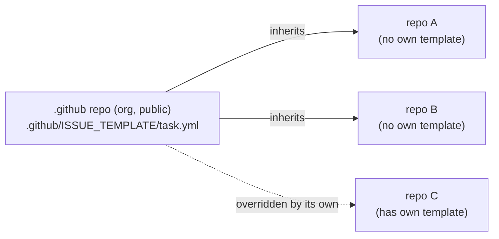

The Maintenance view derives each ticket's **Complexity** and **Priority** from a clean marker in
the issue body, the same "the author writes a convention, the tool reads it" idiom as the verdict
line (`VERDICT: PASS`) and GitHub's `Closes #3`. It reads no custom label *for a signal*: a label
would have to be defined and applied in every repo, and the signal is derived on read and stored
nowhere (like every [maintenance position](../../modules/maintenance/)), so a
repo that carries no marker shows no badge and needs no setup. The one label it does honor,
[`foundry-hidden`](#hiding-a-ticket-from-the-inbox), is not a signal but a visibility switch - covered
last, below.

## What the Console reads

Two signals, each a single value from a fixed vocabulary. Everything else in the body is ignored.

| Marker | Vocabulary | Rendered as |
| --- | --- | --- |
| `Complexity` | `Low` · `Medium` · `High` | a three-segment meter (short to tall, green to red) |
| `Priority` | `Lowest` · `Low` · `Medium` · `High` · `Highest` | one arrow (`⇊ ↓ → ↑ ⇈`, cool to hot) |

The match is **case-insensitive**, and a value outside the vocabulary reads as **absent** (no badge),
never as a wrong one, so a typo shows nothing rather than a guess.

## The two body shapes

The Console accepts either shape, so a guided form and a hand-typed body both work. The form block
wins when both are present.

**A GitHub Issue Form field block** - what a dropdown renders into the submitted body: a heading whose
text is the marker name, the value on the next line (an unselected field renders `_No response_`,
which reads as absent):

```md
### Complexity

High

### Priority

Highest
```

**A trailer line** - the marker on its own line, for a repo with no form or a body typed by hand:

```md
Complexity: High
Priority: Highest
```

The value must be the whole line after the colon; `Complexity: High - because the API changed` is
prose, not a marker, and reads as absent. This keeps the marker a clean line, out of the middle of a
paragraph.

## Complexity is a sizing hint

Complexity is the author's sizing hint, rendered as a three-segment meter. The operator chooses
the resolving model through the worker model configuration.

## Priority is the usual five-level scale

Priority is the familiar five-level arrow. It carries urgency, not size, and is independent of
Complexity.

| Priority | Arrow |
| --- | --- |
| `Lowest` | `⇊` |
| `Low` | `↓` |
| `Medium` | `→` |
| `High` | `↑` |
| `Highest` | `⇈` |

## Type comes from GitHub, not a marker

A ticket's **type** (Bug, Feature, Task) is read from GitHub's native **Issue Type**, not from a
body marker. Issue Types are defined once at the organization level and set on the issue itself, so
the Console reads the type straight from the issue payload with its ordinary token, no marker and no
per-repo setup. This is the opposite of Priority: GitHub's own "Priority" is a Projects board field
that only has a value once an issue is added to a board, so the Console does not read that. It reads
Priority and Complexity from the body markers above, and Type from the native field.

Set a ticket's type in the **Type** control on the New issue page. A ticket with no type shows no
badge, the same invisible-until-set behaviour as the markers.

## Shipping the form to every repo

One GitHub **Issue Form** carries both dropdowns, and GitHub's **default community health files**
spread it across the org with no per-repo file and no CI step: a public repository named `.github` in
the organization supplies defaults to every repo that has no `.github/ISSUE_TEMPLATE/` of its own.



The template's field labels are exactly `Complexity` and `Priority`, so the submitted body renders the
`### Complexity` / `### Priority` blocks the reader above expects. A repo that wants its own templates
overrides the org default wholesale (GitHub does not merge the two sets). The defaults repo must be
public; the template content is a task form, so nothing sensitive lives there. Because the markers
also read from a hand-typed trailer line, a repo needs neither the form nor any label to be
understood - the form is the smooth path, not a requirement.

## Hiding a ticket from the Inbox

Not every open issue is inbox-worthy: a `wontfix` kept open for tracking, a backlog placeholder, a
ticket handed off to a delivery line (which adds this label itself, so the ticket leaves the loop for
its new home). The `foundry-hidden` **label** takes such a ticket off the queue on purpose - an open
issue carrying it is excluded from the fleet Inbox's `issue` signal, and from that repo's own
maintenance backlog, **by default**. Every other signal - a red CI, a PR awaiting review, drift,
unreleased commits - is untouched: the hide is scoped to the one ticket, not the repo.

It is the issue-scope mirror of the Fleet's repo-level hide: a repo carrying the `foundry-hidden`
**topic** sits off the Fleet board the same way, for CI mirrors, vendored libraries, and the like -
and off the Inbox with it, **every** row of it, red CI and drift and unreleased included. That is the
difference in reach between the two marks: the label hides one ticket and leaves the repo's other
signals standing, the topic takes the whole repo off both surfaces at once. Same name, two GitHub
primitives - a label on an issue, a topic on a repo - one habit.

Like every maintenance position, the hide is **controlled at the source and stored nowhere**: the
label (or topic) is the whole state, so it needs no per-ticket Console record and survives a cache
wipe. Add or remove it on the issue in GitHub. And it is recoverable, never lost -
**Settings ▸ Inbox ▸ Show hidden Inbox items** reveals both hides, shown dimmed with a badge (the
board mirror is **Settings ▸ Fleet ▸ Show hidden projects**), and a deep link to a hidden ticket still
resolves. Hidden means off the queue, not gone: the deliberate, reversible sibling of an **archived**
repo, which drops out of the sweep entirely.
